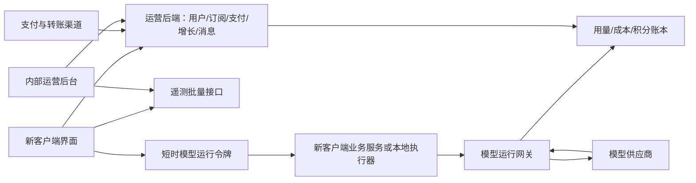

# 新客户端接入喻信运营中心：实施步骤与接口文档

> 适用对象：开发一个新 Web、桌面或其他客户端，希望由现有运营中心统一管理用户、商业化、模型资源和运营数据的客户端研发团队。
> 核对日期：2026-10-20（登录、注册、短信验证码、微信首次扫码注册/绑定及客户端能力查询）；支付订单取消和关单契约核对于 2026-10-14。本文只说明客户端对接运营端 API，不包含部署步骤；目标环境的实际能力以接口返回和联调结果为准。
> 事实来源：运营后端路由、Schema、Service，以及现有投标客户端的真实调用代码。本文描述**当前代码支持的契约**，不代表已核验生产配置、真实商户开通情况或新客户端已经完成接入。
> 语音交接：[语音输入客户端接入说明](语音输入客户端接入说明.md)，含两个接口、录音格式、鉴权、取消、错误处理和验收清单，可直接转交其他客户端同事。
> 财务交接：[支付与财务客户端接入变更清单](支付与财务客户端接入变更清单.md)，可直接交给集成同事。
> 专题说明：[微信扫码登录与 Native 收款接入](wechat-integration.md)、[协议与政策](协议与政策.md)。
> 阅读顺序：负责人先读第 1～4、13～15 节；开发按第 5～12 节实施；既有编号接口的字段和示例见附录 B，微信登录及协议场景见第 6.2～6.3 节；附录 A 为接口索引。

## 目录

- [1. 接入范围](#1-接入范围)
- [2. 系统边界与身份隔离](#2-系统边界与身份隔离)
- [3. 双方职责清单](#3-双方职责清单)
- [4. 从零接入步骤](#4-从零接入步骤)
- [5. 基础协议和错误处理](#5-基础协议和错误处理)
- [6. 登录注册与个人资料](#6-登录注册与个人资料)
- [7. 订阅支付积分和权益](#7-订阅支付积分和权益)
- [8. 模型资源与运行网关](#8-模型资源与运行网关)
- [8.6 聊天框语音输入](#86-聊天框语音输入)
- [9. 数据回传与运营统计](#9-数据回传与运营统计)
- [10. 邀请推广激励和任务凭据](#10-邀请推广激励和任务凭据)
- [11. 转赠提现与收款账号](#11-转赠提现与收款账号)
- [12. 消息反馈和版本更新](#12-消息反馈和版本更新)
- [13. 当前缺口与新增业务适配](#13-当前缺口与新增业务适配)
- [14. 联调验收清单](#14-联调验收清单)
- [15. 开发交付物和源码索引](#15-开发交付物和源码索引)
- [附录 A：本文接口索引](#附录-a本文接口索引)
- [附录 B：逐接口请求与响应](#附录-b逐接口请求与响应)
- [附录 C：平台初始化与联调诊断接口](#附录-c平台初始化与联调诊断接口)

## 1. 接入范围

**新客户端接入范围覆盖身份、业务交互和运营数据闭环。规则、价格、发奖、扣分、支付验签由运营后端处理；客户端负责入口、交互、调用时机、业务凭据、数据回传，以及状态展示。**

| 功能模块 | 客户端集成职责 | 运营后端职责 |
| --- | --- | --- |
| 登录注册、用户管理 | 使用客户端专用注册/登录；接入手机号验证与可选微信扫码；维护会话、资料和退出 | 创建并隔离 `client_user`；验证手机号、处理微信回调与账号绑定、签发会话；运营人员管理用户 |
| 数据回传 | 接入遥测队列；上报实际操作、项目/任务引用、耗时、错误分类等 | 存储遥测，汇总用户活跃与诊断；业务接口自行保存真实交易和用量 |
| 规则中心 | 读取规则执行后的资格、等级、价格、可用能力；提交真实业务动作 | 维护规则版本、生效时间、预算、资格、等级评估和奖励结算 |
| 支付 | 套餐页、下单、二维码/支付页、查单、恢复未完成支付、支付后刷新资产 | 价格裁定、商户下单、回调验签、补查、订单和订阅/积分入账 |
| 推广、邀请 | 邀请码/链接/海报、落地页归属、注册带码、补绑、进度和奖励展示 | 邀请关系、归因、风控、转化统计、推广等级和佣金计算 |
| 模型资源 | 若要统一供模/扣积分/统计成本，必须接模型配置和运行网关 | 供应商密钥、业务路由、降级、计量、积分预留结算和成本记录 |
| 激励 | 登录、付费走既有接口；任务奖励要创建云任务并提交成果引用；反馈走工单 | 事实核验、审核、奖励预算、观察期、发放、退款冲正 |
| 提现 | 读取渠道、绑定收款账号、密码确认、申请、记录、微信确认收款 | 提现资格、现金冻结、财务审核、打款、查单和失败解冻 |
| 权益管理 | 展示订阅/积分/转赠/提现资格；功能服务执行自己的授权校验 | 已有的是积分有效期、转赠和提现等权益政策；尚无通用功能权限网关 |
| 积分 | 展示可用、预留、待释放积分与流水；购买积分包；模型调用后刷新 | 发行、到期、预留、扣除、释放、转赠、奖励积分和账本 |
| 配套运营能力 | 消息中心及已读、反馈投诉与附件、临时密码强制修改、更新检查、断网补报、账号切换隔离 | 消息投递、客服处理、版本发布、接口权限、运营诊断 |

不是每个产品都必须开放提现、转赠或模型选择，但每项必须明确“接入 / 本产品不开放 / 后端待补齐”，不能让运营端看起来已开通而客户端没有入口。

“所有客户端数据回传”不能理解为整库、全部文档或聊天正文自动同步。当前支持结构化运营事件和具体业务接口；业务内容、文件库、项目详情等需要另行设计同步服务。

## 2. 系统边界与身份隔离



### 2.1 一个客户端是一条独立应用记录

- 新应用拥有独立 `app_code`，例如本文占位示例 `new_client`；**不要继续使用现有 `bid_agent`**。
- `app_code` 用于注册/登录时选择应用，是公开标识，不是密钥。
- 登录后后端把 `app_id` 写入认证上下文；业务请求不允许靠传入 `app_id`、请求头或 URL 参数切换应用。
- 用户、订单、积分、邀请、任务、遥测等按 `app_id` 隔离。同名账号在不同客户端可以是不同用户；当前不是跨产品单点登录和共享钱包。
- 运营端仍由一个内部运营团队使用，通过顶栏切换当前客户端；运营人员必须被授予该应用权限。
- 模型供应商资源可由平台管理，再按应用绑定；支付渠道也需要绑定到新应用。新增应用不会自动获得旧应用的配置和数据。

### 2.2 三种身份不可混用

| 身份 | 获取方式 | 可调用范围 |
| --- | --- | --- |
| 运营人员 Token | 运营后台登录 | 应用建档、规则、资源、审核、运营查询；不得随客户端分发 |
| 客户端 access token | `/client/auth/login` | 当前应用、当前用户的个人业务接口 |
| 模型 runtime token | 客户端 access token 调 `/client/runtime/token` | `/client/runtime/complete`、`/client/runtime/stream`；当前有效期 600 秒 |

Refresh token 只用于刷新，不是业务访问凭证。邀请码、订单号、云任务 ID 同样不是访问凭证。

如果新客户端已有独立账号系统，当前没有可直接使用的“外部用户 ID 换运营 Token”或通用 SSO 接口。要么改用本平台账号，要么先补安全的账号绑定/联邦认证方案；不能拿运营账号代替终端用户。

## 3. 双方职责清单

| 工作包 | 新客户端开发 | 运营端/后端负责人 | 接入级别 |
| --- | --- | --- | --- |
| 应用建档和授权 | 提供名称、编码、端类型、版本和联系人 | 创建应用、启用注册、分配运营人员 | 必须 |
| 基础网络和会话 | API adapter、Token 刷新、错误映射、环境配置 | 提供网关地址、CORS/代理配置、可用测试环境 | 必须 |
| 账号与资料 | 登录注册、资料、头像、密码、安全退出 | 账号状态、密码规则、审计和运营用户管理 | 必须 |
| 微信扫码登录 | 展示官方二维码、轮询状态；首次扫码创建账号或绑定已有账号 | 网站应用凭据、回调、身份校验及会话签发 | 需要微信登录时接入 |
| 协议与政策 | 注册/购买前读取场景、展示正文、提交确认版本 | 发布协议版本、配置场景、校验并记录同意 | 启用相关场景时必须 |
| 遥测 | 埋点、持久队列、补报、归属隔离 | 接收、诊断、统计口径 | 要完整运营数据则必须 |
| 订阅/积分 | 账户页、套餐页、流水、状态刷新 | 刊例、定价策略、释放计划、账本 | 启用商业化/积分时必须 |
| 支付 | 下单、拉起、查单、支付恢复 | 商户配置、应用渠道绑定、回调 | 开放付费时必须 |
| 模型 | 配置读取、请求/SSE adapter、任务关联 | 应用模型绑定和业务路由、积分单价与供应商成本 | 统一模型运营时必须 |
| 邀请/推广 | 链接入口、邀请码贯穿安装/注册、补绑、记录 | 发布活动、归因、审核和推广等级 | 开放推广时必须 |
| 激励任务 | 领取/完成/成果引用、模型证据关联 | 核验任务、规则和奖励处理 | 开放任务激励时必须 |
| 现金提现 | 现金账户、收款账号、确认交互和记录 | 权益政策、商户转账、审核、后台任务 | 开放提现时必须 |
| 积分转赠 | 查资格、核对收件人、确认和流水刷新 | 权益限制、额度和账本转移 | 按产品决定 |
| 消息与反馈 | 收件箱、已读、反馈表单和跟进 | 模板、投递、工单处理与价值评级 | 建议首版接入 |
| 桌面更新 | 更新器、安全下载和安装交互 | 制品、版本和渠道发布 | 桌面端按需；现有仅 Windows x64 |
| 自有业务数据同步 | 新业务定义、主键、增量与冲突策略 | 新建应用范围内的业务服务 | 现有运营 API 不自动提供 |

## 4. 从零接入步骤

### 第 1 步：确定接入清单

双方记录：应用名称、`app_code`、Web/桌面/移动类型、测试与生产域名、版本、是否使用平台账号、是否付费/模型/推广/提现/转赠、需回传事件、安装及邀请入口、技术和运营负责人。

先核对第 13 节：非招投标产品、移动端、独立商户、已有账号系统、功能配额等需求可能需要后端开发，不能只估算前端调用工作量。

### 第 2 步：运营端建档并授权

优先在运营后台操作。以下是运营人员接口，全部不是客户端启动时自动调用：

| 方法与路径（省略环境 API_BASE） | 用途 / 输入 |
| --- | --- |
| `POST /operations/client-apps` | 创建应用；见下方示例 |
| `PUT /operations/client-apps/{app_id}` | 更新 `name/logo/client_version/status/registration_enabled/order/description`；编码不可用此接口修改 |
| `GET /operations/client-apps/{app_id}/staff` | 查可授予运营人员 |
| `PUT /operations/client-apps/{app_id}/staff` | `{ "staff_ids": [运营人员ID] }`，配置权限人员名单 |
| `GET /operations/client-apps/switchable` | 查询有权切换的应用 |
| `POST /system/auth/select-app` | `{ "app_id": 新应用ID }`；返回新运营 Token，后续配置必须使用新上下文 |

创建示例（示例值不是实际配置）：

```json
{
  "name": "新业务客户端",
  "code": "new_client",
  "client_version": "0.1.0",
  "status": "active",
  "registration_enabled": true,
  "description": "新客户端接入联调"
}
```

`code` 规则为 `^[a-z][a-z0-9_]{1,63}$`；应用状态 `draft/active/inactive`。创建默认是 `draft` 且注册关闭，必须明确开启才能注册/登录。

### 第 3 步：配置新应用的商业化和资源

在**切换后的新应用上下文**中逐项配置并验证：

1. 价格体系、套餐刊例、积分数量和分期释放计划；需要时设置优惠定价策略。套餐必须处于有效时间内且 `on_sale`。
2. 支付渠道：平台商户配置就绪后，通过 `PUT /payment/channel/bind/{provider}`，请求体 `{ "enabled": true }`，绑定当前应用；全局启用不等于新应用可支付。
3. 模型：供应商账号和目录就绪后，在 `/operations/models/bindings` 配应用模型，再在 `/operations/models/routes` 配业务路由；相关状态需为 `active`。
4. 规则：`/growth/rules` 管理使用等级、推广等级、权益与激励。初始草稿接口 `/growth/rules/defaults` 只建立草案；必须审核配置、预算、模式和生效时间后发布。
5. 提现需要有效权益政策及真实可用的商户转账配置；不能用支付能力替代转账能力判断。
6. 配置运营消息/反馈处理人员；桌面端需要版本制品与更新渠道。
7. 验证增长维护任务、奖励到期发放、提现查单、等级评估、消息定时投递等服务端任务正常运行。客户端查询成功不代表这些后台任务已运行。

### 第 4 步：完成基础客户端接入

建立一个统一 HTTP 层；依次打通注册 → 登录 → 当前用户 → 修改资料 → Token 刷新 → 改密码 → 退出。保存身份时同时保存 `app_id/user_id`，清理跨账号缓存和队列发送上下文。

建议公开配置名（新客户端可自选名称，不是额外后端协议）：`OPS_API_BASE`、`CLIENT_APP_CODE`、`CLIENT_VERSION`、`RELEASE_CHANNEL`。现有投标端对应 `VITE_API_BASE_URL`、`VITE_CLIENT_APP_CODE` 等。

### 第 5 步：按依赖接入业务

推荐顺序：账户/订阅/积分 → 模型网关 → 付费 → 遥测 → 邀请/激励 → 转赠/提现 → 消息/工单 → 更新。

其中遥测可以与业务开发同步埋点，任务激励必须在实际任务开始和完成处接入，不能只做一页奖励列表。

### 第 6 步：完成跨端联调

至少准备新旧两个应用、每应用两个用户。逐项执行第 14 节；在运营后台核对对应用户、订单、用量、奖励、工单、消息已读和遥测诊断，记录具体业务 ID。

### 第 7 步：接口联调交接

确认目标环境的 API 入口、注册开关、渠道能力、模型和权益规则；把“未开放”和“尚未支持”明确呈现在客户端。交接接口调用样例、错误处理、验收结果与待开通事项；部署流程由运营端另行管理。

## 5. 基础协议和错误处理

### 5.1 API 地址和传输

- 文中的路径统一相对 `API_BASE`；通过现有公网反向代理时，通常为 `https://<运营API域名>/api/v1`，不是运营后台 `/web/` 地址。
- 现有客户端生产 API 地址为 `https://www.yxciedu.com/api/v1`。新客户端以分配给自己的目标环境 API 域名为准；微信授权和支付回调需使用该环境已登记的 HTTPS 域名。
- **本地直连注意**：FastAPI 配置的是 `root_path=/api/v1`，内部注册路由仍为 `/client/...`；现有 Nginx 会剥离 `/api/v1/` 再转发。直连后端常用 `http://localhost:8001/client/...`；不要把 root_path 当成所有内部路由的真实前缀。按本环境代理确认一次完整 URL。
- Swagger 内部入口 `/docs`、OpenAPI `/openapi.json`；公网暴露位置受代理影响。联调以目标环境实际可访问接口为准。
- 普通请求 `Content-Type: application/json`；客户端业务身份使用 `Authorization: Bearer <access_token>`。
- 表单上传使用 `multipart/form-data`，文件字段为 `file`，由 HTTP 库生成 boundary。
- 模型流为 POST SSE；版本更新为 YAML/重定向；支付渠道回调有独立协议，不能统一按 JSON 包络解析。
- Web 需同源反向代理或正确配置 CORS；桌面端检查代理、CSP、外链和下载规则。不能通过放宽所有来源来接入。

### 5.2 标准返回

```json
{
  "code": 0,
  "msg": "操作成功",
  "data": {},
  "status_code": 200,
  "success": true
}
```

必须同时判断 HTTP 成功、`code === 0`、`success === true`，再解包 `data`。`data` 可以为 `null`、数组、对象、整数。创建订单/工单等可能返回 HTTP 201。支付下单遇到 HTTP 202 时，虽然 `success=false`，`data.order_no` 仍须保留用于原单查单；不能按一般失败丢弃。文中示例响应通常只写解包后的 `data`。

有分页的客户端列表用 `page_no/page_size` 查询，响应 `items/total/page_no/page_size/has_next`；**不是所有列表都有分页**。账本和消息当前最多返回最近 100 条，不能凭空加分页参数期待全量历史。

金额 `_fen` 是人民币“分”，展示元时除以 100；`_yuan` 是元。`credits` 是整数积分，与现金不是同一单位。现金 `available/frozen/debt` 及现金奖励 `amount` 虽不都带 `_fen`，同样按分处理。

时间输入使用带时区 ISO 8601，推荐 UTC `Z`。当前输出还混用 `DateTimeStr` 和展示格式字符串，不能假定所有字段都带 `Z`；后端 `SuccessResponse` 对 datetime 使用展示格式序列化。联调记录时区约定，并由统一解析层处理。统计和增长业务按各自服务的时区/口径计算，不使用用户电脑日期裁定权益。

### 5.3 客户端统一处理表

| HTTP 状态 | 常见含义 | 客户端动作 |
| --- | --- | --- |
| 202（仅支付下单） | 渠道下单结果未明，响应 `success=false` 且 `data.status=confirming` | 保存 `data.order_no`，查原单；不生成新订单或展示付款成功 |
| 400 / 422 | 密码、字段、业务条件不符合 | 显示 `msg`，修正输入；不无限重试 |
| 401 | 登录时账号密码错误；受保护接口 Token 过期、会话失效、用户或应用停用、身份类型错 | 公开登录接口显示 `msg`；受保护请求尝试一次并发合并刷新，仅刷新明确被拒绝或重放仍为 401 时清理登录；runtime 需重新换取 |
| 402 | 模型算力积分不足 | 提示余额与充值/订阅入口 |
| 403 | 注册关闭、禁止选模、购买资格不足或敏感操作密码错误等 | 展示原因；刷新资格，不能把所有 403 都当登录过期 |
| 404 | 当前范围无此资源 | 显示不存在/不可访问，不跨应用寻找 |
| 409 | 邀请已绑定、任务状态冲突、重复 request_id、规则未开放等 | 查当前状态，避免重复创建业务 |
| 410 | 临时微信链接已失效；旧等级写接口弃用 | 生成新链接或使用新接口 |
| 429 | 认证/资产操作限流 | 暂停提交并退避；不要循环试密码 |
| 502（支付下单） | 渠道明确下单失败，响应 `data.status=failed` | 展示失败，保留订单号以便核对；用户重试购买时使用新幂等键 |
| 5xx / 网络超时 | 上游或平台临时异常，结果可能未明 | 读取已有订单/提现状态；只按该接口幂等语义重试 |

当前 `CustomException` 未显式设置 HTTP 状态时，默认返回 HTTP 500、业务 code=-1。因此某些套餐不可购买、错误头像格式、文件超限等业务拒绝也可能表现为 500；不能对所有 500 自动重试，必须结合 `msg`、原业务状态和该操作的幂等语义处理。请求校验异常通常为 HTTP 422、code=1；code 与 HTTP 状态不是一一对应关系。

错误通常有标准包络，但代理错误可能是 HTML/文本；解析失败要转成网络服务错误，不能冒充业务成功。

### 5.4 幂等与缓存

| 场景 | 标识 | 重试规则 |
| --- | --- | --- |
| 支付下单 | `idempotency_key` | 同一次购买稳定复用；同键且套餐、渠道或 `auto_renew` 改变时返回 409。`confirming` 订单复用原键并按原 `order_no` 查单；换套餐/渠道或明确失败后重新购买才用新键 |
| 转赠/提现 | `idempotency_key` | 同一次业务复用，修改收件人/金额/账户必须新键 |
| 激励任务创建 | `local_task_id` | 持久化并复用，服务端核对原项目和任务类型 |
| 遥测 | `event_id` | 事件创建时生成；失败重传不换 ID；服务端唯一键为 `(app_id,event_id)` |
| 模型调用 | `request_id` | 不能按“幂等结果查询”理解；已记录 ID 返回 409。新版可查询本人结算回执（§8.7），仍不能恢复历史响应正文，结果未知时不要自动换 ID 重跑并重复计费 |

用户退出或切换后，清空用户查询缓存、失效回调和密码输入；旧队列只能由原应用原用户继续补报。款项请求、密码和 Token 不持久写入通用日志或埋点。

## 6. 登录注册与个人资料

接入前调用无须 Token 的 `GET /client/auth/capabilities/{app_code}`。它只返回该应用的公开登录配置，不包含云密钥、手机号或用户信息；应用不存在或未启用时返回 404。每个客户端必须使用自己分配的 `app_code`，不能借用其他应用的编码。

```http
GET {API_BASE}/client/auth/capabilities/new_client
```

成功响应使用统一包络；`data` 示例：

```json
{
  "app_code": "new_client",
  "registration_enabled": true,
  "password_login_enabled": true,
  "sms_login_configured": true,
  "sms_registration_configured": true,
  "sms_bind_configured": true,
  "wechat_login_configured": true,
  "sms_code_length": 6,
  "sms_expires_in": 300,
  "sms_retry_after": 60,
  "wechat_qr_expires_in": 300
}
```

| 返回字段 | 含义 |
| --- | --- |
| `app_code` | 服务端确认的应用编码 |
| `registration_enabled` | 该应用是否允许创建新账号 |
| `password_login_enabled` | 账号/已验证手机号加密码登录入口 |
| `sms_login_configured` | 该环境已填写短信登录通道参数和登录模板 |
| `sms_registration_configured` | 该应用允许注册且短信注册模板已配置 |
| `sms_bind_configured` | 绑定或验证手机号的短信模板已配置 |
| `wechat_login_configured` | 该环境已配置微信网站应用登录凭据与回调 |
| `sms_code_length/sms_expires_in/sms_retry_after/wechat_qr_expires_in` | 当前分别为 6 位、300 秒、60 秒、300 秒，客户端按返回值显示倒计时 |

`*_configured` 表示参数齐全，**不是**腾讯云余额、模板实时审核或实际下发成功的保证；发短信失败时以发送接口错误为准。短信应用、签名和密钥由运营端统一保管，客户端只传 `app_code` 和当前业务所需字段。多个应用的用户、验证码、微信绑定及登录会话按应用隔离，但当前短信应用和微信网站应用凭据仍由该运营环境共用；需要各品牌独立短信签名或微信网站应用时，需另行配置对应的服务端能力。

### 6.1 注册与登录

```http
POST {API_BASE}/client/auth/register
Content-Type: application/json
```

```json
{
  "app_code": "new_client",
  "username": "demo_user",
  "password": "ExampleOnly9A",
  "mobile": "13800138000",
  "sms_code": "123456",
  "display_name": "联调用户",
  "company_name": "示例公司"
}
```

注册前先调用 `POST /client/auth/sms/send`，请求 `{ "app_code": "new_client", "mobile": "13800138000", "purpose": "register" }`；短信服务须由运营端配置，缺配置返回 503。`invite_code` 可选，接收邀请码或官方邀请链接。注册返回用户资料，**不返回登录 Token**；然后调用登录：

```json
{
  "app_code": "new_client",
  "username": "demo_user",
  "password": "ExampleOnly9A"
}
```

`POST /client/auth/login` 的 `username` 可填写账号或**已验证**的 11 位手机号；`data` 包含 `access_token/refresh_token/token_type/expires_in/must_change_password/user`。手机号验证码登录先以 `purpose=login` 发送短信，再调用 `POST /client/auth/sms/login`，提交 `{ "app_code": "new_client", "mobile": "13800138000", "sms_code": "123456" }`，返回相同的登录 `data`。

- 账号归一化为小写；注册用户名以字母开头，3～32 位，允许小写字母、数字、`_ . -`。
- 注册密码 Schema 至少 8 位，包含大小写字母和数字；服务端还调用统一强度校验，错误以服务端为准。
- 不接 `/system/auth/login`；该入口是内部运营人员身份。
- 新注册必须提交手机号和 6 位短信验证码；验证码 5 分钟有效、一次使用，发送后 60 秒内不能重发。仅完成短信验证的手机号可用于手机号密码/验证码登录。历史资料中未验证的手机号不自动变成登录凭据。短信发送接口对未知手机号返回统一提示，不代表一定已发送。
- 发送成功时 `data` 为 `{ "expires_in": 300, "retry_after": 60 }`；客户端应按返回的秒数显示有效期和重发倒计时。验证码按**应用、手机号、用途**分别存储，换用途、换号码、换客户端均须重新发送；发送成功不等于后续注册或登录成功。
- `purpose=register` 用于普通注册，`login` 用于已验证手机号登录，`wechat_register` 用于微信首次创建账号，`wechat_bind` 用于微信绑定已有手机号。微信两种用途发送时必须附上确认扫码后的 `flow_id`。登录后的本人手机号验证走独立的受保护接口 `/client/user/me/mobile/send`，不在公开发送接口传 `verify_mobile`。
- 运营端须把已审核短信模板与用途对应：登录文案只能用于登录；注册、微信绑定和本人手机号验证应使用内容适用的已审核模板。短信签名配置使用**签名文字**而不是签名 ID，客户端不接触这些配置。模板未审核、通道余额不足、密钥或 IP 权限异常时，即使能力查询显示“已配置”，发送仍会失败；客户端应保留输入并提示重试或联系运营人员。
- 历史用户先用账号密码登录，再在个人资料中验证本人手机号：带客户端 Access Token 调用 `POST /client/user/me/mobile/send`，请求 `{ "mobile": "13800138000" }`；收到验证码后调用 `POST /client/user/me/mobile/verify`，请求 `{ "mobile": "13800138000", "sms_code": "123456" }`，返回更新后的用户资料及 `mobile_verified_at`。此流程也用于更换已验证手机号，必须验证新号码；同一应用已验证的手机号不能绑定给第二个账号。未验证前仍可用账号密码登录，不得仅凭旧资料手机号用短信认领账号。
- 注册邀请码无效会拒绝注册，不会静默忽略邀请码。
- 注册 Schema 中虽继承 `avatar` 字段，当前注册 Service 不写入该字段；头像在登录后走头像上传接口。

| 场景 | 手机号 | 6 位验证码 | 账号/密码 | 结果 |
| --- | --- | --- | --- | --- |
| 账号密码登录 | 不单独填写；`username` 可填已验证手机号 | 不需要 | `username` 与 `password` 必填 | 返回会话 |
| 手机号验证码登录 | 已验证手机号必填 | `purpose=login`，必填 | 不需要 | 返回会话 |
| 普通注册 | 本人手机号必填且须唯一验证 | `purpose=register`，必填 | 新账号与符合强度要求的密码必填 | 返回用户资料，再登录 |
| 首次微信扫码后创建账号 | 本人手机号必填且须唯一验证 | `purpose=wechat_register`，必填 | 新账号与密码必填；另需 `flow_id` | 返回会话并绑定微信 |
| 首次微信扫码后绑定已有账号（密码） | 不单独填写；可用已验证手机号作为 `username` | 不需要 | 已有账号或已验证手机号及密码必填；另需 `flow_id` | 返回会话并绑定微信 |
| 首次微信扫码后绑定已有账号（短信） | 已验证手机号必填 | `purpose=wechat_bind`，必填 | 不需要；另需 `flow_id` | 返回会话并绑定微信 |
| 已登录用户验证/更换手机号 | 新手机号必填 | 受保护的本人手机号验证接口，必填 | 不需要；需当前 Access Token | 返回更新的用户资料 |
| 已绑定微信再次扫码 | 不需要 | 不需要 | 不需要 | 轮询完成后直接返回会话 |

<a id="wechat-login"></a>
### 6.2 微信网站应用扫码登录（可选）

这是**用户登录**，与第 11.4 节的微信提现收款绑定不是同一流程。客户端无需服务号 AppID、商户证书或 AppSecret；运营端使用已开通微信登录的网站应用配置。新客户端若共用当前运营后端，也共用其网站应用凭据，但用户绑定仍按 `app_code/app_id` 隔离；独立网站应用凭据目前不是按客户端配置的能力。

1. `POST /client/auth/wechat/start`，无用户 Token，请求 `{ "app_code": "new_client" }`。`data` 返回 `flow_id`（43 字符随机值）、`authorize_url`（微信官方 `https://open.weixin.qq.com/connect/qrconnect` 地址）和 `expires_in`（当前为 300 秒）。只展示经校验的官方地址，桌面端可在登录框内嵌官方二维码；不要自行把回调地址、`state` 或授权码当成扫码图片。
2. 用户用微信扫一扫并确认。微信调用运营后端 `GET /client/auth/wechat/callback`；**客户端不调用该回调**，也不从其 HTML 页面读取 Token。
3. 客户端用 `POST /client/auth/wechat/poll` 轮询 `{ "flow_id": "..." }`。`data.status` 为 `pending/cancelled/failed/bind_required/complete`；`complete` 另带 `data.login`，结构与密码登录的 `data` 相同。当前投标端约每 2 秒轮询，离开页面即停止。

`start`、`poll` 与微信访问的公网 `callback` 必须连接到共享同一扫码状态的运营后端。客户端在本机调试时若把前两个请求发往本机后端、回调却落在正式后端，二维码仍可能显示，但确认后轮询会一直停在 `pending`。内嵌二维码授权后可能跳成空白回调页，客户端应继续以 `poll` 结果为准，不能以二维码消失判断登录成功。
4. `bind_required` 表示该微信尚未绑定本应用账号。接入方应提供以下互斥选择，完成后均返回与密码登录相同的会话结构：
   - **创建新账号**：以 `purpose=wechat_register` 发送短信（须传 `flow_id`）；调用 `POST /client/auth/wechat/register`，提交 `flow_id/app_code/username/password/mobile/sms_code`，按 `auth` 场景要求提交 `agreement_acceptance`，可选 `invite_code`。手机号必须本人验证；密码供以后账号或手机号密码登录。
   - **绑定已有账号**：调用 `POST /client/auth/wechat/bind`，提交 `flow_id/username/password`。`username` 可为登录账号或已验证手机号；历史未验证手机号不能凭此绑定。
   - **用手机号绑定已有账号**：以 `purpose=wechat_bind` 发送短信（须传 `flow_id`），调用同一个 bind 接口，提交 `flow_id/mobile/sms_code`。只有该应用中已经验证、且唯一归属的手机号可绑定；不得以旧资料里未经验证的手机号认领账号。

发送短信统一使用 `POST /client/auth/sms/send`，请求 `{ "app_code": "new_client", "mobile": "13800138000", "purpose": "wechat_register", "flow_id": "..." }`；可选 `purpose=register/login/wechat_register/wechat_bind`，微信用途需要已确认扫码的 `flow_id`。验证码仅用于指定应用、手机号和用途，不可跨用途复用。微信扫码确认后流程保留 15 分钟供填写，初始二维码仍为 300 秒。不把密码、验证码、微信授权码、AppSecret 放进二维码 URL 或客户端持久存储。一个微信在同一客户端只能绑定一个账号；需要改绑时不自动合并用户、订单和资产。

轮询返回示例（省略标准包络的 `code/msg/status_code/success`）：

```json
{
  "data": {
    "status": "complete",
    "login": {
      "access_token": "<仅示例，使用实际返回值>",
      "refresh_token": "<仅示例，使用实际返回值>",
      "token_type": "Bearer",
      "expires_in": 43200,
      "must_change_password": false,
      "user": { "id": 1001, "app_id": 101, "username": "demo_user" }
    }
  }
}
```

`pending/cancelled/failed/bind_required` 仅返回 `data.status`，不带 `login`；绑定、扫码注册接口则直接返回登录 `data`。上述用户对象只列出部分字段，完整会话字段以[账号登录](#api-02)为准。

`flow_id` 只在短时流程中使用，不能代替 access token。二维码过期或流程不存在时刷新并重新 `start`；取消、失败和网络故障分别提示。绑定后的再次扫码可直接完成登录。后端会校验应用状态、登录配置、限流和微信身份；新客户端不能只根据二维码成功扫描就认定登录完成。目标环境若未配置网站应用或 HTTPS 回调，`start` 返回 503，客户端应隐藏或禁用入口并给出可理解提示。

<a id="client-agreements"></a>
### 6.3 协议与政策场景

客户端可无登录态读取 `GET /public/client-apps/{app_code}/agreement-scenes/{code}`，其中 `code` 可为 `auth`、`membership_purchase`、`credit_purchase`、`about`；也可按协议标识读取 `GET /public/client-apps/{app_code}/agreements/{code}`。场景返回 `revision`、`require_acceptance` 和有序的 `agreements[]`，每项含 `version_id/version/title/content/published_at`。阅读正文应以服务端返回的版本为准，按安全 HTML 规则渲染；未配置场景返回 404，不应显示伪造的占位协议。

登录页可展示 `auth` 场景协议链接，已有用户登录（包括微信扫码）不强制重新勾选。注册和购买若场景要求确认，用户须主动勾选，再提交：

```json
{
  "agreement_acceptance": {
    "scene_revision": 1,
    "version_ids": [12, 15]
  }
}
```

`version_ids` 必须是该场景当前全部版本 ID，按场景顺序展示并提交；版本或修订号过期时服务端返回 409，客户端重新获取正文、清除勾选并请用户重新确认。未配置过的场景保持旧请求兼容；一旦运营端配置必需场景，注册或下单缺少确认会被拒绝。具体协议维护、版本和同意记录见[协议与政策](协议与政策.md)。

### 6.4 会话和个人资料

客户端刷新令牌和 Redis 会话使用独立配置 `CLIENT_REFRESH_TOKEN_EXPIRE_SECONDS`，默认 2592000 秒（30 天）；访问令牌仍按 `ACCESS_TOKEN_EXPIRE_SECONDS` 签发（默认 12 小时），运营后台继续使用原刷新期限。每次成功刷新会同时轮换 access/refresh 并重新计算 30 天窗口；禁用账号/应用、改密码和退出仍使会话失效。

“记住登录”表示跨客户端重启保存刷新令牌，不代表忽略服务端期限。恢复时即使 access 已过期，也应先尝试 refresh；关闭客户端超过刷新期限后才要求重新登录。网络、超时、限流、5xx 或响应格式错误应保留会话供重试，刷新成功后业务接口的 400/403/500 等错误不能清掉登录态。新期限适用于更新后签发或成功刷新的令牌，旧令牌已经过期时需要重新登录一次；Redis 会话被清空也需要重新登录。

| 方法与路径 | 请求 | 结果/要求 |
| --- | --- | --- |
| `POST /client/auth/refresh` | `{ "refresh_token": "..." }`，不需要 access token | 替换 access 和 refresh；按返回 `expires_in` 更新 |
| `GET /client/user/me` | 无 | 资料、`app_id`、账号状态、订阅/积分摘要、等级 |
| `PATCH /client/user/me` | 可选 `display_name/avatar/company_name/mobile/email/description` | 更新个人资料；已验证手机号不能在资料接口直接改；历史未验证手机号修改后仍为未验证 |
| `POST /client/user/avatar` | multipart `file` | JPG/JPEG/PNG/WebP；返回上传结构并自动更新头像 |
| `POST /client/user/change-password` | `{ "old_password": "...", "new_password": "..." }` | 成功后清会话，重新登录 |
| `POST /client/auth/logout` | access token，无 body | 服务端注销；即使断网，本地也清理会话 |

若 `must_change_password=true`，客户端必须引导先改密码，这是运营重置临时密码后的必要交互。不能只显示一个提示然后长期跳过。

新增客户端不需要开发“管理所有用户”的页面；这部分属于运营端。终端用户只读写自己的资料。

## 7. 订阅支付积分和权益

### 7.1 先接四个读取接口

| 接口 | 返回重点 | 用于 |
| --- | --- | --- |
| `GET /client/billing/catalog` | 套餐数组；类型、价格、积分、权益文案、`eligible/disabled_reason` | 订阅购买和积分包 |
| `GET /client/billing/account` | `available/reserved/pending/total_granted/total_consumed` | 积分账户 |
| `GET /client/billing/subscription` | 当前订阅对象或 `null`，期限、等级和状态 | 当前套餐 |
| `GET /client/billing/ledger` | 最近最多 100 条积分流水 | 账本展示 |

套餐按 `plan_type` 区分 `subscription/credit_pack`。实际报价使用 `effective_price_fen`，基价 `base_price_fen`，优惠 `discount_amount_fen`；金额策略由后端计算。`benefits` 是展示文案，不能解析文案来决定权限。

首次购买、升级和续费使用服务端返回的 `purchase_type`；不要自己根据“这个用户付过钱”判断所有商品都是续费。手动续费价格不代表已开通自动扣款。

`pending` 积分尚未释放；`reserved` 是运行请求预留；不能相加后全部显示为可消费。消费后重读账户与流水，不由客户端直接扣减服务器余额。

订阅升级的积分规则：

- 更高等级套餐支付成功即生效。原套餐**已到账积分及在途预留不扣减**，继续沿原批次有效期使用。
- 原低等级套餐尚未发放的批次停止，状态为 `superseded`，从 `pending` 扣除；后续只按新套餐计划发放。账本新增 `entry_type=subscription_upgrade`，`amount=0`，`reason` 记录停止发放的数量；这不是已到账积分消费。
- 同套餐续费仍顺延周期，保留原周期发放，不适用升级停止规则。额外积分包、运营赠送和激励积分不因升级停止。
- 原订阅周期保留原始到期日，供退款回退权益使用；不会自动折抵、延期，也不会复活已因升级取消的积分批次。退款回退套餐后，不补发这些已取消批次。
- 服务端对重复付款履约、定时发放和到账消息均做幂等处理。旧版本遗留的双计划在账户查询或到期发放前按仍有效的升级周期检查并停止旧批次，不追扣历史已发积分。


### 7.2 支付完整时序

1. 请求 `GET /client/payment/capabilities`；只有 `enabled && configured` 才显示可用渠道。
2. 用户选实际可购买套餐，生成并保存本次购买 `idempotency_key`。
3. `POST /client/payment/orders`。HTTP 201 且 `success=true` 为正常创建；HTTP 202、`success=false`、`data.status=confirming` 表示渠道结果待确认；HTTP 502、`data.status=failed` 表示下单失败。后两者都可能带原订单 `data.order_no`，不能只按通用错误弹窗丢掉该编号。
4. 返回订单若已 `paid`（例如零价订单），直接刷新权益；`pending` 且有有效 `pay_url` 才展示官方付款二维码。`confirming` 没有可付款二维码，不引导再次扫码或立即用新幂等键下单。
5. 保存 `order_no`，调用 `GET /client/payment/orders/{order_no}` 查状态；界面恢复后可继续查原单。服务端对 `created/pending/confirming/failed` 原号主动补查，并对超时或已请求取消的订单执行渠道关单；只有渠道确认后才成为 `closed`，迟到的验签付款仍按原单核对。
6. 后端接受渠道验签回调或主动查单确认后处理入账。
7. 客户端仅在创建订单或后续查单明确返回 `paid` 后显示成功，再刷新套餐、订阅、积分、流水、邀请和奖励数据；同时刷新 `GET /client/user/me` 的全局用户资料缓存，更新头像菜单、套餐标识等所有使用者，不要求退出重新登录。

下单示例（`catalog_plan_id` 必须来自本应用返回的真实刊例）：

```json
{
  "catalog_plan_id": 123,
  "provider": "wechat",
  "idempotency_key": "purchase_example_0001",
  "auto_renew": false
}
```

当前扫码支付使用以下渠道，下单接口仍为 `POST /client/payment/orders`，无需客户端直接调用支付平台：

| 渠道 | 后端调用 | `pay_url` 的来源 | 客户端展示 |
| --- | --- | --- | --- |
| 支付宝 | 当面付 `alipay.trade.precreate` | 验签通过的支付宝响应 `qr_code`，通常为 `https://qr.alipay.com/...` | 将该链接绘制成二维码，使用支付宝扫一扫 |
| 微信 | 微信支付 Native 下单 | 验签通过的微信响应 `code_url`，通常为 `weixin://wxpay/...` | 将该链接绘制成二维码，使用微信扫一扫 |

二维码图片由客户端绘制，付款链接由支付平台返回；不能把运营工作台地址或支付宝网页支付网关长链接转换成付款二维码。支付宝需当前 AppID 具有当面付预下单权限；微信需完成商户配置和 Native 支付开通，代码支持不代表渠道已经开通。

**微信 Native 支付的接入边界**：商户须已开通 Native，且用于支付的服务号/小程序/移动应用 AppID 已关联商户号；网站应用扫码登录 AppID 不替代该支付 AppID。商户 API 证书序列号与对应私钥、32 字节 APIv3 密钥，以及微信支付公钥 ID+公钥文件（或平台证书）都由运营后端持有。客户端只根据 `capabilities`、订单 `pay_url` 和查单结果工作，不接收、上传或保存这些密钥与证书。`enabled/configured` 由目标环境返回，不能因文档列出了微信支付就默认开放。

客户端弹窗展示金额、渠道、二维码和订单状态，不提供“复制支付链接”按钮。历史支付宝网页订单仅保留浏览器打开入口，不绘制扫码码；需要官方扫码码时先核验原购买结果，在原单允许重新购买后使用新的幂等键。待支付订单缺少或返回无效付款链接时显示错误提示，不能用工作台地址兜底。

请求字段 `return_url` 为兼容保留，当前支付宝预下单及微信 Native 流程不使用它；客户端可省略。扫码完成、浏览器返回或手动点击“已完成支付”均不能作为到账依据。当前接口不包含微信小程序、App SDK 或应用商店内购接入。

支付状态：`created/pending/confirming/paid/failed/closed`。`confirming` 表示结果待核对，不是已付款，也不是可安全重复下单。当前新订单付款码有效期 15 分钟，客户端仍以返回 `expires_at` 为准；到期后继续查原单结果，不能仅因超时判定未支付。建议查单间隔 3～5 秒、退出页面停止轮询；这些是客户端实现建议，不是新增协议。

#### 7.2.1 取消购买、超时查单与购买阻塞

**付款前取消选择不创建订单；关闭购买弹窗或停止轮询不关闭已创建订单。已创建订单的主动取消必须调用 `POST /client/payment/orders/{order_no}/cancel`，并按响应确认结果。** 本接口只关闭未付款订单，不退款、不取消已支付订阅，也不扣减已有权益。

| 能力 | 当前接口或实现 | 接入边界 |
| --- | --- | --- |
| 创建订单 | `POST /client/payment/orders` | 同一次购买重试复用原幂等键 |
| 查询支付状态 | `GET /client/payment/orders/{order_no}` | 保留原订单号，按服务端状态展示结果 |
| 本人历史订单和详情 | `GET /client/finance/orders`、`GET /client/finance/orders/{order_id}` | 查询与恢复入口，不执行取消或关单 |
| 客户端取消订单 | `POST /client/payment/orders/{order_no}/cancel` | 仅本人、本应用订单；重复取消已关闭订单幂等返回 |
| 运营主动关单 | `POST /finance/orders/{order_id}/close`，仅运营 Token | 必填原因，沿用 `workspace:finance:order:query` 写权限，记录审计；客户端不可调用 |
| 运营删除未支付订单 | `DELETE /finance/orders/{order_id}`，仅运营 Token | JSON 必填 `reason`，同一订单写权限；清理未入账关联记录并保留付款核验档案，客户端不可调用 |
| 运营核验渠道订单 | `POST /finance/orders/{order_id}/query`，仅运营 Token | 识别已关闭结果；超时或已有取消请求时继续关单 |
| 超时自动关单 | 财务维护任务和订单状态查询 | 调用微信 Native 关单或支付宝 `alipay.trade.close`，渠道确认后设为 `closed` |

客户端取消使用客户端 Bearer Token，路径统一加 `/api/v1`，请求体可省略；传入时为 `{"reason":"用户取消购买"}`。`reason` 去除首尾空白后为 2～500 个字符，默认“用户取消购买”。原订单号就是取消的幂等范围，不额外生成购买幂等键；不能通过请求字段指定用户或应用。

```http
POST /api/v1/client/payment/orders/YX20261014030000EXAMPLE001/cancel
Authorization: Bearer <client_access_token>
Content-Type: application/json

{"reason":"改选其他套餐"}
```

| HTTP 与包络 | `data` 中的原订单 | 客户端处理 |
| --- | --- | --- |
| 200，`success=true` | `status=closed`、`closed_at` 有值、`pay_url=null` | 已确认关闭或满足下述预下单过期关闭条件，可重置当前购买；下一次真实购买使用新幂等键 |
| 202，`success=false` | `status=confirming`、`cancel_requested_at` 有值、`closed_at=null`、`pay_url=null` | 关单结果未明；保存原号继续 GET 查单，不能立即重建购买或显示已取消 |
| 409，`success=false` | 已付款时返回原订单，`status=paid` 或 `paid_at` 有值 | 取消被拒绝；刷新权益，退款走运营流程 |
| 404 | 无可访问原订单 | 不存在、其他用户、其他应用或已删除订单统一不可访问 |
| 401 / 422 | 鉴权失效 / 参数错误 | 按通用鉴权和参数规则处理 |

200/202/已付款 409 的 `data` 均为现有 `PaymentOrderOut` 完整结构，新增可空字段 `closed_at`、`cancel_requested_at`，金额仍为整数分。渠道结果与原订单身份、金额不符，或查到曾付款后全额退款的关闭订单，会拒绝按未付款取消处理，交由财务核对；不要把所有 409 都当作已付款。202 的 HTTP 接受状态不等于业务取消成功，需保留错误包络内的订单 `data`。

当前超时处理如下（财务任务须在目标环境正常启用）：

1. 新业务订单 `expires_at` 为创建后 15 分钟；支付宝预下单同时设置 `timeout_express=15m` 和 `qr_code_timeout_express=15m`。客户端按返回时间停止展示过期付款码，不据此判定业务订单已关闭。
2. 财务维护任务每分钟扫描到期可补查订单，按每笔订单的 `next_query_at` 和退避间隔核验原商户订单号，不是每笔订单每分钟都请求渠道。
3. 超时或已请求取消的未付款订单先查原单，再调用渠道关单；查到已验签关闭结果或关单成功后写入 `closed/closed_at`，清除付款链接和补查计划。关单超时、查询异常或结果未明时保留 `confirming` 和取消请求时间，后台按原号继续查单与重试。
4. 微信 `CLOSED`、支付宝未付款的 `TRADE_CLOSED` 已可映射为业务订单 `closed`；支付宝曾付款后退款导致的关闭不作为未付款取消。已关闭订单不再反复占用补查队列；迟到的验签付款仍可更新原订单为 `paid` 并幂等核对权益。已取消的模式切换单遇到迟到付款时进入财务待确认，不自动改变用户原模式。

**支付宝未扫码预下单的边界**：`alipay.trade.precreate` 返回付款码不代表已形成支付宝交易，未扫码时查单/关单可能返回 `ACQ.TRADE_NOT_EXIST`（[官方说明](https://developer.alibaba.com/docs/doc.htm?articleId=105444&docType=1&source=search&treeId=524)）。新订单成功预下单后，后端保存付款码 15 分钟有效期的证据；到该期限再留出 1 分钟安全余量，且查单响应验签通过、明确返回交易不存在、原单没有付款/渠道交易号，才将业务订单关闭并解除购买阻塞。只有本地超时、查单网络异常、业务错误、无有效期证据或付款码仍有效均不满足条件。未扫码单在码失效前取消可能暂时返回 202；可展示订单 `failure_reason` 中“等待付款码失效后确认关闭”的说明，继续查询原单。取消请求的补查退避不会把这个已知期限再推迟到一小时后；不要用 `alipay.trade.cancel` 自动替代，它可能对已付款交易执行退款。

**2026-10-19 起，普通未支付订单不再阻塞其他套餐、模式或支付渠道的预览和下单。** 独立新购买使用新幂等键；同一次购买的重试继续复用原键。用户在当前购买中更换套餐或微信/支付宝时，推荐在新订单请求加 `replaces_order_no` 关联原订单，新订单建立后后台撤下原码并异步尝试关单，无须等待旧渠道关单成功。模型调用预占、退款未结算、未被替换且已收款待履约的财务订单仍按实际风险校验；服务模式、模式版本和切换权益重置确认也继续生效。完整流程及给接入方的示例见[客户端收银台换套餐与支付切换接入说明](客户端收银台换套餐与支付切换接入说明.md)。

接入方在已创建但未付款的订单提供“取消订单”和“查询原订单”，只有原单响应明确为 `closed` 才展示“已取消订单”。取消中仍可通过关联更换创建新的购买，无须把整页锁住；旧单保留付款核验。投标客户端已接入取消、202/409 订单恢复及关联更换；修改后的共享 React 应用用于 Web 与 Electron，已安装客户端需更新版本才能获得新交互。

运营交易订单页的操作列“更多”已提供“关闭订单”和“删除未支付订单”，均要求填写原因。删除时先核验渠道；已付款、已发放权益、涉及退款或已入账的订单拒绝删除。200 返回 `{order_id, deleted:true, channel_status, removed}`；查到真实付款则 409 返回 `deleted:false, channel_status:"paid"`，已核验付款仍会落库。删除后的订单从正常查询隐藏，客户端 GET 原单返回 404；重用已删除订单的购买幂等键返回 409，新的真实购买应使用新幂等键。付款结果未明的删除不等于渠道关单，服务端保留原号每天低频核验；迟到验签付款会恢复原订单，已取消模式切换则交由财务确认。

上线先备份数据库并应用 `20261014_payment_cancel` 迁移，再发布运营后端；该迁移只增加可空的取消请求时间，不批量修改历史订单或权益。渠道配置异常仍可能持续待核对，不能承诺仅等待 15 分钟即可重新购买。实现依据为[微信关单文档](https://pay.weixin.qq.com/doc/v3/merchant/4012791899)与[支付宝关单文档](https://developer.alibaba.com/docs/api.htm?apiId=1058&docType=4)。

后端当前明确返回 `supports_auto_renew=false`。不要做自动续费签约、自动扣款承诺；下单使用 `auto_renew:false`。

支付回调 `POST /payment/callback/wechat`、`POST /payment/callback/alipay` 由支付平台调用，客户端不调用、不自行验签、不保存商户密钥。

客户端不负责微信/支付宝商户参数、回调验签或服务端密钥配置。接入方需要运营端提供已开通的测试环境、当前应用支付渠道授权和可购买套餐；具体微信后台前置条件见[微信扫码登录与 Native 收款接入](wechat-integration.md)。

### 7.3 权益集成边界

要接入权益的**展示和执行结果**，但目前没有统一 `/client/entitlements` 接口。

- 订阅身份：查 `/client/billing/subscription`。
- 积分消费：模型网关后端预留和结算。
- 购买资格：查 `/client/billing/catalog` 的 `eligible/disabled_reason`。
- 转赠资格：查 `/client/growth/gifts/summary`。
- 提现开关和额度：查 `/client/growth/payout/capabilities`，最终申请仍由服务端校验。
- 使用/推广等级：查 `/client/growth/me` 或用户资料中的相应字段。

如果新产品有“专业版才能导出、最多 10 个项目、并发 3 个任务、团队席位、每天 100 次 OCR”等权益：**现有接口没有提供完整可执行授权体系**。需在可信业务服务增加校验和额度预留/扣减机制，不能仅靠客户端隐藏按钮。

当前没有提供终端用户任意积分发放/扣减接口。源码存在 `CreditReserveSchema/CreditSettleSchema` 不代表有可调用的公开路由；不要编造 `/client/billing/reserve` 或 `/settle`。

### 7.4 历史交易、退款与权益状态（2026-09-10补充）

新增两个只读接口，均使用客户端用户 Token，自动限定当前客户端和当前用户：

| 方法与路径（统一前缀 `/api/v1`） | 功能 |
| --- | --- |
| GET `/client/finance/orders` | 个人历史交易，服务端分页与筛选 |
| GET `/client/finance/orders/{order_id}` | 原订单及其退款申请、已确认退款、订阅周期和积分批次 |

列表参数：`page_no`（从1开始）、`page_size`（1～100）、`keyword`、`provider=alipay/wechat`、`status`、`purchase_type`、`start_date/end_date`、`time_field=created_time/paid_at`、`min_amount_fen/max_amount_fen`。日期范围为北京时间自然日，最多367天。用户传入其他 `user_id` 不改变查询归属；其他用户的订单详情返回404。

`data` 分页结构为 `items/total/page_no/page_size/has_next/total_pages/summary`。每笔包含 `id/order_no/user_id/username/display_name/provider/provider_trade_no/purchase_type/product_name/amount_fen/currency/created_time/paid_at/expires_at/closed_at/failure_reason`，另有：

- `status`：支付状态 `created/pending/confirming/paid/closed/failed`。
- `refund_status`：`none/partial/full`；`refunded_fen` 为已确认退款，`refund_reserved_fen` 为申请占用，`refundable_fen` 为剩余可申请金额。
- `fulfillment_status`：`not_paid/fulfilled/missing/revoked`，分别为未支付、已发放、待核验发放、退款终止。
- 列表 `status=partially_refunded/refunded/unfulfilled` 分别过滤部分退款、全额退款和支付成功但权益未发放。退款不将原支付 `status` 改为未支付，不能因此重新发放权益。

详情 `data` 包含：

| 字段 | 结构 |
| --- | --- |
| order | 上述订单字段 |
| cycles | `id/starts_at/ends_at/status` |
| credits | `id/amount/available/reserved/status/release_at/expires_at` |
| refunds | `id/refund_no/amount_fen/status/refunded_at`，仅已入账退款流水 |
| refund_requests | `id/refund_no/amount_fen/status/entitlement_action/created_time/completed_at` |

退款申请状态为 `review/queued/processing/unknown/succeeded/failed/rejected`，客户端显示“审核中/待处理/渠道处理中/核验中/已退款/未成功/未通过”。`entitlement_action=retain/terminate` 分别保留权益、终止原单剩余权益。已消费或在途预留积分不能伪装成已追回，终止不影响其他订单权益。详情不暴露运营审核依据、渠道调用日志、奖励明细或审计信息。

客户端“订阅与用量 → 订单记录”使用这两个接口，支付中的旧订单仍通过 `GET /client/payment/orders/{order_no}` 获取原官方付款码并每3秒查询结果；不得直接把历史列表的 `provider_trade_no` 绘制成付款码。支付确认后刷新订阅与积分；存在进行中退款的详情每15秒刷新。客户端不提供任意退款金额/权益变更权限，用户退款需求通过反馈由财务审核承接。

### 7.5 支付模块客户端联调要点

- `order_no` 是字符串商户订单号：支付状态查询与取付款码用它；`order_id` 是历史订单返回的数字 `id`：财务详情用它；`provider_trade_no` 是渠道交易号：只展示/核对，不用于构造付款码。
- 新订单正常创建为 HTTP 201 且 `code=0 && success=true`；待确认返回 HTTP 202 且 `success=false`、失败返回 HTTP 502 且 `success=false`，两种情况仍需读取 `data.order_no/status`。`amount_fen` 为整数分，界面展示除以 100，不能把元直接传入分字段。
- 网络重试同一次购买必须复用同一个幂等键；原订单明确关闭后重新购买才换键。渠道关闭/未配置、返回无效付款码时显示服务端错误，不展示另一渠道的二维码或工作台链接。
- `paid` 不等于“尚未退款”；订单记录结合 `refund_status`、`refunded_fen` 和 `fulfillment_status` 展示。`full + fulfilled` 可以表示补偿退款保留权益；`full + revoked` 才表示退订退款终止原单权益。
- 终端用户目前没有发起退款、指定退款金额、审核退款、修改渠道或手动发积分的 API。可提供“联系支持/申请售后”进入第 12.2 节反馈工单，不能显示能直接完成退款的按钮。
- 财务概览、对账、退款审批、异常处理、支付渠道管理以及 `/operations/user-operations/message-deliveries` 都是运营职责；新客户端不复制这些管理页面，也不使用运营 Token。
- 支付回调属于支付平台到服务器的链路，客户端无需提供 HTTPS 回调服务、OAuth 授权回调或商户证书。新客户端要完成自己的登录身份、官方码展示、查单、订单记录、退款状态、账户刷新和消息已读闭环。
- 最少验收：支付宝真实小额付款 → 官方查单为 paid → 权益只到账一次 → 订单记录显示支付宝；补偿/退订两种退款分别验证；专业版升级企业版保留已到账积分并停止旧待发放；支付后不重登看到新套餐；激励到账出现消息并回写已读。微信以能力接口配置就绪后再测，不因代码存在而提前显示可支付。

## 8. 模型资源与运行网关

### 8.1 模型集成适用条件

如果要让运营端控制模型、统一算力积分、看用量和成本，新客户端必须通过平台模型网关执行模型调用；仅在客户端展示资源中心模型名称不算完成集成。

不使用 AI 的客户端可以不接。客户端使用自己的供应商 Key 直接调用模型时，现有平台不会自动获得权威用量、成本或积分消费记录；普通遥测不能替代结算。

### 8.2 配置接口

`GET /client/model/config` 返回 `app_id/user_id/version/service_status/updated_at/models/routes`。

- `service_status=unavailable` 时显示不可用状态，不自行绕过平台连供应商。
- 模型 `code` 是应用公开编码，`name` 用于展示；使用 `user_selectable` 和工具/视觉/PDF 能力控制 UI。
- 业务路由返回主备模型、输出上限、超时、`allow_tools/allow_user_model`。客户端可参考展示，真正路由由后端裁定。
- 当前业务代码只有 `chat_default`、`document_intelligence`、`semantic_review`。新增其他业务代码必须改 Schema 和相关服务，不能直接传新字符串。
- 配置需在登录、重新进入模型页、配置刷新/不可用后重新读取；不要永久缓存模型 ID 或供应商地址。

### 8.3 获取运行令牌并调用

```http
POST {API_BASE}/client/runtime/token
Authorization: Bearer <客户端 access_token>
```

返回 `{ "token":"...", "expires_in":600, "token_type":"Bearer" }`。然后：

```http
POST {API_BASE}/client/runtime/complete
Authorization: Bearer <runtime token>
Content-Type: application/json
```

```json
{
  "request_id": "model_request_example_0001",
  "business_code": "chat_default",
  "messages": [{ "role": "user", "content": "请给出一句测试回复" }],
  "max_output_tokens": 256
}
```

可选 `model` 使用公开 model code；可选 `tools/temperature/cloud_task_id`。`cloud_task_id` 必须是当前用户已领取、仍在 `started` 的任务，见第 10 节。

返回 `request_id/model/content/reasoning_content/tool_calls/input_tokens/output_tokens/charged_credits`。客户端业务仍需处理工具调用循环，运营网关不替客户端执行工具或完整工作流。

2026-09-14 兼容扩展（随对应服务版本发布后生效）：响应额外提供 `finish_reason` 和 `effective_max_output_tokens`。前者保留上游结束原因，未报告时为 null；`length` 或内容过滤不代表业务完整。后者是完成预占/可用额度调整后实际发给模型的输出上限，可能小于请求值。新客户端应保留这两项回执；连接旧服务时允许字段缺失，不自行补成自然结束，也不把达到预算的可解析JSON当完整审查结果。

### 8.4 流式调用

同样请求体 POST `/client/runtime/stream`，返回 `text/event-stream`。需使用支持 POST 和鉴权的流解析器；它不是直接兼容供应商 `/v1/chat/completions` 的转发协议。

| SSE 事件名 | data 结构 | 处理 |
| --- | --- | --- |
| `text_delta` | `{delta}` | 追加正文 |
| `reasoning_delta` | `{delta}` | 处理推理内容展示 |
| `tool_call` | `{tool_calls}` | 按结构处理工具调用；不要当正文拼接 |
| `usage` | `{input_tokens,output_tokens,charged_credits}` | 更新本次用量；刷新账户 |
| `done` | `{request_id,model,finish_reason,effective_max_output_tokens}` | 本次传输结束；结合结束原因验证业务完整性，新字段兼容旧服务缺省 |
| `error` | `{code,message}` | `UPSTREAM_INTERRUPTED` 或 `UPSTREAM_UNAVAILABLE`；保留部分结果并显示失败 |

示例：

```text
event: text_delta
data: {"delta":"你好"}

event: usage
data: {"input_tokens":12,"output_tokens":2,"charged_credits":1}

event: done
data: {"request_id":"model_request_example_0001","model":"example-model"}

```

HTTP 200 只表示流已建立，必须解析流内 `error`；断开且未收到正常终止不能显示成功。取消或部分输出失败也可能结算已产生的用量，不能假定失败必然零扣分。

网关仅在观察到上游结束标记或明确结束原因后发送 `done`；收到部分文本后直接EOF会发送 `UPSTREAM_INTERRUPTED`，保留已观察到的计量和失败状态。`done` 中 `finish_reason=length/content_filter` 仍需由客户端阻断完整业务结论，不可因传输结束就自动通过。

### 8.5 后端自动记录的数据

应用、用户、请求 ID、业务类型、实际使用模型与供应商账号、输入/输出 Token、缓存/推理等供应商可用计量、扣除积分、成本、首 Token 耗时、总耗时、状态、错误分类、上游请求和成本精度/对账信息。具体字段取决于供应商返回与网关计量。

网关为了推理需要接收消息及请求内容；这与“不把正文放入遥测”是两个不同概念。客户端无需再次把供应商密钥、完整提示词或模型正文当运营埋点发送。

### 8.6 聊天框语音输入

本期支持录音后转写，结果追加到聊天草稿，由用户确认后发送。语音模型、供应商、采购价及客户端开关由运营维护，用户不选择模型；新增兼容型号不需要客户端改代码。语音合成和朗读本期没有客户端接口。

| 接口 | 认证 | 输入/输出 |
| --- | --- | --- |
| `GET /client/speech/capability` | 客户端用户 access token | 无请求体；返回 `available/reason/max_duration_seconds/daily_limit_seconds` |
| `POST /client/speech/transcriptions` | 客户端用户 access token | multipart 的 `audio`（16 kHz、mono、PCM16 WAV）与 UUID `request_id`；返回 `text/duration_ms` |

所有路径加统一 `/api/v1` 前缀，沿用标准响应包络。默认关闭，先由运营在正确客户端开启。不能使用运营令牌、runtime token，不能下发供应商密钥，也不能使用客户端传入的 app_id/model 决定范围。每日限额字段为总配置额度，不是剩余额度。

客户端须处理权限拒绝、空识别、时长限制、重复提交、429/502/503，以及取消、账号/会话切换后的迟到结果；不自动重试录音请求，不自动发送识别文字。完整可复制的请求/响应、cURL、TypeScript 示例及验收清单见 [语音输入客户端接入说明](语音输入客户端接入说明.md)。

### 8.7 按请求编号核对本人结算回执

随生成策略发布包上线后，使用普通客户端用户 access token 调 `GET /client/model/requests/{request_id}/receipt`。请求编号沿用模型请求的 `^[a-zA-Z0-9_.:-]{8,128}$` 格式。响应沿用标准包络，`data.schema_version=model-request-receipt/v1`；完整字段见[接口 57](#api-57)。

接口只读当前令牌所属应用和用户的记录，未找到、已删除、其他用户或其他应用的编号均为相同 404。查询不会创建模型请求、释放到期预占、退款或修改业务状态；普通积分流水接口可能执行到期预占维护，不能代替此只读回执。

`execution_status` 表示网关记录的执行状态；`settlement_status` 独立表示积分预占状态。只有预占记录时执行情况为 `UNKNOWN`；预占释放不证明模型没有执行。旧用量没有完整性元数据时 `usage_complete=null`，不能按成功状态补成 `true`。`charged_credits` 仅来自已结算/已释放预占的实际值，`reported_charged_credits` 单独保留用量记录的扣分值，两者缺失或不同都不由客户端强行补齐。

服务端不保存可恢复的模型正文，`server_content_available` 始终为 `false`。服务器 `SUCCEEDED` 也不能将客户端遗留的 `UNKNOWN`、失败分片、检查点或业务结果改成完成。客户端应按原调用账号取得查询租约；本机项目共享不授予另一账号核对旧账号请求的权限。响应在切号后迟到仍只能追加到原账号的补充记录，不能写入新账号账本。

本地补充记录以原账号、请求编号、`receipt_sha256` 去重并保留原记录；同一服务状态重复读取哈希不变，状态推进会产生新哈希。查询时间由客户端另存，不参与回执哈希。404 在旧服务上也可能表示接口尚未发布，不能解释为零扣费或安全重试。旧模型响应、正文哈希、业务检查点及历史调用状态均应保留。

## 9. 数据回传与运营统计

### 9.1 可以回传/汇总哪些数据

| 数据类别 | 可得到的数据 | 来源和接入方式 | 当前边界 |
| --- | --- | --- | --- |
| 用户档案 | 账号、昵称、头像、公司、电话、邮箱、注册时间、状态 | 注册和资料 API | 不含独立企业组织/席位体系 |
| 认证审计 | 注册/登录成功失败、IP、User-Agent、失败原因、最近登录 | 认证 Service 自动记录 | 不是通用设备指纹和设备管理 |
| 用户使用行为 | 功能、页面路由、操作、开始结束、成功失败、重试 | 客户端遥测 | 事件可存不等于已有专门报表 |
| 项目/任务引用 | `project_ref/task_ref/session_ref`、阶段、进度档位 | 客户端遥测 | 是引用和统计线索，不是业务对象同步 |
| 文件操作 | 类型、扩展名、大小档、页数、导入/导出结果 | 客户端遥测 | 不传本地路径、正文和真实文件名 |
| 性能和异常 | `duration_ms/error_category/reason_code/retry_count` | 客户端遥测 | 不支持在 metadata 塞任意异常堆栈 |
| AI 用量 | Token、模型调用、耗时、状态、积分、估算/实际成本 | 模型网关自动记录 | 直连供应商或本地模型不会自动入账 |
| 付费与订阅 | 订单、真实成交金额、支付时间、购买类型、订阅期限 | 支付回调/查单及订阅服务 | 不采信客户端“付款成功”事件 |
| 积分账本 | 发放、预留、消耗、待释放、转赠等流水 | 平台账本服务 | 不能直接传余额覆盖 |
| 邀请和推广 | 邀请人/受邀者、绑定来源、首任务、首付费、审核和奖励 | 注册带码/补绑及业务服务 | 不是 UTM/广告点击全链路归因 |
| 激励任务 | 任务类型、成果引用、完成/审核结果、关联模型凭据 | growth 任务 API + 模型 `cloud_task_id` | 成功埋点不直接触发可信发奖 |
| 反馈投诉 | 分类、主题、正文、附件、优先级、回复、处理状态、采纳 | 工单 API | 正文为用户主动提交，不走遥测 |
| 消息触达 | 站内投递、内容、关联资源、已读回执 | 消息 API | 没有自动变成移动 Push/SMS/邮件 |
| 提现 | 收款账号脱敏信息、金额、审核、渠道处理、确认、结果 | 提现 API + 服务端转账 | 用户申请不代表已经到账 |
| 版本 | 发布版本、制品；用户事件中的客户端版本 | 更新服务 + 遥测 `client_version` | 安装成功率需额外埋点/统计 |
| 供应商财务 | 账户余额、账单、资源包、对账覆盖率 | 运营服务连接供应商/导入 | 来自供应商和运营配置，不是客户端回传 |
| 平台运行 | 接口/服务/配置健康、任务维护情况 | 后端监控和运营配置 | 不等于用户设备 CPU/内存遥测 |

### 9.2 唯一现有通用遥测写入口

```http
POST {API_BASE}/client/telemetry/events:batch
Authorization: Bearer <客户端 access_token>
Content-Type: application/json
```

```json
{
  "events": [
    {
      "event_id": "evt_example_00000001",
      "event_type": "task.completed",
      "occurred_at": "2026-09-09T03:00:00Z",
      "source": "desktop",
      "client_version": "0.1.0",
      "session_ref": "session_0001",
      "project_ref": "project_0001",
      "task_ref": "task_00000001",
      "critical": true,
      "metadata": {
        "feature": "report_generation",
        "operation": "generate",
        "duration_ms": 8200,
        "success": true,
        "artifact_type": "report"
      }
    }
  ]
}
```

返回 `{ "accepted":1, "duplicated":0 }`。一次 1～100 个事件；事件唯一键不含 user_id，因此每个 app 内应生成全局唯一 event_id，推荐随机 UUID。

**字段限制：**

| 字段 | 要求 |
| --- | --- |
| `event_id` | 必填，8～64 字符，`^[A-Za-z0-9][A-Za-z0-9._:-]*$` |
| `event_type` | 必填，2～64 字符，`^[a-z][a-z0-9_.-]*$` |
| `occurred_at` | 必填，事件实际发生时间；重试不要改为补报时间 |
| `source` | 必填，仅 `web/desktop/openworker`；没有 `ios/android` 枚举 |
| `client_version` | 可选，最多 64；建议每条填 |
| `session_ref/project_ref/task_ref` | 可选，每个最多 128；使用稳定、无敏感语义的引用 |
| `critical` | 默认 false，仅存储重要标记；不代表服务端直接发奖或保证高优先级投递 |
| `metadata` | 默认 `{}`，最多 24 个键，序列化后不超过 4KB |

metadata 的**完整键白名单**：

```text
artifact_type, client_platform, count, document_type, duration_ms,
error_category, feature, file_extension, file_size_bucket,
model_business_code, model_code, operation, page_count, progress_bucket,
reason_code, result, retry_count, route, source_type, stage, status,
success, workflow
```

值只允许 `null/bool/int/有限浮点/字符串`，或这些标量组成的数组；字符串最多 256 字符，数组最多 50 项，不允许嵌套对象。外层未知字段和未知 metadata 键会被拒绝。

不要传 `app_id/user_id`，后端从 Token 获取。不要用白名单中的 `route/result` 等字段夹带完整 URL 查询参数、账号信息、密码、Token、业务正文或本地路径。

### 9.3 新客户端建议埋点目录

下列是**建议命名**，当前接收端允许符合规则的 event_type，不代表现有每个客户端都已发出这些事件，也不代表已有对应报表：

| 事件 | 触发时机 | metadata 建议 |
| --- | --- | --- |
| `app.opened` | 已认证用户进入应用 | `client_platform,route` |
| `page.viewed` | 用户实际进入业务页 | `route,feature` |
| `feature.used` | 实际使用功能 | `feature,operation,result` |
| `project.created` / `project.opened` | 项目创建/打开成功 | `source_type`，并填 `project_ref` |
| `document.imported` / `document.exported` | 导入/导出结束 | `document_type,file_extension,file_size_bucket,page_count,success` |
| `task.started` / `task.completed` / `task.failed` / `task.cancelled` | 任务状态变化 | `workflow,stage,duration_ms,error_category`，填任务引用 |
| `artifact.generated` | 确有成果生成 | `artifact_type,count` |
| `operation.failed` | 可归类的业务失败 | `feature,operation,error_category,reason_code,retry_count` |
| `update.checked` / `update.installed` | 更新检查/新版本启动核验 | `client_platform,result,reason_code` |

若新增商业转化漏斗事件（查看套餐、点击购买、分享邀请等），先登记事件字典和统计口径；这些只能统计行为，不能当交易凭据。

### 9.4 可靠投递要求

1. 操作发生时固定事件 ID、发生时间、原始应用和用户归属；引用 ID 同样持久化。
2. 桌面/本地执行器可使用本地持久队列；Web 可使用具备相同归属保护的持久队列。
3. 每批最多 100；成功确认 `accepted + duplicated` 与发送数量一致后移除该批。当前无逐条拒绝清单；Schema 错误应修正后再发。
4. 网络和 5xx 使用指数退避加随机抖动；422 等永久无效数据进入本地诊断，不无限堵塞队列。
5. 401 刷新失败后暂停补报；账号切换后绝不能用新账号 Token 发送旧账号事件。
6. 离线发生的动作恢复后补报；同时设置容量、保留期、异常队列可观察性。容量策略不能悄悄丢掉所有关键任务凭据。
7. 遥测和 growth 任务补报分别维护；两者的幂等键、响应和业务意义不同。

当前遥测接口要求登录，不能直接上报未登录访客、安装前访问或登录失败的匿名事件。认证接口会记录自身失败；如要匿名漏斗需另增受控入口。

### 9.5 运营大盘的数据并非全部由客户端上报

- 大盘活跃：当前按时间范围合并成功认证事件、模型调用与遥测中的用户并去重。
- 用户详情“项目数”：当前是该用户遥测中不同非空 `project_ref` 的计数，不是业务项目表实时存量；删除项目不会自动从此历史指标扣除。
- 使用等级 `active_days`：当前依据**已核验 growth 任务发生的日期**，不是大盘 DAU，也不是客户端开机天数。
- 收入：已支付订单；退款：成功退款记录；净收入：二者相减。
- 模型成本：网关请求计量与价格；供应商账单另做核对，共享账号账单按请求成本占比分摊。不是新客户端上报一个“利润”字段。
- 工单、消息已读、邀请、奖励分别来自对应业务表；规则是否发布与供应商财务同步来自运营服务。

因此接完遥测只能补齐行为数据，不能保证用户增长、任务核验、财务和所有图表同时完整。新业务希望新增漏斗、留存分组、功能排行榜时，还需增加统计查询/图表。

## 10. 邀请推广激励和任务凭据

### 10.1 邀请与推广闭环

1. 登录后 `GET /client/growth/me` 获得 `invite_code/invite_url/usage_grade/promotion_grade/evaluations/invited_count/reward_totals/binding/cash/pending_rewards`。
2. 原样使用 `invite_url` 生成复制链接和二维码，不拼旧客户端地址。
3. 邀请落地页调用 `GET /public/growth/invitations/{code}`，得到 `code/app_code/inviter_name/rewards`。必须据 `app_code` 引导到正确客户端，并贯穿注册或安装后的填写流程。
4. 活动说明使用返回的 `rewards[].name/summary`；奖励随预算、有效规则、模拟模式等变化，不写死“邀请必得多少钱”。
5. 注册时提交 `invite_code`；已注册用户可 `POST /client/growth/bind` 提交 `{code}` 补绑。
6. 通过 `/client/growth/referrals`、`/client/growth/rewards` 分页展示邀请和奖励记录。

补绑以 `/me.binding.eligible/reason/expires_at` 为准：当前必须注册后 72 小时内、尚未绑定、无首个有效任务、无正金额成功支付；禁止自己邀请自己、跨应用邀请码和循环邀请。

推广等级为 `ungraded/A1/A2/A3`，使用等级为 `R1/R2/R3`。旧 `LV1～LV5` 字段仍为历史兼容；不要作为新客户端规则入口。

**落地页是单独的接入环节。**当前 API 会返回新应用编码，但不会自动为每个应用生成正确的下载页、安装参数或 deep link。需验收“分享 → 打开 → 下载/注册 → 邀请归属”的全过程。

### 10.2 哪些动作能产生激励事实

| 激励事件 | 当前事实入口 | 客户端要做 |
| --- | --- | --- |
| `daily_login` | 产品登录业务中的服务端事件 | 正常登录；不是发遥测冒充签到；持久登录跨天需核对产品期待 |
| `first_task` | 首个经过运营核验的指定类型任务 | 创建任务 → 关联模型调用 → 完成提交 → 等核验 |
| `first_subscription` | 正金额订阅支付业务 | 正常下单和查单，不上报“支付完成”来领钱 |
| `first_traffic` | 正金额积分包付费业务 | 正常积分包购买流程 |
| `feedback` | 运营对反馈采纳/价值评级等服务端处理 | 提交真实反馈并跟进，不自报 S/A/B 等级 |
| `artifact` | 有效成果任务核验 | 提交稳定成果引用，防止重复奖励 |
| `cocreate` | 共创任务核验 | 接任务链路；适用业务含义需明确 |

事件可存在但不一定发奖：规则需已发布且生效；还受预算、等级、订阅、邀请风控、频次、观察期、审核和模拟模式影响。`review/pending` 奖励不可显示成已到账；最终资产以账户和已入账记录为准。

### 10.3 任务接口与模型证据

创建：`POST /client/growth/tasks`。

```json
{
  "local_task_id": "task_local_000001",
  "project_ref": "project_00000001",
  "kind": "tender_analysis"
}
```

保存响应 `id` 为云任务 ID；模型请求填写 `cloud_task_id`。当前关联约束：

- `tender_analysis` 任务只允许 `document_intelligence` 模型业务。
- `full_review/cocreate` 允许 `document_intelligence` 或 `semantic_review`。
- 必须为本应用本用户且任务仍为 `started`。
- 网关记录关联调用的服务端证据，供运营核验；这不等于自动审核通过。

完成：`POST /client/growth/tasks/{task_id}/complete`。

```json
{
  "result": "completed",
  "artifact_ref": "artifact_hash_000001"
}
```

`result` 为 `completed/failed/cancelled`；completed 必须带 `artifact_ref`。只提交引用或哈希，不提交本地路径。状态通常 `started → review → verified/rejected`，失败/取消为 `failed/cancelled`。

必须持久化 `local_task_id → cloud_task_id` 映射及原用户归属。重复创建同 ID 返回原任务；绑定项目/类型变化为 409。创建接口允许重新启动失败/取消任务，但完成后不会仅凭再次 complete 就重算奖励。

当前没有客户端任务列表/详情 GET 路由；任务 ID 和响应需本地保存，用户的奖励结果通过奖励列表读取。新产品需要任务审批进度页时，需补受保护查询接口。

## 11. 转赠提现与收款账号

### 11.1 两套资产账户

| 资产 | 查询 | 单位 | 可做什么 |
| --- | --- | --- | --- |
| 算力积分 | `/client/billing/account` | 整数积分 | 模型消耗、符合权益时转赠 |
| 推广现金 | `/client/growth/me` 的 `cash` | 人民币分 | `available` 可申请提现，`frozen` 处理中，`debt` 为待追偿 |

**没有积分直接兑换现金提现接口。**`pending_rewards` 按 `credits/cash` 分开；不得把两个资产求和，或把未发放奖励算入可提现金额。

### 11.2 积分转赠

1. `GET /client/growth/gifts/summary`：`enabled/reason`，以及开放时的 `minimum/daily_count/requires_subscription/monthly_remaining/giftable/month`。
2. `GET /client/growth/gifts/recipient/{code}`：返回 `code/name`，展示脱敏接收人。
3. 密码确认后 `POST /client/growth/gifts`：

```json
{
  "recipient_code": "A1B2C3D4E5F6",
  "amount": 10000,
  "password": "<当前账号密码>",
  "idempotency_key": "gift_example_0001"
}
```

返回 `id/amount/recipient_id/created_time`。成功后刷新积分账户、流水和转赠额度。可赠积分不等于全部可用积分，服务端还检查来源、退款、订阅和月度额度。`requires_subscription` 约束的是接收方必须有有效订阅；受赠积分不可再次转赠，赠送方有积分追偿债务时不可转赠。

### 11.3 支付宝收款与提现

1. `GET /client/growth/payout/capabilities`：渠道 `provider/available/reason/minimum/maximum`；金额按分。
2. `GET /client/growth/payout/accounts`：已绑定账户数组，字段 `id/provider/masked_label/status`。
3. `POST /client/growth/payout/accounts/alipay`：`{account,name,password}`，保存收款账号；不把姓名账号放入日志和遥测。
4. `POST /client/growth/withdrawals`：

```json
{
  "account_id": 123,
  "amount_fen": 10000,
  "password": "<当前账号密码>",
  "idempotency_key": "withdraw_example_0001"
}
```

5. 保存响应 `id`，通过 `GET /client/growth/withdrawals?page_no=1&page_size=10` 查看状态；当前无单笔 GET 路由。
6. 刷新现金账户；提交成功只代表已申请并进入审核，不能显示“已到账”。

### 11.4 微信绑定与收款确认

1. `POST /client/growth/payout/wechat/link` 获取 `{id,url,expires_at}`，用 url 展示扫码入口。
2. 用户在微信中完成授权；客户端轮询 `GET /client/growth/payout/wechat/links/{link_id}`。
3. 状态变为 `authorized` 后，客户端再让用户输入当前账号密码，调用 `POST /client/growth/payout/wechat/links/{link_id}/confirm`，body `{password}`。
4. 绑定成功后按正常提现流程使用账户 ID 申请。
5. 提现状态为 `confirming` 时，调用 `POST /client/growth/withdrawals/{withdrawal_id}/confirmation` 获得微信确认收款链接。
6. 用户确认后仍以平台查询到的提现最终状态为准。

临时链接当前有效期 10 分钟，以返回到期时间为准。仅扫码授权不等于客户端绑定完成；打开确认收款组件也不等于转账成功。

公开承接页若由平台共用，则新客户端只接扫码链接和查询；若要自己开发承接页，还要接：

- `POST /public/growth/payout/wechat/authorize`：`{token}` → `{url,purpose}`。
- `POST /public/growth/payout/wechat/exchange`：`{token,code,sdk_url?}`；绑定返回 `purpose/status/message`，收款确认返回 `purpose/sdk/mchId/appId/package`。
- 渠道异步通知 `POST /public/growth/payout/wechat/callback` 只由微信服务端调用，客户端不调用。

### 11.5 提现状态与异常

| 状态 | 页面含义 |
| --- | --- |
| `review` | 待财务审核 |
| `queued` | 已通过审核，等待出款 |
| `processing` | 渠道处理中 |
| `confirming` | 待用户微信确认收款 |
| `unknown` | 渠道结果尚未确认，后端继续查原单 |
| `succeeded` | 已成功 |
| `failed` | 渠道明确失败 |
| `rejected` | 审核拒绝 |

`unknown` 不能提示用户“重新提现即可”，也不能自行释放冻结现金。后端继续按原商户单号查单，客户端展示处理中。

微信通道另有固定限制：当前单次提现必须低于 2000 元（`amount_fen < 200000`），即使权益政策给出的 maximum 更大，也仍受此限制。存在现金追偿 debt 时禁止提现。

敏感资产操作共用账号级限流：当前 5 分钟窗口超过 10 次返回 429；验证服务不可用返回 503。密码输入不能持久缓存，重试不要绕过确认和限制。

## 12. 消息反馈和版本更新

### 12.1 消息中心

- `GET /client/user-operations/messages`：最近最多 100 条；返回 `message_type/title/content/content_type/deep_link/resource_type/resource_id/delivered_at/read_at/status` 等。
- `PATCH /client/user-operations/messages/{delivery_id}/read`：真正阅读后回写。
- `POST /client/user-operations/messages/read-all`：返回标记数量。

必须有消息入口、未读状态、详情、已读回执；否则运营端有投递记录却没有阅读反馈。`plain_text` 与 `rich_text` 分开处理；富文本安全渲染，deep link 根据新客户端已支持路由映射，不直接执行未知协议。

当前为拉取接口，未提供通用消息 WebSocket/SSE 或移动系统 Push 注册入口。当前桌面/Web 客户端登录后每 15 秒轮询消息；消息中心默认展示“全部消息”，积分到账属于通知，不放入“待处理”任务。窗口恢复时可重新拉取；断线期间不承诺实时送达。

**积分到账通知**（无需新建触达任务）：

| 字段 | 值及含义 |
| --- | --- |
| `message_type` | `credit_grant` |
| `title` | 积分到账通知 |
| `content_type` | `plain_text` |
| `content` | 发放来源与积分数；有历史退款追偿抵扣时分别列出抵扣额与实际到账额 |
| `resource_type` | `credit_grant` |
| `resource_id` | 积分批次 ID 的字符串形式，作为稳定关联资源 |
| `deep_link` | `/settings/usage`；其他客户端应映射到自身订阅/积分明细页 |
| `delivered_at / read_at / status` | 沿用消息送达时间、阅读时间和 `delivered/read` 状态 |

订阅首批、订阅计划发放、积分包、运营赠送、规则中心激励（包括每日登录奖励）在**实际入账时**生成通知，消息和积分账本在同一数据库事务提交或回滚。未发布/模拟规则、待审核奖励、尚未到期奖励、扣分及升级取消待发放批次不生成“到账”消息。重复回调、重复任务不重发；上线前的历史入账不自动补发通知。积分到账消息只是回执，不能作为客户端自行增加余额或确认支付成功的依据。

运营端“消息触达 → 投递记录”使用 `GET /operations/user-operations/message-deliveries`，仅允许 `workspace:user:message:list` 权限，应用范围由运营令牌确定。支持 `page_no/page_size`、`keyword`（用户名、昵称、标题）、`message_type`、`read_status=read|unread`；空筛选省略参数。返回标准 `PageResult`，每条在客户端消息字段之外增加 `user_id/username/display_name/campaign_id`。客户端继续使用自己的收件箱接口，不得调用运营查询接口。

**账户资料同步**：支付完成、退款权益刷新、收到新的 `credit_grant` 消息时，刷新当前用户缓存。当前实现以 TanStack Query `meta.refreshTags=['account']` 标记账户查询，由通用 `invalidateQueriesByTag` 触发更新，避免跨功能模块导入私有 query key。已登录用户资料每 30 秒刷新、窗口恢复/网络恢复时重查；订阅页与打开的购买弹窗在前台每 30 秒刷新。短暂后台刷新失败保留已有会话与资料，认证失效仍按统一 401/刷新令牌流程处理。

### 12.2 投诉和反馈工单

```json
{
  "kind": "feedback",
  "category": "ai_quality",
  "subject": "生成结果需要改进",
  "content": "这是用户主动提交的反馈内容。",
  "priority": "normal",
  "attachments": []
}
```

POST `/client/user-operations/tickets`；返回工单 `id/ticket_no/status` 和其他字段。

- `kind`：`complaint/feedback`。
- `category`：`service/billing/security/bug/feature/experience/ai_quality/other`。
- `priority`：`low/normal/high/urgent`。
- 主题 2～120 字，正文 2～10000；附件最多 5，引用结构 `{name,url,size?}`，单个 size Schema 上限 10MiB。上传服务 `MAX_FILE_SIZE` 默认也是 10MiB，环境可覆盖。
- 附件先 POST `/client/user-operations/attachments`，multipart `file`；允许 jpg/jpeg/png/gif/pdf/txt/log。上传实际大小还受平台文件配置限制。
- GET `/client/user-operations/tickets` 分页查自己的工单；GET `/tickets/{ticket_id}` 看详情。
- POST `/tickets/{ticket_id}/messages` 提交 `{content,attachments?,internal:false}` 追加内容；客户端不能借 `internal` 获取运营内部备注。
- 状态 `pending/processing/waiting_user/resolved/closed`，客户端应展示跟进与等待补充内容。

反馈奖励从运营采纳/评级流程产生，不能把点击“提交反馈”直接显示为发奖成功。

### 12.3 桌面版本更新

已有公开路由：

```text
GET /public/client-apps/{app_code}/updates/windows/x64/{channel}/latest.yml
GET /public/client-apps/{app_code}/updates/artifacts/{artifact_id}
```

`channel` 仅 `stable/test`。第一条返回 electron-updater 风格 YAML；第二条返回 HTTP 307 下载重定向，不是 JSON。

运营端负责创建版本草稿、配置安装器/区块文件、校验哈希与签名、发布或撤回；客户端负责检查版本、进度、重启安装和下载安全。

当前仅 Windows x64 路由。虽然版本模型有 `force_update/min_supported_version`，当前 `latest.yml` 不输出这两个字段，不能声称已实现强制升级闭环。Mac、Linux、ARM、移动更新与强制升级元数据需补充。

YAML 中的下载链接可能为根相对 `/public/...`，需确认公网代理路径能解析或改为外链制品；不要简单假设它自动带 `/api/v1`。

## 13. 当前缺口与新增业务适配

以下为当前实现边界和适配要求，应根据产品范围纳入接入排期。表中未实现能力没有可直接调用的现成接口。

| 项目 | 当前情况 | 接入决定/需要补什么 |
| --- | --- | --- |
| 通用新业务任务 | `kind` 仅招标分析、完整审查、共创；首任务认定绑定前两者 | 非招投标产品扩展类型、证据与奖励语义；不要伪装成招标任务 |
| 模型业务路由 | 仅 3 个枚举 | 新业务用确实匹配的既有代码，或扩展路由 Schema、网关与 UI |
| 通用功能权益 | 订阅信息和文案存在，无通用 entitlement/额度裁定 API | 新增可信业务服务授权和额度控制 |
| 外部账号接入/SSO | 已支持网站应用微信扫码登录并绑定已有账号；其他外部用户 ID 换 Token 和通用 SSO 尚无接口 | 微信按第 6.2 节接入；其他身份源先设计安全绑定或联邦认证方案 |
| 无用户的服务端对接 | 无新客户端通用 app_secret/client_credentials 写入入口 | 需要机器身份、签名/权限范围及幂等设计；不发运营 Token 给业务服务 |
| 匿名/移动埋点 | 遥测要求用户 Token，source 只有 3 类 | 原生移动 source、匿名访问/安装漏斗需扩展 |
| 任意业务数据同步 | 遥测只接引用和标量元数据 | 项目、文件、业务订单等需独立 API/冲突和删除协议 |
| 全历史列表 | 积分流水/消息最多100；支付历史已有分页接口（7.4节）；任务无GET详情/列表；提现无单笔GET | 如要完整历史/跨设备恢复/审批页需补受保护查询 |
| 自动扣费订阅 | 当前明确不支持自动续费 | 暂做手动续费；自动签约和续扣需后端及渠道开发 |
| 退款申请/取消订单 | 未付款订单已有客户端取消、运营关单和超时关单；仍无客户端主动退款申请接口 | 取消按 7.2.1 节处理，渠道未确认时继续查原单；已付款退款通过反馈/人工运营承接 |
| 退款后完整资产恢复 | 运营端支持保留权益或终止原单剩余权益、增长奖励冲正 | 已消费与在途预留积分分别处理；不宣称所有历史消费被完整回退，见7.4节 |
| 独立商户 | 应用有渠道绑定，但密钥/商户身份主要读取服务端全局配置 | 新产品需不同商户时先改配置模型和回调路由归属 |
| 邀请域名与落地页 | 使用全局 `GROWTH_INVITE_BASE_URL` 生成链接 | 多品牌域名/安装包分流/唤起新客户端需适配；API 返回 app_code 不等于页面已适配 |
| 微信收款页面 | 使用全局 `GROWTH_PUBLIC_BASE_URL` 和公众号配置 | 确认共用承接页与新应用正常匹配；独立公众号另设计 |
| 任意奖励任务列表 | 无通用客户端激励活动中心/所有权益详情接口 | 邀请公开接口只展示相关有效活动；其他活动需专门客户端接口 |
| 业务错误 HTTP 状态 | 部分 CustomException 未显式设状态，业务拒绝也返回 500 | 客户端不能无差别重试；后端统一错误状态需另行修正 |
| 账号自助服务 | 有改密码；无已核实的客户端找回密码/注销/换绑/设备列表接口 | 当前可由运营重置临时密码；其他需求需开发 |
| 功能统计报表 | 遥测能存自定义 event_type，大盘和诊断已有固定查询 | 增加埋点不自动产生新漏斗/留存/排行榜 |
| 时间字段规范 | datetime 输出有展示字符串，非全部 ISO 时区格式 | 集成时固定解析约定；跨时区最好统一输出协议 |
| 更新平台与强制升级 | Windows x64 YAML；强制升级字段未完整下发 | 其他平台和强更需增接口/客户端执行 |
| 系统消息推送 | 站内消息拉取 | Push/SMS/邮件/实时订阅不是默认支持 |
| 团队/企业账户 | client_user 上有 company_name，但不是企业组织模型 | 团队、席位、企业共享钱包需独立业务设计 |

现有支持不能由菜单名称推断。尤其“规则中心”“权益管理”“资源中心”不等于客户端自动具备所有业务能力。

## 14. 联调验收清单

所有验证在确认的测试环境完成；真实资金场景使用负责人安排的渠道与测试计划。每项记录“通过 / 不适用 / 阻塞原因”，不适用的能力在客户端隐藏并在交接单注明。

### 14.1 基础与隔离

- [ ] 新应用编码唯一，开启后能注册，关闭注册时明确报错。
- [ ] 正常注册、重名、密码不合规、错误邀请码、登录失败、限流均处理。
- [ ] 如启用微信登录：官方二维码在登录框内展示；首次扫码绑定已有账号、再次扫码直接登录、取消/过期/失败刷新均正确；未配置时有明确提示。
- [ ] `auth` 协议场景未配置时不展示占位内容；已配置时可阅读已发布版本，注册主动确认，登录不重复强制确认。
- [ ] 注册后新用户出现在运营端所选新客户端，不进入旧客户端列表。
- [ ] 刷新旋转 Token、并发 401、旧响应丢弃、退出、应用停用和用户停用有效。
- [ ] 临时密码登录强制引导改密码；改密码后旧会话按服务端结果失效。
- [ ] 旧应用 Token 访问新应用订单/任务/邀请码/附件相关资源失败。
- [ ] 同应用用户 A 不能读取或修改用户 B 的订单、任务、工单、消息、提现。
- [ ] Web 代理/CORS、桌面代理/CSP、上传文件地址和绝对/相对 URL 可正确解析。

### 14.2 支付、积分和模型

- [ ] 未绑定/未配置渠道不可下单；套餐下架、过期、不具购买资格正确处理。
- [ ] 套餐展示价、订单成交价、后台订单快照一致；手动续费与首购正确区分。
- [ ] 双击下单/断网重试复用原键，不产生重复权益；原购买结果已核验且允许重新购买后，换套餐才使用新键。
- [ ] 模拟渠道下单超时返回 202 `confirming`：客户端保存原订单号并查单，不展示付款码或立即重建订单；502 `failed` 有清晰错误提示。
- [ ] 支付宝新订单展示当面付 `qr_code`；微信订单展示 Native `code_url`；扫码进入对应渠道的付款流程。
- [ ] 历史支付宝网页链接仅支持浏览器打开，不生成付款二维码；无效链接显示错误；弹窗无“复制支付链接”按钮。
- [ ] 扫码、支付页返回或手动确认不会直接标付费，只有查单 `paid` 才刷新权益。
- [ ] 购买场景已配置时分别按 `membership_purchase`/`credit_purchase` 展示协议，提交当前 `scene_revision/version_ids`；过期修订号重新获取并确认。
- [ ] 已付款、待付款、过期、失败、关闭页面后恢复均有明确状态。
- [ ] 付款码过期、回调延迟或遗漏时仍按原单查到最终结果；重复回调不重复发放权益。
- [ ] 下单前取消不创建订单；下单后关闭弹窗或停止轮询不展示“订单已取消”，再次进入仍可通过原订单号核验。
- [ ] 订单超过 `expires_at` 且返回 `confirming` 时，不仅凭倒计时结束改成 `closed` 或立即重建订单；明确提示继续查原单及必要时联系运营。
- [ ] 主动取消分别覆盖 200 `closed`、202 `confirming`、409 已付款、重复取消与跨用户/应用拒绝；只有确认关闭后才清除购买状态、用新键重新下单。
- [ ] 存在原单时验证模式切换阻塞；渠道确认关闭后解除原单阻塞。关单与付款竞态、迟到回调不丢付款、不重复发权益，已取消的切换单遇到迟到付款交由财务核对。
- [ ] 可用/预留/待释放积分与账本一致；无模型时不会展示虚构模型。
- [ ] runtime token 与 client token 不混用；过期能重新获取。
- [ ] 模型正常/流式/工具请求/取消/中断/不足积分/重复 request_id 均处理。
- [ ] 运营端出现正确 app/user/request 的模型用量、扣分与成本，未重复人工上报。
- [ ] 单纯隐藏功能按钮不能绕过可信业务服务的权益限制。

### 14.3 数据、邀请和激励

- [ ] 遥测批量受理；重复 event_id 返回 duplicated；非法键/超大字段拒绝。
- [ ] 跨账号、重启和断网补报归属正确，队列不发送密码、正文和本地路径。
- [ ] 运营诊断能查新客户端版本、最近事件时间和类型分布。
- [ ] 用户详情项目数符合 project_ref 去重口径；大盘与使用等级不混淆活跃定义。
- [ ] 邀请链接打开后指向新应用；邀请码贯穿下载、安装、注册。
- [ ] 补绑过期、自邀、重复绑定、跨应用邀请码正确拒绝。
- [ ] 完整任务创建/云 ID 保存/模型关联/完成/运营核验/奖励处理可追踪。
- [ ] 重放本地任务或同一成果不重复发奖；普通 task.completed 遥测不会直接发奖。
- [ ] 审核、观察期、模拟、停用、预算耗尽与实际到账区分清楚。

### 14.4 转赠、提现、触达和更新

- [ ] 积分与现金单位正确，待奖励/冻结/负债不显示成可提现。
- [ ] 转赠资格、额度、收件人、密码错误、幂等重试和成功后流水正确。
- [ ] 支付宝收款账号脱敏，微信扫码后仍需密码确认绑定。
- [ ] 提现申请/审核/拒绝/处理中/unknown/失败/成功/确认收款状态完整。
- [ ] 结果未知不重复出款；密码失败/限流不会绕过；敏感表单关闭即清理。
- [ ] 反馈和附件出现于新应用运营后台，用户能看到回复，内部备注不可见。
- [ ] 消息收到、打开、已读回写后运营读数变化；旧客户端 deep link 不导致新客户端异常。
- [ ] 桌面更新清单、下载重定向、哈希、渠道、无更新、断网和安装后版本核验正确。
- [ ] 新应用的增长维护、提现查单、等级评估和定时消息在后台实际运行。

## 15. 开发交付物和源码索引

客户端研发交付物至少包括：API 地址与应用编码配置样例、API adapter 与类型、会话处理、已选模块的用户入口、埋点字典与持久补报、任务 ID 映射、联调验收记录、已知缺口及不开放项。

接口行为以当前代码和目标环境实际服务版本为准；渠道开通与交易链路需按验收清单核验。

### 15.1 运营端事实来源

以下链接相对本文，便于文档随仓库共享：

| 领域 | 代码 |
| --- | --- |
| 路由装配和外部前缀 | [init_app.py](../backend/app/init_app.py)、[setting.py](../backend/app/config/setting.py) |
| 应用管理与更新 | [controller.py](../backend/app/api/v1/module_client/app/controller.py)、[schema.py](../backend/app/api/v1/module_client/app/schema.py)、[service.py](../backend/app/api/v1/module_client/app/service.py) |
| 认证和个人资料 | [auth/controller.py](../backend/app/api/v1/module_client/auth/controller.py)、[auth/service.py](../backend/app/api/v1/module_client/auth/service.py)、[wechat_service.py](../backend/app/api/v1/module_client/auth/wechat_service.py)、[user/schema.py](../backend/app/api/v1/module_client/user/schema.py) |
| 协议与场景 | [协议公开路由](../backend/app/api/v1/module_agreement/controller.py)、[公开读取与确认](../backend/app/api/v1/module_agreement/public_service.py) |
| 客户端鉴权 | [client_dependencies.py](../backend/app/core/client_dependencies.py) |
| 订阅和积分 | [controller.py](../backend/app/api/v1/module_billing/controller.py)、[schema.py](../backend/app/api/v1/module_billing/schema.py)、[service.py](../backend/app/api/v1/module_billing/service.py) |
| 支付订单、渠道查询与超时恢复 | [controller.py](../backend/app/api/v1/module_payment/order/controller.py)、[schema.py](../backend/app/api/v1/module_payment/order/schema.py)、[service.py](../backend/app/api/v1/module_payment/order/service.py)、[providers.py](../backend/app/api/v1/module_payment/order/providers.py)、[cancellation.py](../backend/app/api/v1/module_payment/order/cancellation.py)、[recovery.py](../backend/app/api/v1/module_payment/order/recovery.py) |
| 财务查单与定时调度 | [controller.py](../backend/app/api/v1/module_finance/controller.py)、[orders.py](../backend/app/api/v1/module_finance/orders.py)、[jobs.py](../backend/app/api/v1/module_finance/jobs.py)、[ap_scheduler.py](../backend/app/core/ap_scheduler.py) |
| 模式切换的原单检查 | [mode_switch/service.py](../backend/app/api/v1/module_billing/mode_switch/service.py) |
| 模型配置与执行 | [controller.py](../backend/app/api/v1/module_model_gateway/controller.py)、[schema.py](../backend/app/api/v1/module_model_gateway/schema.py)、[gateway.py](../backend/app/api/v1/module_model_gateway/gateway.py) |
| 遥测 | [controller.py](../backend/app/api/v1/module_telemetry/controller.py)、[schema.py](../backend/app/api/v1/module_telemetry/schema.py)、[service.py](../backend/app/api/v1/module_telemetry/service.py) |
| 邀请、任务、奖励、转赠、提现 | [controller.py](../backend/app/api/v1/module_growth/controller.py)、[schema.py](../backend/app/api/v1/module_growth/schema.py)、[task_service.py](../backend/app/api/v1/module_growth/task_service.py)、[jobs.py](../backend/app/api/v1/module_growth/jobs.py) |
| 消息与工单 | [controller.py](../backend/app/api/v1/module_user_operations/controller.py)、[schema.py](../backend/app/api/v1/module_user_operations/schema.py)、[service.py](../backend/app/api/v1/module_user_operations/service.py) |
| 大盘和用户指标 | [overview service](../backend/app/api/v1/module_operations/service.py)、[用户 service](../backend/app/api/v1/module_client/user/service.py)、[等级 service](../backend/app/api/v1/module_growth/grade_service.py) |
| 公共字段 | [response.py](../backend/app/common/response.py)、[base_schema.py](../backend/app/core/base_schema.py) |

### 15.2 现有投标客户端可参考的实现

另一仓库 `bid-agent-client` 下的下列路径是参考实现，不是要求新产品引入完整投标业务：

```text
yx-bid-agent-app/packages/app/src/shared/api/api-client.ts
yx-bid-agent-app/packages/app/src/features/auth/api/auth-api.ts
yx-bid-agent-app/packages/app/src/features/workspace-shell/settings/api/billing-api.ts
yx-bid-agent-app/packages/app/src/features/workspace-shell/settings/model/use-purchase.ts
yx-bid-agent-app/packages/app/src/features/workspace-shell/settings/model/purchase-state.ts
yx-bid-agent-app/packages/app/src/features/workspace-shell/settings/api/growth-api.ts
yx-bid-agent-app/packages/app/src/features/workspace-shell/settings/api/payout-api.ts
yx-bid-agent-app/packages/app/src/features/workspace-shell/settings/api/support-api.ts
yx-bid-agent-app/docs/backend-integration.md
yx-bid-agent-app/docs/growth-integration.md
openworker-backend/coworker/telemetry.py
openworker-backend/coworker/growth.py
```

OpenWorker sidecar、它自己的云连接/第三方 OAuth 与运营中心用户登录不是一套接口。新客户端不必复制完整 OpenWorker；需要的是对齐本文运营 API 与必要的模型/任务执行适配。

## 附录 A：本文接口索引

本清单列出本文涉及的客户端、公开读取和渠道回调接口；运营后端还会随业务演进增加其他接口，不能把此表当作全站路由总数。原编号 01～57 的逐接口字段见附录 B；短信与微信登录、协议场景接口见第 6.1～6.3 节。渠道回调由平台后端对接，客户端不发送。

| 编号 | 方法与路径 | 接口说明 |
| --- | --- | --- |
| 01 | `POST /client/auth/register` | [注册账号](#api-01) |
| 02 | `POST /client/auth/login` | [账号登录](#api-02) |
| C1 | `GET /client/auth/capabilities/{app_code}` | [查询本应用登录能力](#6-登录注册与个人资料) |
| S1 | `POST /client/auth/sms/send` | [发送验证码](#61-注册与登录) |
| S2 | `POST /client/auth/sms/login` | [手机号验证码登录](#61-注册与登录) |
| M1 | `POST /client/user/me/mobile/send` | [登录后发送本人手机号验证短信](#61-注册与登录) |
| M2 | `POST /client/user/me/mobile/verify` | [验证或更换本人手机号](#61-注册与登录) |
| W1 | `POST /client/auth/wechat/start` | [创建微信扫码流程](#wechat-login) |
| W2 | `GET /client/auth/wechat/callback` | [微信网站应用回调，仅微信调用](#wechat-login) |
| W3 | `POST /client/auth/wechat/poll` | [轮询扫码状态](#wechat-login) |
| W4 | `POST /client/auth/wechat/bind` | [首次绑定已有账号](#wechat-login) |
| W5 | `POST /client/auth/wechat/register` | [首次扫码创建账号](#wechat-login) |
| A1 | `GET /public/client-apps/{app_code}/agreement-scenes/{code}` | [读取协议场景](#client-agreements) |
| A2 | `GET /public/client-apps/{app_code}/agreements/{code}` | [读取已发布协议](#client-agreements) |
| 03 | `POST /client/auth/refresh` | [刷新会话令牌](#api-03) |
| 04 | `POST /client/auth/logout` | [退出登录](#api-04) |
| 05 | `GET /client/user/me` | [读取当前用户](#api-05) |
| 06 | `PATCH /client/user/me` | [修改个人资料](#api-06) |
| 07 | `POST /client/user/avatar` | [上传头像](#api-07) |
| 08 | `POST /client/user/change-password` | [修改密码](#api-08) |
| 09 | `GET /client/billing/catalog` | [读取可购买套餐](#api-09) |
| 10 | `GET /client/billing/account` | [读取积分账户](#api-10) |
| 11 | `GET /client/billing/subscription` | [读取当前订阅](#api-11) |
| 12 | `GET /client/billing/ledger` | [读取积分流水](#api-12) |
| 13 | `GET /client/payment/capabilities` | [读取支付能力](#api-13) |
| 14 | `POST /client/payment/orders` | [创建支付订单](#api-14) |
| 15 | `GET /client/payment/orders/{order_no}` | [查询支付订单](#api-15) |
| P1 | `POST /client/payment/orders/{order_no}/cancel` | [取消本人未付款订单，含请求、响应、鉴权和新增字段](#721-取消购买超时查单与购买阻塞) |
| 16 | `POST /payment/callback/wechat` | [微信支付通知（渠道）](#api-16) |
| 17 | `POST /payment/callback/alipay` | [支付宝支付通知（渠道）](#api-17) |
| 18 | `GET /client/model/config` | [读取模型配置](#api-18) |
| 19 | `POST /client/runtime/token` | [签发模型运行令牌](#api-19) |
| S1 | `GET /client/speech/capability` | [语音能力查询](语音输入客户端接入说明.md#2-查询是否可用) |
| S2 | `POST /client/speech/transcriptions` | [录音转文字](语音输入客户端接入说明.md#3-上传录音并识别) |
| 20 | `POST /client/runtime/complete` | [模型非流式执行](#api-20) |
| 21 | `POST /client/runtime/stream` | [模型流式执行](#api-21) |
| 22 | `POST /client/telemetry/events:batch` | [批量上报遥测](#api-22) |
| 23 | `GET /client/growth/me` | [读取增长与现金摘要](#api-23) |
| 24 | `POST /client/growth/bind` | [补绑邀请关系](#api-24) |
| 25 | `GET /client/growth/referrals` | [分页查询邀请记录](#api-25) |
| 26 | `GET /public/growth/invitations/{code}` | [查询公开邀请活动](#api-26) |
| 27 | `GET /client/growth/rewards` | [分页查询奖励记录](#api-27) |
| 28 | `GET /client/growth/gifts/summary` | [读取积分转赠资格](#api-28) |
| 29 | `POST /client/growth/gifts` | [执行积分转赠](#api-29) |
| 30 | `GET /client/growth/gifts/recipient/{code}` | [查询转赠接收人](#api-30) |
| 31 | `POST /client/growth/tasks` | [创建激励任务](#api-31) |
| 32 | `POST /client/growth/tasks/{task_id}/complete` | [提交激励任务结果](#api-32) |
| 33 | `GET /client/growth/payout/capabilities` | [读取提现渠道能力](#api-33) |
| 34 | `GET /client/growth/payout/accounts` | [读取收款账户](#api-34) |
| 35 | `POST /client/growth/payout/accounts/alipay` | [保存支付宝收款账户](#api-35) |
| 36 | `POST /client/growth/withdrawals` | [提交提现申请](#api-36) |
| 37 | `GET /client/growth/withdrawals` | [分页查询提现记录](#api-37) |
| 38 | `POST /client/growth/payout/wechat/link` | [创建微信绑定链接](#api-38) |
| 39 | `GET /client/growth/payout/wechat/links/{link_id}` | [查询微信链接状态](#api-39) |
| 40 | `POST /client/growth/payout/wechat/links/{link_id}/confirm` | [确认微信收款绑定](#api-40) |
| 41 | `POST /client/growth/withdrawals/{withdrawal_id}/confirmation` | [创建微信确认收款链接](#api-41) |
| 42 | `POST /public/growth/payout/wechat/authorize` | [微信网页授权入口](#api-42) |
| 43 | `POST /public/growth/payout/wechat/exchange` | [兑换微信授权结果](#api-43) |
| 44 | `POST /public/growth/payout/wechat/callback` | [微信转账通知（渠道）](#api-44) |
| 45 | `POST /client/user-operations/tickets` | [创建反馈或投诉工单](#api-45) |
| 46 | `POST /client/user-operations/attachments` | [上传工单附件](#api-46) |
| 47 | `GET /client/user-operations/tickets` | [分页查询本人工单](#api-47) |
| 48 | `GET /client/user-operations/tickets/{ticket_id}` | [查询本人工单详情](#api-48) |
| 49 | `POST /client/user-operations/tickets/{ticket_id}/messages` | [追加工单回复](#api-49) |
| 50 | `GET /client/user-operations/messages` | [读取站内消息](#api-50) |
| 51 | `PATCH /client/user-operations/messages/{delivery_id}/read` | [标记单条消息已读](#api-51) |
| 52 | `POST /client/user-operations/messages/read-all` | [全部消息标为已读](#api-52) |
| 53 | `GET /public/client-apps/{app_code}/updates/windows/x64/{channel}/latest.yml` | [读取 Windows 更新清单](#api-53) |
| 54 | `GET /public/client-apps/{app_code}/updates/artifacts/{artifact_id}` | [下载更新制品](#api-54) |
| 55 | `GET /client/finance/orders` | [分页查询个人订单记录](#api-55) |
| 56 | `GET /client/finance/orders/{order_id}` | [查询个人订单及退款权益](#api-56) |
| 57 | `GET /client/model/requests/{request_id}/receipt` | [核对本人模型请求结算回执](#api-57) |

## 附录 B：逐接口请求与响应

本节按既有编号接口列出请求头、路径/Query、请求体字段、响应字段和示例；新增微信登录与协议场景详见第 6.2～6.3 节。`API_BASE` 按第 5.1 节配置。示例 ID、时间、令牌、域名和金额均为演示值，必须替换成当前环境真实返回值；示例不是生产抓包，也不表示默认奖励或价格。

请求表“必填”指请求 Schema；响应表“可为 null”不等于可省略字段。数组可为空；增长资产汇总的 credits/cash 键可能缺省。时间格式按当前序列化行为给出，事件上报使用带时区 ISO 8601。HTTP 请求示例与紧随其后的 JSON 共同构成一条请求。

通用失败示例（邀请码不存在，HTTP 404）：

```json
{
  "code": -1,
  "msg": "邀请码不存在或不属于当前客户端",
  "data": null,
  "status_code": 404,
  "success": false
}
```

<a id="api-01"></a>
### 01. 注册账号

`POST {API_BASE}/client/auth/register`

**调用方与请求头**

- 鉴权：不需要用户 Token。
- `Content-Type: application/json`。

**路径参数与 Query**

无。不要额外传入 app_id/user_id 作为权限范围。

**请求体字段**

| 字段 | 类型 | 必填 | 说明与约束 |
| --- | --- | --- | --- |
| display_name | string / null | 否 | 显示昵称；最多长度/数量 64；默认 null |
| avatar | string / null | 否 | 头像 URL；最多长度/数量 1000；默认 null |
| company_name | string / null | 否 | 公司名称，非企业组织 ID；最多长度/数量 128；默认 null |
| mobile | string | 是 | 本人中国大陆 11 位手机号，须先完成当前应用注册短信验证 |
| sms_code | string | 是 | `purpose=register` 的 6 位一次性验证码，5 分钟内使用 |
| email | string（邮箱） / null | 否 | 电子邮箱；默认 null |
| invite_code | string / null | 否 | 邀请码或官方邀请链接（请求）；平台生成邀请码（返回）；最少长度/数量 4；最多长度/数量 1024；默认 null |
| app_code | string | 是 | 客户端稳定编码；注册/登录选择应用；最少长度/数量 2；最多长度/数量 64 |
| username | string | 是 | 登录账号；最少长度/数量 3；最多长度/数量 32 |
| password | string | 是 | 当前账号密码；注册时为新密码；不得记录日志；最少长度/数量 8；最多长度/数量 128 |
| agreement_acceptance | object / null | 条件必填 | `auth` 场景已配置时提交 `scene_revision` 和当前全部 `version_ids`；未配置时可省略，详见第 6.3 节 |

**请求示例**

```http
POST {API_BASE}/client/auth/register
Content-Type: application/json
```

```json
{
  "app_code": "new_client",
  "username": "demo_user",
  "password": "ExampleOnly9A",
  "mobile": "13800138000",
  "sms_code": "123456",
  "display_name": "示例用户"
}
```

**成功响应字段**

| 字段 | 类型 | 出现条件 | 说明与约束 |
| --- | --- | --- | --- |
| code | integer | 返回 | 成功为 0 |
| msg | string | 返回 | 业务提示，以服务端实际文案为准 |
| status_code | integer | 返回 | 200 |
| success | boolean | 返回 | 成功为 true |
| data | object | 返回 | 本接口业务数据；下面展开所有已声明字段 |
| data.id | integer / null | 可为 null | 主键ID |
| data.uuid | string / null | 可为 null | UUID |
| data.created_time | string（时间） / null | 可为 null | 创建时间 |
| data.updated_time | string（时间） / null | 可为 null | 更新时间 |
| data.is_deleted | boolean | 返回 | 是否已删除 |
| data.deleted_time | string（时间） / null | 可为 null | 删除时间 |
| data.app_id | integer | 返回 | 所属应用 ID；由认证上下文裁定 |
| data.username | string | 返回 | 登录账号 |
| data.display_name | string / null | 可为 null | 显示昵称 |
| data.avatar | string / null | 可为 null | 头像 URL |
| data.company_name | string / null | 可为 null | 公司名称，非企业组织 ID |
| data.mobile | string / null | 可为 null | 联系电话 |
| data.mobile_verified_at | string（时间） / null | 可为 null | 本人手机号完成验证的时间；为空不可用手机号登录 |
| data.email | string / null | 可为 null | 电子邮箱 |
| data.status | 枚举 "active", "disabled" | 返回 | 业务状态；取值与本接口处理规则见下文 |
| data.must_change_password | boolean | 返回 | 是否必须先修改临时密码 |
| data.registration_source | string | 返回 | 注册来源：self/referral |
| data.registered_at | string（时间） | 返回 | 注册时间 |
| data.last_login_at | string（时间） / null | 可为 null | 最近登录时间 |
| data.last_active_at | string（时间） / null | 可为 null | 最近活跃时间，更新口径由服务端决定 |
| data.description | string / null | 可为 null | 说明/个人简介 |
| data.tags | array<object> | 返回 | 运营人工标签 |
| data.tags[].id | integer / null | 可为 null | 主键ID |
| data.tags[].uuid | string / null | 可为 null | UUID |
| data.tags[].created_time | string（时间） / null | 可为 null | 创建时间 |
| data.tags[].updated_time | string（时间） / null | 可为 null | 更新时间 |
| data.tags[].is_deleted | boolean | 返回 | 是否已删除 |
| data.tags[].deleted_time | string（时间） / null | 可为 null | 删除时间 |
| data.tags[].app_id | integer | 返回 | 所属应用 ID；由认证上下文裁定 |
| data.tags[].user_id | integer | 返回 | 客户端用户 ID |
| data.tags[].name | string | 返回 | 展示名称；邀请/收款场景为脱敏名称 |
| data.tags[].color | string / null | 可为 null | 标签颜色 |
| data.tags[].status | string | 返回 | 业务状态；取值与本接口处理规则见下文 |
| data.current_subscription | string / null | 可为 null | 当前订阅名称 |
| data.current_subscription_tier | string / null | 可为 null | 当前订阅层级 |
| data.subscription_status | string / null | 可为 null | 订阅状态 |
| data.subscription_expires_at | string（时间） / null | 可为 null | 订阅到期时间 |
| data.available_credits | integer | 返回 | 可用积分 |
| data.pending_credits | integer | 返回 | 待释放积分 |
| data.total_paid_fen | integer | 返回 | 累计付款，分 |
| data.model_calls | integer | 返回 | 模型调用次数 |
| data.token_usage | integer | 返回 | Token 使用量 |
| data.credit_usage | integer | 返回 | 积分消耗量 |
| data.failed_calls | integer | 返回 | 失败调用次数 |
| data.level_code | string | 返回 | 历史 LV 字段，新业务使用 usage_grade/promotion_grade |
| data.usage_grade | string | 返回 | 使用等级 R1/R2/R3 |
| data.promotion_grade | string | 返回 | 推广等级 ungraded/A1/A2/A3 |
| data.level_score | number | 返回 | 历史等级评分 |
| data.level_evaluated_at | string（时间） / null | 可为 null | 历史等级评估时间 |
| data.level_metrics | object | 返回 | 历史等级指标快照 |

**完整成功响应示例**

```json
{
  "code": 0,
  "msg": "注册成功",
  "data": {
    "id": 1001,
    "uuid": "00000000-0000-4000-8000-000000001001",
    "created_time": "2026-09-09 03:00:00",
    "updated_time": null,
    "is_deleted": false,
    "deleted_time": null,
    "app_id": 101,
    "username": "demo_user",
    "display_name": "示例用户",
    "avatar": null,
    "company_name": null,
    "mobile": null,
    "email": null,
    "status": "active",
    "must_change_password": false,
    "registration_source": "self",
    "registered_at": "2026-09-09 03:00:00",
    "last_login_at": null,
    "last_active_at": null,
    "description": null,
    "tags": [],
    "current_subscription": null,
    "current_subscription_tier": null,
    "subscription_status": null,
    "subscription_expires_at": null,
    "available_credits": 0,
    "pending_credits": 0,
    "total_paid_fen": 0,
    "model_calls": 0,
    "token_usage": 0,
    "credit_usage": 0,
    "failed_calls": 0,
    "level_code": "LV1",
    "usage_grade": "R1",
    "promotion_grade": "ungraded",
    "level_score": 0,
    "level_evaluated_at": null,
    "level_metrics": {}
  },
  "status_code": 200,
  "success": true
}
```

**业务约束与失败处理**

注册返回用户资料而非 Token，成功后还需登录。先通过 `/client/auth/sms/send` 发送 `purpose=register` 验证码；缺短信配置返回 503，验证码仅在指定应用、手机号和用途下有效。用户名归一化为小写，格式为 `[a-z][a-z0-9_.-]{2,31}`；密码至少 8 位并含大小写字母和数字。已验证手机号在同应用下唯一；历史未经验证的资料手机号不会自动占用登录身份。invite_code 选填且必须属于当前应用；无效则整次注册失败。avatar 虽存在请求模型中，但注册 Service 不写入，需登录后上传。

公开不代表无需业务校验；应用状态、邀请码、临时凭证及有效期仍由后端校验。

实现依据：[module_client/auth/controller.py](../backend/app/api/v1/module_client/auth/controller.py)。

<a id="api-02"></a>
### 02. 账号登录

`POST {API_BASE}/client/auth/login`

**调用方与请求头**

- 鉴权：不需要用户 Token。
- `Content-Type: application/json`。

**路径参数与 Query**

无。不要额外传入 app_id/user_id 作为权限范围。

**请求体字段**

| 字段 | 类型 | 必填 | 说明与约束 |
| --- | --- | --- | --- |
| app_code | string | 是 | 客户端稳定编码；注册/登录选择应用；最少长度/数量 2；最多长度/数量 64 |
| username | string | 是 | 登录账号或已验证手机号；最少长度/数量 3；最多长度/数量 32 |
| password | string | 是 | 当前账号密码；注册时为新密码；不得记录日志；最少长度/数量 6；最多长度/数量 128 |

**请求示例**

```http
POST {API_BASE}/client/auth/login
Content-Type: application/json
```

```json
{
  "app_code": "new_client",
  "username": "demo_user",
  "password": "ExampleOnly9A"
}
```

**成功响应字段**

| 字段 | 类型 | 出现条件 | 说明与约束 |
| --- | --- | --- | --- |
| code | integer | 返回 | 成功为 0 |
| msg | string | 返回 | 业务提示，以服务端实际文案为准 |
| status_code | integer | 返回 | 200 |
| success | boolean | 返回 | 成功为 true |
| data | object | 返回 | 本接口业务数据；下面展开所有已声明字段 |
| data.access_token | string | 返回 | 客户端访问令牌 |
| data.refresh_token | string | 返回 | 刷新令牌；刷新后替换旧值 |
| data.token_type | string | 返回 | Bearer |
| data.expires_in | integer | 返回 | 有效期秒数，使用服务端返回值 |
| data.must_change_password | boolean | 返回 | 是否必须先修改临时密码 |
| data.user | object | 返回 | 当前用户资料 |
| data.user.id | integer / null | 可为 null | 主键ID |
| data.user.uuid | string / null | 可为 null | UUID |
| data.user.created_time | string（时间） / null | 可为 null | 创建时间 |
| data.user.updated_time | string（时间） / null | 可为 null | 更新时间 |
| data.user.is_deleted | boolean | 返回 | 是否已删除 |
| data.user.deleted_time | string（时间） / null | 可为 null | 删除时间 |
| data.user.app_id | integer | 返回 | 所属应用 ID；由认证上下文裁定 |
| data.user.username | string | 返回 | 登录账号 |
| data.user.display_name | string / null | 可为 null | 显示昵称 |
| data.user.avatar | string / null | 可为 null | 头像 URL |
| data.user.company_name | string / null | 可为 null | 公司名称，非企业组织 ID |
| data.user.mobile | string / null | 可为 null | 联系电话 |
| data.user.mobile_verified_at | string（时间） / null | 可为 null | 本人手机号完成验证的时间；为空不可用手机号登录 |
| data.user.email | string / null | 可为 null | 电子邮箱 |
| data.user.status | 枚举 "active", "disabled" | 返回 | 业务状态；取值与本接口处理规则见下文 |
| data.user.must_change_password | boolean | 返回 | 是否必须先修改临时密码 |
| data.user.registration_source | string | 返回 | 注册来源：self/referral |
| data.user.registered_at | string（时间） | 返回 | 注册时间 |
| data.user.last_login_at | string（时间） / null | 可为 null | 最近登录时间 |
| data.user.last_active_at | string（时间） / null | 可为 null | 最近活跃时间，更新口径由服务端决定 |
| data.user.description | string / null | 可为 null | 说明/个人简介 |
| data.user.tags | array<object> | 返回 | 运营人工标签 |
| data.user.tags[].id | integer / null | 可为 null | 主键ID |
| data.user.tags[].uuid | string / null | 可为 null | UUID |
| data.user.tags[].created_time | string（时间） / null | 可为 null | 创建时间 |
| data.user.tags[].updated_time | string（时间） / null | 可为 null | 更新时间 |
| data.user.tags[].is_deleted | boolean | 返回 | 是否已删除 |
| data.user.tags[].deleted_time | string（时间） / null | 可为 null | 删除时间 |
| data.user.tags[].app_id | integer | 返回 | 所属应用 ID；由认证上下文裁定 |
| data.user.tags[].user_id | integer | 返回 | 客户端用户 ID |
| data.user.tags[].name | string | 返回 | 展示名称；邀请/收款场景为脱敏名称 |
| data.user.tags[].color | string / null | 可为 null | 标签颜色 |
| data.user.tags[].status | string | 返回 | 业务状态；取值与本接口处理规则见下文 |
| data.user.current_subscription | string / null | 可为 null | 当前订阅名称 |
| data.user.current_subscription_tier | string / null | 可为 null | 当前订阅层级 |
| data.user.subscription_status | string / null | 可为 null | 订阅状态 |
| data.user.subscription_expires_at | string（时间） / null | 可为 null | 订阅到期时间 |
| data.user.available_credits | integer | 返回 | 可用积分 |
| data.user.pending_credits | integer | 返回 | 待释放积分 |
| data.user.total_paid_fen | integer | 返回 | 累计付款，分 |
| data.user.model_calls | integer | 返回 | 模型调用次数 |
| data.user.token_usage | integer | 返回 | Token 使用量 |
| data.user.credit_usage | integer | 返回 | 积分消耗量 |
| data.user.failed_calls | integer | 返回 | 失败调用次数 |
| data.user.level_code | string | 返回 | 历史 LV 字段，新业务使用 usage_grade/promotion_grade |
| data.user.usage_grade | string | 返回 | 使用等级 R1/R2/R3 |
| data.user.promotion_grade | string | 返回 | 推广等级 ungraded/A1/A2/A3 |
| data.user.level_score | number | 返回 | 历史等级评分 |
| data.user.level_evaluated_at | string（时间） / null | 可为 null | 历史等级评估时间 |
| data.user.level_metrics | object | 返回 | 历史等级指标快照 |

**完整成功响应示例**

```json
{
  "code": 0,
  "msg": "登录成功",
  "data": {
    "access_token": "<access_token>",
    "refresh_token": "<refresh_token>",
    "token_type": "Bearer",
    "expires_in": 3600,
    "must_change_password": false,
    "user": {
      "id": 1001,
      "uuid": "00000000-0000-4000-8000-000000001001",
      "created_time": "2026-09-09 03:00:00",
      "updated_time": null,
      "is_deleted": false,
      "deleted_time": null,
      "app_id": 101,
      "username": "demo_user",
      "display_name": "示例用户",
      "avatar": null,
      "company_name": null,
      "mobile": null,
      "email": null,
      "status": "active",
      "must_change_password": false,
      "registration_source": "self",
      "registered_at": "2026-09-09 03:00:00",
      "last_login_at": null,
      "last_active_at": null,
      "description": null,
      "tags": [],
      "current_subscription": null,
      "current_subscription_tier": null,
      "subscription_status": null,
      "subscription_expires_at": null,
      "available_credits": 0,
      "pending_credits": 0,
      "total_paid_fen": 0,
      "model_calls": 0,
      "token_usage": 0,
      "credit_usage": 0,
      "failed_calls": 0,
      "level_code": "LV1",
      "usage_grade": "R1",
      "promotion_grade": "ungraded",
      "level_score": 0,
      "level_evaluated_at": null,
      "level_metrics": {}
    }
  },
  "status_code": 200,
  "success": true
}
```

**业务约束与失败处理**

登录返回 access/refresh 两种 Token；必须处理 must_change_password。认证失败通常为 401；应用未开放或停用为 403；请求过频为 429。

公开不代表无需业务校验；应用状态、邀请码、临时凭证及有效期仍由后端校验。

实现依据：[module_client/auth/controller.py](../backend/app/api/v1/module_client/auth/controller.py)。

<a id="api-03"></a>
### 03. 刷新会话令牌

`POST {API_BASE}/client/auth/refresh`

**调用方与请求头**

- 鉴权：不需要用户 Token。
- `Content-Type: application/json`。

**路径参数与 Query**

无。不要额外传入 app_id/user_id 作为权限范围。

**请求体字段**

| 字段 | 类型 | 必填 | 说明与约束 |
| --- | --- | --- | --- |
| refresh_token | string | 是 | 刷新令牌；刷新后替换旧值；最少长度/数量 1 |

**请求示例**

```http
POST {API_BASE}/client/auth/refresh
Content-Type: application/json
```

```json
{
  "refresh_token": "<refresh_token>"
}
```

**成功响应字段**

| 字段 | 类型 | 出现条件 | 说明与约束 |
| --- | --- | --- | --- |
| code | integer | 返回 | 成功为 0 |
| msg | string | 返回 | 业务提示，以服务端实际文案为准 |
| status_code | integer | 返回 | 200 |
| success | boolean | 返回 | 成功为 true |
| data | object | 返回 | 本接口业务数据；下面展开所有已声明字段 |
| data.access_token | string | 返回 | 访问token |
| data.refresh_token | string | 返回 | 刷新token |
| data.token_type | string | 返回 | token类型 |
| data.expires_in | integer | 返回 | 过期时间(秒) |

**完整成功响应示例**

```json
{
  "code": 0,
  "msg": "刷新成功",
  "data": {
    "access_token": "<access_token>",
    "refresh_token": "<refresh_token>",
    "token_type": "Bearer",
    "expires_in": 3600
  },
  "status_code": 200,
  "success": true
}
```

**业务约束与失败处理**

无需携带 access token。刷新成功替换两种 Token；并发刷新应合并；旧 refresh token 不能继续使用。

公开不代表无需业务校验；应用状态、邀请码、临时凭证及有效期仍由后端校验。

实现依据：[module_client/auth/controller.py](../backend/app/api/v1/module_client/auth/controller.py)。

<a id="api-04"></a>
### 04. 退出登录

`POST {API_BASE}/client/auth/logout`

**调用方与请求头**

- 鉴权：客户端 access token。
- `Authorization: Bearer <access_token>`。
- 无请求体，无需 Content-Type。

**路径参数与 Query**

无。不要额外传入 app_id/user_id 作为权限范围。

**请求体字段**

无请求体。

**请求示例**

```http
POST {API_BASE}/client/auth/logout
Authorization: Bearer <access_token>
```

请求体：无。

**成功响应字段**

| 字段 | 类型 | 出现条件 | 说明与约束 |
| --- | --- | --- | --- |
| code | integer | 返回 | 成功为 0 |
| msg | string | 返回 | 业务提示，以服务端实际文案为准 |
| status_code | integer | 返回 | 200 |
| success | boolean | 返回 | 成功为 true |
| data | null | 返回 | 本接口业务数据；下面展开所有已声明字段 |

**完整成功响应示例**

```json
{
  "code": 0,
  "msg": "退出成功",
  "data": null,
  "status_code": 200,
  "success": true
}
```

**业务约束与失败处理**

没有请求体。退出失败时客户端也应清空本地会话和查询缓存；不能保留旧 runtime token。

认证失效通常返回 HTTP 401；先按身份类型刷新或重新换取令牌。字段格式错误通常为 HTTP 422。其他失败按第 5.3 节处理；不要仅根据 HTTP 2xx 判断业务完成。

实现依据：[module_client/auth/controller.py](../backend/app/api/v1/module_client/auth/controller.py)。

<a id="api-05"></a>
### 05. 读取当前用户

`GET {API_BASE}/client/user/me`

**调用方与请求头**

- 鉴权：客户端 access token。
- `Authorization: Bearer <access_token>`。
- 无请求体，无需 Content-Type。

**路径参数与 Query**

无。不要额外传入 app_id/user_id 作为权限范围。

**请求体字段**

无请求体。

**请求示例**

```http
GET {API_BASE}/client/user/me
Authorization: Bearer <access_token>
```

请求体：无。

**成功响应字段**

| 字段 | 类型 | 出现条件 | 说明与约束 |
| --- | --- | --- | --- |
| code | integer | 返回 | 成功为 0 |
| msg | string | 返回 | 业务提示，以服务端实际文案为准 |
| status_code | integer | 返回 | 200 |
| success | boolean | 返回 | 成功为 true |
| data | object | 返回 | 本接口业务数据；下面展开所有已声明字段 |
| data.id | integer / null | 可为 null | 主键ID |
| data.uuid | string / null | 可为 null | UUID |
| data.created_time | string（时间） / null | 可为 null | 创建时间 |
| data.updated_time | string（时间） / null | 可为 null | 更新时间 |
| data.is_deleted | boolean | 返回 | 是否已删除 |
| data.deleted_time | string（时间） / null | 可为 null | 删除时间 |
| data.app_id | integer | 返回 | 所属应用 ID；由认证上下文裁定 |
| data.username | string | 返回 | 登录账号 |
| data.display_name | string / null | 可为 null | 显示昵称 |
| data.avatar | string / null | 可为 null | 头像 URL |
| data.company_name | string / null | 可为 null | 公司名称，非企业组织 ID |
| data.mobile | string / null | 可为 null | 联系电话 |
| data.mobile_verified_at | string（时间） / null | 可为 null | 本人手机号完成验证的时间；为空不可用手机号登录 |
| data.email | string / null | 可为 null | 电子邮箱 |
| data.status | 枚举 "active", "disabled" | 返回 | 业务状态；取值与本接口处理规则见下文 |
| data.must_change_password | boolean | 返回 | 是否必须先修改临时密码 |
| data.registration_source | string | 返回 | 注册来源：self/referral |
| data.registered_at | string（时间） | 返回 | 注册时间 |
| data.last_login_at | string（时间） / null | 可为 null | 最近登录时间 |
| data.last_active_at | string（时间） / null | 可为 null | 最近活跃时间，更新口径由服务端决定 |
| data.description | string / null | 可为 null | 说明/个人简介 |
| data.tags | array<object> | 返回 | 运营人工标签 |
| data.tags[].id | integer / null | 可为 null | 主键ID |
| data.tags[].uuid | string / null | 可为 null | UUID |
| data.tags[].created_time | string（时间） / null | 可为 null | 创建时间 |
| data.tags[].updated_time | string（时间） / null | 可为 null | 更新时间 |
| data.tags[].is_deleted | boolean | 返回 | 是否已删除 |
| data.tags[].deleted_time | string（时间） / null | 可为 null | 删除时间 |
| data.tags[].app_id | integer | 返回 | 所属应用 ID；由认证上下文裁定 |
| data.tags[].user_id | integer | 返回 | 客户端用户 ID |
| data.tags[].name | string | 返回 | 展示名称；邀请/收款场景为脱敏名称 |
| data.tags[].color | string / null | 可为 null | 标签颜色 |
| data.tags[].status | string | 返回 | 业务状态；取值与本接口处理规则见下文 |
| data.current_subscription | string / null | 可为 null | 当前订阅名称 |
| data.current_subscription_tier | string / null | 可为 null | 当前订阅层级 |
| data.subscription_status | string / null | 可为 null | 订阅状态 |
| data.subscription_expires_at | string（时间） / null | 可为 null | 订阅到期时间 |
| data.available_credits | integer | 返回 | 可用积分 |
| data.pending_credits | integer | 返回 | 待释放积分 |
| data.total_paid_fen | integer | 返回 | 累计付款，分 |
| data.model_calls | integer | 返回 | 模型调用次数 |
| data.token_usage | integer | 返回 | Token 使用量 |
| data.credit_usage | integer | 返回 | 积分消耗量 |
| data.failed_calls | integer | 返回 | 失败调用次数 |
| data.level_code | string | 返回 | 历史 LV 字段，新业务使用 usage_grade/promotion_grade |
| data.usage_grade | string | 返回 | 使用等级 R1/R2/R3 |
| data.promotion_grade | string | 返回 | 推广等级 ungraded/A1/A2/A3 |
| data.level_score | number | 返回 | 历史等级评分 |
| data.level_evaluated_at | string（时间） / null | 可为 null | 历史等级评估时间 |
| data.level_metrics | object | 返回 | 历史等级指标快照 |

**完整成功响应示例**

```json
{
  "code": 0,
  "msg": "成功",
  "data": {
    "id": 1001,
    "uuid": "00000000-0000-4000-8000-000000001001",
    "created_time": "2026-09-09 03:00:00",
    "updated_time": null,
    "is_deleted": false,
    "deleted_time": null,
    "app_id": 101,
    "username": "demo_user",
    "display_name": "示例用户",
    "avatar": null,
    "company_name": null,
    "mobile": null,
    "email": null,
    "status": "active",
    "must_change_password": false,
    "registration_source": "self",
    "registered_at": "2026-09-09 03:00:00",
    "last_login_at": null,
    "last_active_at": null,
    "description": null,
    "tags": [],
    "current_subscription": null,
    "current_subscription_tier": null,
    "subscription_status": null,
    "subscription_expires_at": null,
    "available_credits": 0,
    "pending_credits": 0,
    "total_paid_fen": 0,
    "model_calls": 0,
    "token_usage": 0,
    "credit_usage": 0,
    "failed_calls": 0,
    "level_code": "LV1",
    "usage_grade": "R1",
    "promotion_grade": "ungraded",
    "level_score": 0,
    "level_evaluated_at": null,
    "level_metrics": {}
  },
  "status_code": 200,
  "success": true
}
```

**业务约束与失败处理**

账号与应用从 Token 确定，不能传入 user_id/app_id 查询他人。金额和等级为服务端摘要。

认证失效通常返回 HTTP 401；先按身份类型刷新或重新换取令牌。字段格式错误通常为 HTTP 422。其他失败按第 5.3 节处理；不要仅根据 HTTP 2xx 判断业务完成。

实现依据：[module_client/auth/controller.py](../backend/app/api/v1/module_client/auth/controller.py)。

<a id="api-06"></a>
### 06. 修改个人资料

`PATCH {API_BASE}/client/user/me`

**调用方与请求头**

- 鉴权：客户端 access token。
- `Authorization: Bearer <access_token>`。
- `Content-Type: application/json`。

**路径参数与 Query**

无。不要额外传入 app_id/user_id 作为权限范围。

**请求体字段**

| 字段 | 类型 | 必填 | 说明与约束 |
| --- | --- | --- | --- |
| display_name | string / null | 否 | 显示昵称；最多长度/数量 64；默认 null |
| avatar | string / null | 否 | 头像 URL；最多长度/数量 1000；默认 null |
| company_name | string / null | 否 | 公司名称，非企业组织 ID；最多长度/数量 128；默认 null |
| mobile | string / null | 否 | 未验证的联系号码；不能通过此接口验证或更换已验证手机号，登录凭据变更须走手机号验证接口；最多长度/数量 20；默认 null |
| email | string（邮箱） / null | 否 | 电子邮箱；默认 null |
| description | string / null | 否 | 说明/个人简介；最多长度/数量 1000；默认 null |

**请求示例**

```http
PATCH {API_BASE}/client/user/me
Authorization: Bearer <access_token>
Content-Type: application/json
```

```json
{
  "display_name": "更新昵称",
  "company_name": "示例公司",
  "email": "demo@example.com"
}
```

**成功响应字段**

| 字段 | 类型 | 出现条件 | 说明与约束 |
| --- | --- | --- | --- |
| code | integer | 返回 | 成功为 0 |
| msg | string | 返回 | 业务提示，以服务端实际文案为准 |
| status_code | integer | 返回 | 200 |
| success | boolean | 返回 | 成功为 true |
| data | object | 返回 | 本接口业务数据；下面展开所有已声明字段 |
| data.id | integer / null | 可为 null | 主键ID |
| data.uuid | string / null | 可为 null | UUID |
| data.created_time | string（时间） / null | 可为 null | 创建时间 |
| data.updated_time | string（时间） / null | 可为 null | 更新时间 |
| data.is_deleted | boolean | 返回 | 是否已删除 |
| data.deleted_time | string（时间） / null | 可为 null | 删除时间 |
| data.app_id | integer | 返回 | 所属应用 ID；由认证上下文裁定 |
| data.username | string | 返回 | 登录账号 |
| data.display_name | string / null | 可为 null | 显示昵称 |
| data.avatar | string / null | 可为 null | 头像 URL |
| data.company_name | string / null | 可为 null | 公司名称，非企业组织 ID |
| data.mobile | string / null | 可为 null | 联系电话 |
| data.mobile_verified_at | string（时间） / null | 可为 null | 本人手机号完成验证的时间；为空不可用手机号登录 |
| data.email | string / null | 可为 null | 电子邮箱 |
| data.status | 枚举 "active", "disabled" | 返回 | 业务状态；取值与本接口处理规则见下文 |
| data.must_change_password | boolean | 返回 | 是否必须先修改临时密码 |
| data.registration_source | string | 返回 | 注册来源：self/referral |
| data.registered_at | string（时间） | 返回 | 注册时间 |
| data.last_login_at | string（时间） / null | 可为 null | 最近登录时间 |
| data.last_active_at | string（时间） / null | 可为 null | 最近活跃时间，更新口径由服务端决定 |
| data.description | string / null | 可为 null | 说明/个人简介 |
| data.tags | array<object> | 返回 | 运营人工标签 |
| data.tags[].id | integer / null | 可为 null | 主键ID |
| data.tags[].uuid | string / null | 可为 null | UUID |
| data.tags[].created_time | string（时间） / null | 可为 null | 创建时间 |
| data.tags[].updated_time | string（时间） / null | 可为 null | 更新时间 |
| data.tags[].is_deleted | boolean | 返回 | 是否已删除 |
| data.tags[].deleted_time | string（时间） / null | 可为 null | 删除时间 |
| data.tags[].app_id | integer | 返回 | 所属应用 ID；由认证上下文裁定 |
| data.tags[].user_id | integer | 返回 | 客户端用户 ID |
| data.tags[].name | string | 返回 | 展示名称；邀请/收款场景为脱敏名称 |
| data.tags[].color | string / null | 可为 null | 标签颜色 |
| data.tags[].status | string | 返回 | 业务状态；取值与本接口处理规则见下文 |
| data.current_subscription | string / null | 可为 null | 当前订阅名称 |
| data.current_subscription_tier | string / null | 可为 null | 当前订阅层级 |
| data.subscription_status | string / null | 可为 null | 订阅状态 |
| data.subscription_expires_at | string（时间） / null | 可为 null | 订阅到期时间 |
| data.available_credits | integer | 返回 | 可用积分 |
| data.pending_credits | integer | 返回 | 待释放积分 |
| data.total_paid_fen | integer | 返回 | 累计付款，分 |
| data.model_calls | integer | 返回 | 模型调用次数 |
| data.token_usage | integer | 返回 | Token 使用量 |
| data.credit_usage | integer | 返回 | 积分消耗量 |
| data.failed_calls | integer | 返回 | 失败调用次数 |
| data.level_code | string | 返回 | 历史 LV 字段，新业务使用 usage_grade/promotion_grade |
| data.usage_grade | string | 返回 | 使用等级 R1/R2/R3 |
| data.promotion_grade | string | 返回 | 推广等级 ungraded/A1/A2/A3 |
| data.level_score | number | 返回 | 历史等级评分 |
| data.level_evaluated_at | string（时间） / null | 可为 null | 历史等级评估时间 |
| data.level_metrics | object | 返回 | 历史等级指标快照 |

**完整成功响应示例**

```json
{
  "code": 0,
  "msg": "个人资料更新成功",
  "data": {
    "id": 1001,
    "uuid": "00000000-0000-4000-8000-000000001001",
    "created_time": "2026-09-09 03:00:00",
    "updated_time": null,
    "is_deleted": false,
    "deleted_time": null,
    "app_id": 101,
    "username": "demo_user",
    "display_name": "更新昵称",
    "avatar": null,
    "company_name": "示例公司",
    "mobile": null,
    "email": "demo@example.com",
    "status": "active",
    "must_change_password": false,
    "registration_source": "self",
    "registered_at": "2026-09-09 03:00:00",
    "last_login_at": null,
    "last_active_at": null,
    "description": null,
    "tags": [],
    "current_subscription": null,
    "current_subscription_tier": null,
    "subscription_status": null,
    "subscription_expires_at": null,
    "available_credits": 0,
    "pending_credits": 0,
    "total_paid_fen": 0,
    "model_calls": 0,
    "token_usage": 0,
    "credit_usage": 0,
    "failed_calls": 0,
    "level_code": "LV1",
    "usage_grade": "R1",
    "promotion_grade": "ungraded",
    "level_score": 0,
    "level_evaluated_at": null,
    "level_metrics": {}
  },
  "status_code": 200,
  "success": true
}
```

**业务约束与失败处理**

所有字段可选，未提交字段保持原值；不能提交 username/app_id/积分/等级。仅更新资料不绑定邀请码。

认证失效通常返回 HTTP 401；先按身份类型刷新或重新换取令牌。字段格式错误通常为 HTTP 422。其他失败按第 5.3 节处理；不要仅根据 HTTP 2xx 判断业务完成。

实现依据：[module_client/auth/controller.py](../backend/app/api/v1/module_client/auth/controller.py)。

<a id="api-07"></a>
### 07. 上传头像

`POST {API_BASE}/client/user/avatar`

**调用方与请求头**

- 鉴权：客户端 access token。
- `Authorization: Bearer <access_token>`。
- `Content-Type: multipart/form-data; boundary=<HTTP库生成>`。

**路径参数与 Query**

无。不要额外传入 app_id/user_id 作为权限范围。

**请求体字段**

| 字段 | 类型 | 必填 | 说明与约束 |
| --- | --- | --- | --- |
| file | binary | 是 | 实际文件内容，不是本地路径字符串 |

**请求示例**

```http
POST {API_BASE}/client/user/avatar
Authorization: Bearer <access_token>
Content-Type: multipart/form-data; boundary=ExampleBoundary

--ExampleBoundary
Content-Disposition: form-data; name="file"; filename="avatar.png"
Content-Type: image/png

<实际文件字节>
--ExampleBoundary--
```

**成功响应字段**

| 字段 | 类型 | 出现条件 | 说明与约束 |
| --- | --- | --- | --- |
| code | integer | 返回 | 成功为 0 |
| msg | string | 返回 | 业务提示，以服务端实际文案为准 |
| status_code | integer | 返回 | 200 |
| success | boolean | 返回 | 成功为 true |
| data | object | 返回 | 本接口业务数据；下面展开所有已声明字段 |
| data.file_path | string / null | 可为 null | 新文件映射路径 |
| data.file_name | string / null | 可为 null | 新文件名称 |
| data.origin_name | string / null | 可为 null | 原文件名称 |
| data.file_url | string / null | 可为 null | 新文件访问地址 |

**完整成功响应示例**

```json
{
  "code": 0,
  "msg": "头像更新成功",
  "data": {
    "file_path": null,
    "file_name": null,
    "origin_name": null,
    "file_url": null
  },
  "status_code": 200,
  "success": true
}
```

**业务约束与失败处理**

允许 .jpg/.jpeg/.png/.webp；multipart 字段 file；默认 MAX_FILE_SIZE 为 10MiB。上传后自动更新头像。错误扩展名当前可能为 HTTP 500、code=-1，应修正输入，不自动重试。

认证失效通常返回 HTTP 401；先按身份类型刷新或重新换取令牌。字段格式错误通常为 HTTP 422。其他失败按第 5.3 节处理；不要仅根据 HTTP 2xx 判断业务完成。

实现依据：[module_client/auth/controller.py](../backend/app/api/v1/module_client/auth/controller.py)。

<a id="api-08"></a>
### 08. 修改密码

`POST {API_BASE}/client/user/change-password`

**调用方与请求头**

- 鉴权：客户端 access token。
- `Authorization: Bearer <access_token>`。
- `Content-Type: application/json`。

**路径参数与 Query**

无。不要额外传入 app_id/user_id 作为权限范围。

**请求体字段**

| 字段 | 类型 | 必填 | 说明与约束 |
| --- | --- | --- | --- |
| old_password | string | 是 | 修改前密码；最少长度/数量 6；最多长度/数量 128 |
| new_password | string | 是 | 新密码；服务端校验强度；最少长度/数量 6；最多长度/数量 128 |

**请求示例**

```http
POST {API_BASE}/client/user/change-password
Authorization: Bearer <access_token>
Content-Type: application/json
```

```json
{
  "old_password": "ExampleOnly9A",
  "new_password": "NewExample9A"
}
```

**成功响应字段**

| 字段 | 类型 | 出现条件 | 说明与约束 |
| --- | --- | --- | --- |
| code | integer | 返回 | 成功为 0 |
| msg | string | 返回 | 业务提示，以服务端实际文案为准 |
| status_code | integer | 返回 | 200 |
| success | boolean | 返回 | 成功为 true |
| data | null | 返回 | 本接口业务数据；下面展开所有已声明字段 |

**完整成功响应示例**

```json
{
  "code": 0,
  "msg": "密码修改成功，请重新登录",
  "data": null,
  "status_code": 200,
  "success": true
}
```

**业务约束与失败处理**

Schema 的 new_password 最少 6 位，Service 还要求大小写字母和数字；与注册最少 8 位不同。成功后旧会话失效，重新登录。

认证失效通常返回 HTTP 401；先按身份类型刷新或重新换取令牌。字段格式错误通常为 HTTP 422。其他失败按第 5.3 节处理；不要仅根据 HTTP 2xx 判断业务完成。

实现依据：[module_client/auth/controller.py](../backend/app/api/v1/module_client/auth/controller.py)。

<a id="api-09"></a>
### 09. 读取可购买套餐

`GET {API_BASE}/client/billing/catalog`

**调用方与请求头**

- 鉴权：客户端 access token。
- `Authorization: Bearer <access_token>`。
- 无请求体，无需 Content-Type。

**路径参数与 Query**

无。不要额外传入 app_id/user_id 作为权限范围。

**请求体字段**

无请求体。

**请求示例**

```http
GET {API_BASE}/client/billing/catalog
Authorization: Bearer <access_token>
```

请求体：无。

**成功响应字段**

| 字段 | 类型 | 出现条件 | 说明与约束 |
| --- | --- | --- | --- |
| code | integer | 返回 | 成功为 0 |
| msg | string | 返回 | 业务提示，以服务端实际文案为准 |
| status_code | integer | 返回 | 200 |
| success | boolean | 返回 | 成功为 true |
| data | array<object> | 返回 | 本接口业务数据；下面展开所有已声明字段 |
| data[].id | integer / null | 可为 null | 主键ID |
| data[].uuid | string / null | 可为 null | UUID |
| data[].created_time | string（时间） / null | 可为 null | 创建时间 |
| data[].updated_time | string（时间） / null | 可为 null | 更新时间 |
| data[].is_deleted | boolean | 返回 | 是否已删除 |
| data[].deleted_time | string（时间） / null | 可为 null | 删除时间 |
| data[].app_id | integer | 返回 | 所属应用 ID；由认证上下文裁定 |
| data[].template_id | integer / null | 可为 null | 来源价格模板 ID |
| data[].pricing_version_id | integer | 返回 | 价格体系版本 ID |
| data[].code | string | 返回 | 稳定业务编码；邀请相关接口为邀请码 |
| data[].name | string | 返回 | 展示名称；邀请/收款场景为脱敏名称 |
| data[].plan_type | string | 返回 | subscription/credit_pack |
| data[].tier_code | string / null | 可为 null | 套餐层级编码 |
| data[].tier_order | integer | 返回 | 套餐层级排序 |
| data[].one_time_price_fen | integer | 返回 | 首购价格，分 |
| data[].recurring_price_fen | integer | 返回 | 手动续费价格，分 |
| data[].benefit_period_days | integer | 返回 | 权益有效天数 |
| data[].total_credits | integer | 返回 | 套餐总积分 |
| data[].release_plan | array<object> | 返回 | 积分释放计划数组；元素含 offset_day（延迟天数，0～3650）、amount（正整数积分）、account_type（积分账户类型，默认 current_cycle） |
| data[].credit_valid_days | integer | 返回 | 积分有效天数 |
| data[].benefits | array<string> | 返回 | 权益展示文案，不能据此解析授权 |
| data[].requires_active_subscription | boolean | 返回 | 购买是否要求有效订阅 |
| data[].cost_budget_yuan | number / null | 可为 null | 成本预算，元 |
| data[].effective_from | string（时间） / null | 可为 null | 生效时间 |
| data[].effective_until | string（时间） / null | 可为 null | 失效时间 |
| data[].order | integer | 返回 | 展示排序 |
| data[].status | string | 返回 | 业务状态；取值与本接口处理规则见下文 |
| data[].effective_price_fen | integer / null | 可为 null | 用户实际执行报价，分 |
| data[].base_price_fen | integer / null | 可为 null | 相应购买类型基价，分 |
| data[].discount_amount_fen | integer | 返回 | 优惠金额，分 |
| data[].purchase_type | 枚举 "first", "renewal" | 返回 | first/renewal，由服务端裁定 |
| data[].strategy_name | string / null | 可为 null | 命中定价策略名称 |
| data[].strategy_version | string / null | 可为 null | 命中策略版本 |
| data[].is_current | boolean | 返回 | 是否当前应用 |
| data[].eligible | boolean | 返回 | 是否具有本操作资格 |
| data[].disabled_reason | string / null | 可为 null | 不可购买原因 |

**完整成功响应示例**

```json
{
  "code": 0,
  "msg": "成功",
  "data": [
    {
      "id": 123,
      "uuid": "00000000-0000-4000-8000-000000001001",
      "created_time": "2026-09-09 03:00:00",
      "updated_time": null,
      "is_deleted": false,
      "deleted_time": null,
      "app_id": 101,
      "template_id": null,
      "pricing_version_id": 1,
      "code": "professional_monthly",
      "name": "示例名称",
      "plan_type": "subscription",
      "tier_code": "professional",
      "tier_order": 2,
      "one_time_price_fen": 9900,
      "recurring_price_fen": 9900,
      "benefit_period_days": 30,
      "total_credits": 10000,
      "release_plan": [
        {
          "offset_day": 0,
          "amount": 10000,
          "account_type": "current_cycle"
        }
      ],
      "credit_valid_days": 30,
      "benefits": [
        "示例权益说明"
      ],
      "requires_active_subscription": false,
      "cost_budget_yuan": null,
      "effective_from": null,
      "effective_until": null,
      "order": 1,
      "status": "on_sale",
      "effective_price_fen": 9900,
      "base_price_fen": 9900,
      "discount_amount_fen": 0,
      "purchase_type": "first",
      "strategy_name": null,
      "strategy_version": null,
      "is_current": false,
      "eligible": true,
      "disabled_reason": null
    }
  ],
  "status_code": 200,
  "success": true
}
```

**业务约束与失败处理**

无需 query 参数。返回数组，不分页。使用 effective_price_fen、eligible/disabled_reason；定价策略、首购/手动续费由后端计算。release_plan 元素包含 offset_day（延迟天数）、amount（释放积分）和 account_type（账户类型）；account_type 可为 activity_reward、current_cycle、monthly_reserve、traffic_pack、enterprise_pool、manual，默认 current_cycle。

认证失效通常返回 HTTP 401；先按身份类型刷新或重新换取令牌。字段格式错误通常为 HTTP 422。其他失败按第 5.3 节处理；不要仅根据 HTTP 2xx 判断业务完成。

实现依据：[module_billing/controller.py](../backend/app/api/v1/module_billing/controller.py)。

<a id="api-10"></a>
### 10. 读取积分账户

`GET {API_BASE}/client/billing/account`

**调用方与请求头**

- 鉴权：客户端 access token。
- `Authorization: Bearer <access_token>`。
- 无请求体，无需 Content-Type。

**路径参数与 Query**

无。不要额外传入 app_id/user_id 作为权限范围。

**请求体字段**

无请求体。

**请求示例**

```http
GET {API_BASE}/client/billing/account
Authorization: Bearer <access_token>
```

请求体：无。

**成功响应字段**

| 字段 | 类型 | 出现条件 | 说明与约束 |
| --- | --- | --- | --- |
| code | integer | 返回 | 成功为 0 |
| msg | string | 返回 | 业务提示，以服务端实际文案为准 |
| status_code | integer | 返回 | 200 |
| success | boolean | 返回 | 成功为 true |
| data | object | 返回 | 本接口业务数据；下面展开所有已声明字段 |
| data.available | integer | 返回 | 积分账户为可用积分；cash 对象为可提现分；渠道为布尔可用标记 |
| data.reserved | integer | 返回 | 运行请求预留积分 |
| data.pending | integer | 返回 | 待释放积分 |
| data.total_granted | integer | 返回 | 累计发放积分 |
| data.total_consumed | integer | 返回 | 累计消耗积分 |

**完整成功响应示例**

```json
{
  "code": 0,
  "msg": "成功",
  "data": {
    "available": 10000,
    "reserved": 0,
    "pending": 0,
    "total_granted": 10000,
    "total_consumed": 0
  },
  "status_code": 200,
  "success": true
}
```

**业务约束与失败处理**

available 是可用积分；reserved 是预留积分；pending 尚未释放。不能把三者全部显示成可用。

认证失效通常返回 HTTP 401；先按身份类型刷新或重新换取令牌。字段格式错误通常为 HTTP 422。其他失败按第 5.3 节处理；不要仅根据 HTTP 2xx 判断业务完成。

实现依据：[module_billing/controller.py](../backend/app/api/v1/module_billing/controller.py)。

<a id="api-11"></a>
### 11. 读取当前订阅

`GET {API_BASE}/client/billing/subscription`

**调用方与请求头**

- 鉴权：客户端 access token。
- `Authorization: Bearer <access_token>`。
- 无请求体，无需 Content-Type。

**路径参数与 Query**

无。不要额外传入 app_id/user_id 作为权限范围。

**请求体字段**

无请求体。

**请求示例**

```http
GET {API_BASE}/client/billing/subscription
Authorization: Bearer <access_token>
```

请求体：无。

**成功响应字段**

| 字段 | 类型 | 出现条件 | 说明与约束 |
| --- | --- | --- | --- |
| code | integer | 返回 | 成功为 0 |
| msg | string | 返回 | 业务提示，以服务端实际文案为准 |
| status_code | integer | 返回 | 200 |
| success | boolean | 返回 | 成功为 true |
| data | object / null | 返回 | 本接口业务数据；下面展开所有已声明字段 |
| data.id | integer / null | 可为 null | 主键ID |
| data.uuid | string / null | 可为 null | UUID |
| data.created_time | string（时间） / null | 可为 null | 创建时间 |
| data.updated_time | string（时间） / null | 可为 null | 更新时间 |
| data.is_deleted | boolean | 返回 | 是否已删除 |
| data.deleted_time | string（时间） / null | 可为 null | 删除时间 |
| data.catalog_plan_id | integer | 返回 | 本应用套餐刊例 ID，从 catalog 获取 |
| data.plan_name | string | 返回 | 订阅套餐名称 |
| data.tier_code | string / null | 可为 null | 套餐层级编码 |
| data.tier_order | integer | 返回 | 套餐层级排序 |
| data.status | string | 返回 | 业务状态；取值与本接口处理规则见下文 |
| data.current_period_start | string（时间） | 返回 | 当前订阅周期开始 |
| data.current_period_end | string（时间） | 返回 | 当前订阅周期结束 |
| data.auto_renew | boolean | 返回 | 是否自动续费，当前商业通道未开放自动扣费 |

**完整成功响应示例**

```json
{
  "code": 0,
  "msg": "成功",
  "data": null,
  "status_code": 200,
  "success": true
}
```

无订阅分支：

```json
{
  "code": 0,
  "msg": "成功",
  "data": null,
  "status_code": 200,
  "success": true
}
```

**业务约束与失败处理**

无订阅时 data=null；存在订阅时按 status 和 current_period_end 展示。没有客户端订阅取消/自动续扣接口。

认证失效通常返回 HTTP 401；先按身份类型刷新或重新换取令牌。字段格式错误通常为 HTTP 422。其他失败按第 5.3 节处理；不要仅根据 HTTP 2xx 判断业务完成。

实现依据：[module_billing/controller.py](../backend/app/api/v1/module_billing/controller.py)。

<a id="api-12"></a>
### 12. 读取积分流水

`GET {API_BASE}/client/billing/ledger`

**调用方与请求头**

- 鉴权：客户端 access token。
- `Authorization: Bearer <access_token>`。
- 无请求体，无需 Content-Type。

**路径参数与 Query**

无。不要额外传入 app_id/user_id 作为权限范围。

**请求体字段**

无请求体。

**请求示例**

```http
GET {API_BASE}/client/billing/ledger
Authorization: Bearer <access_token>
```

请求体：无。

**成功响应字段**

| 字段 | 类型 | 出现条件 | 说明与约束 |
| --- | --- | --- | --- |
| code | integer | 返回 | 成功为 0 |
| msg | string | 返回 | 业务提示，以服务端实际文案为准 |
| status_code | integer | 返回 | 200 |
| success | boolean | 返回 | 成功为 true |
| data | array<object> | 返回 | 本接口业务数据；下面展开所有已声明字段 |
| data[].id | integer / null | 可为 null | 主键ID |
| data[].uuid | string / null | 可为 null | UUID |
| data[].created_time | string（时间） / null | 可为 null | 创建时间 |
| data[].updated_time | string（时间） / null | 可为 null | 更新时间 |
| data[].is_deleted | boolean | 返回 | 是否已删除 |
| data[].deleted_time | string（时间） / null | 可为 null | 删除时间 |
| data[].entry_type | string | 返回 | 流水业务类型 |
| data[].amount | integer | 返回 | 积分数量；asset=cash 时为现金分 |
| data[].balance_after | integer | 返回 | 该笔完成后的余额 |
| data[].reason | string / null | 可为 null | 状态原因/限制说明 |
| data[].reference_type | string / null | 可为 null | 关联业务类型 |
| data[].reference_id | string / null | 可为 null | 关联业务 ID |
| data[].status | string | 返回 | 业务状态；取值与本接口处理规则见下文 |

**完整成功响应示例**

```json
{
  "code": 0,
  "msg": "成功",
  "data": [
    {
      "id": 1001,
      "uuid": "00000000-0000-4000-8000-000000001001",
      "created_time": "2026-09-09 03:00:00",
      "updated_time": null,
      "is_deleted": false,
      "deleted_time": null,
      "entry_type": "credit_pack_order",
      "amount": 10000,
      "balance_after": 10000,
      "reason": null,
      "reference_type": null,
      "reference_id": null,
      "status": "posted"
    }
  ],
  "status_code": 200,
  "success": true
}
```

**业务约束与失败处理**

只返回最近最多 100 条，不支持 page_no/page_size。流水不是任意调账入口。

认证失效通常返回 HTTP 401；先按身份类型刷新或重新换取令牌。字段格式错误通常为 HTTP 422。其他失败按第 5.3 节处理；不要仅根据 HTTP 2xx 判断业务完成。

实现依据：[module_billing/controller.py](../backend/app/api/v1/module_billing/controller.py)。

<a id="api-13"></a>
### 13. 读取支付能力

`GET {API_BASE}/client/payment/capabilities`

**调用方与请求头**

- 鉴权：客户端 access token。
- `Authorization: Bearer <access_token>`。
- 无请求体，无需 Content-Type。

**路径参数与 Query**

无。不要额外传入 app_id/user_id 作为权限范围。

**请求体字段**

无请求体。

**请求示例**

```http
GET {API_BASE}/client/payment/capabilities
Authorization: Bearer <access_token>
```

请求体：无。

**成功响应字段**

| 字段 | 类型 | 出现条件 | 说明与约束 |
| --- | --- | --- | --- |
| code | integer | 返回 | 成功为 0 |
| msg | string | 返回 | 业务提示，以服务端实际文案为准 |
| status_code | integer | 返回 | 200 |
| success | boolean | 返回 | 成功为 true |
| data | array<object> | 返回 | 本接口业务数据；下面展开所有已声明字段 |
| data[].provider | 枚举 "wechat", "alipay" | 返回 | wechat/alipay |
| data[].name | string | 返回 | 展示名称；邀请/收款场景为脱敏名称 |
| data[].enabled | boolean | 返回 | 是否启用 |
| data[].configured | boolean | 返回 | 是否已配置必要服务端凭据 |
| data[].supports_auto_renew | boolean | 返回 | 当前返回 false |

**完整成功响应示例**

```json
{
  "code": 0,
  "msg": "成功",
  "data": [
    {
      "provider": "wechat",
      "name": "微信支付",
      "enabled": true,
      "configured": true,
      "supports_auto_renew": false
    }
  ],
  "status_code": 200,
  "success": true
}
```

**业务约束与失败处理**

enabled 与 configured 同时为 true 才显示可用渠道；supports_auto_renew 当前为 false。

认证失效通常返回 HTTP 401；先按身份类型刷新或重新换取令牌。字段格式错误通常为 HTTP 422。其他失败按第 5.3 节处理；不要仅根据 HTTP 2xx 判断业务完成。

实现依据：[module_payment/order/controller.py](../backend/app/api/v1/module_payment/order/controller.py)。

<a id="api-14"></a>
### 14. 创建支付订单

`POST {API_BASE}/client/payment/orders`

**调用方与请求头**

- 鉴权：客户端 access token。
- `Authorization: Bearer <access_token>`。
- `Content-Type: application/json`。

**路径参数与 Query**

无。不要额外传入 app_id/user_id 作为权限范围。

**请求体字段**

| 字段 | 类型 | 必填 | 说明与约束 |
| --- | --- | --- | --- |
| catalog_plan_id | integer | 是 | 本应用套餐刊例 ID，从 catalog 获取；> 0 |
| provider | 枚举 "wechat", "alipay" | 是 | wechat/alipay |
| idempotency_key | string | 是 | 同一业务重试复用的幂等键；格式 ^[a-zA-Z0-9_.:-]{8,128}$ |
| auto_renew | boolean | 否 | 是否自动续费，当前商业通道未开放自动扣费；默认 false |
| return_url | string / null | 否 | 兼容保留，当前支付宝预下单及微信 Native 流程不使用；不能用作到账证明；最多 1000 字符；默认 null |
| agreement_acceptance | object / null | 条件必填 | 按套餐类型使用 `membership_purchase` 或 `credit_purchase` 场景，提交 `scene_revision` 与当前全部 `version_ids`；场景未配置时可省略 |

**请求示例**

```http
POST {API_BASE}/client/payment/orders
Authorization: Bearer <access_token>
Content-Type: application/json
```

```json
{
  "catalog_plan_id": 123,
  "provider": "wechat",
  "idempotency_key": "purchase_example_0001",
  "auto_renew": false
}
```

**成功响应字段**

| 字段 | 类型 | 出现条件 | 说明与约束 |
| --- | --- | --- | --- |
| code | integer | 返回 | 成功为 0 |
| msg | string | 返回 | 业务提示，以服务端实际文案为准 |
| status_code | integer | 返回 | 201 |
| success | boolean | 返回 | 成功为 true |
| data | object | 返回 | 本接口业务数据；下面展开所有已声明字段 |
| data.id | integer / null | 可为 null | 主键ID |
| data.uuid | string / null | 可为 null | UUID |
| data.created_time | string（时间） / null | 可为 null | 创建时间 |
| data.updated_time | string（时间） / null | 可为 null | 更新时间 |
| data.is_deleted | boolean | 返回 | 是否已删除 |
| data.deleted_time | string（时间） / null | 可为 null | 删除时间 |
| data.app_id | integer | 返回 | 所属应用 ID；由认证上下文裁定 |
| data.user_id | integer | 返回 | 客户端用户 ID |
| data.order_no | string | 返回 | 支付订单号 |
| data.catalog_plan_id | integer | 返回 | 本应用套餐刊例 ID，从 catalog 获取 |
| data.purchase_type | string | 返回 | first/renewal，由服务端裁定 |
| data.provider | string | 返回 | wechat/alipay |
| data.amount_fen | integer | 返回 | 金额，人民币分 |
| data.currency | string | 返回 | 币种，当前 CNY |
| data.plan_snapshot | object | 返回 | 下单时套餐权益与价格快照，不随后续调价变化 |
| data.strategy_snapshot | object / null | 可为 null | 下单时定价策略快照 |
| data.status | string | 返回 | 业务状态；取值与本接口处理规则见下文 |
| data.pay_url | string / null | 可为 null | 新订单为支付宝当面付 `qr_code` 或微信 Native `code_url`，供客户端绘制二维码；历史支付宝网页链接仅作浏览器打开入口 |
| data.expires_at | string（时间） | 返回 | 到期时间 |
| data.paid_at | string（时间） / null | 可为 null | 确认付款时间 |
| data.failure_reason | string / null | 可为 null | 订单失败原因 |
| data.auto_renew_requested | boolean | 返回 | 下单是否请求自动续费，当前应 false |

**完整成功响应示例**

```json
{
  "code": 0,
  "msg": "订单创建成功",
  "data": {
    "id": 701,
    "uuid": "00000000-0000-4000-8000-000000001001",
    "created_time": "2026-09-09 03:00:00",
    "updated_time": null,
    "is_deleted": false,
    "deleted_time": null,
    "app_id": 101,
    "user_id": 1001,
    "order_no": "YX20260909030000EXAMPLE001",
    "catalog_plan_id": 123,
    "purchase_type": "first",
    "provider": "wechat",
    "amount_fen": 9900,
    "currency": "CNY",
    "plan_snapshot": {
      "id": 123,
      "code": "professional_monthly",
      "name": "专业版示例套餐",
      "plan_type": "subscription",
      "requires_active_subscription": false,
      "benefit_period_days": 30,
      "total_credits": 10000,
      "release_plan": [
        {
          "offset_day": 0,
          "amount": 10000,
          "account_type": "current_cycle"
        }
      ],
      "credit_valid_days": 30,
      "benefits": [
        "示例权益说明"
      ],
      "base_price_fen": 9900,
      "execution_price_fen": 9900,
      "credits_per_cost_yuan": 100,
      "pricing_snapshot": {}
    },
    "strategy_snapshot": null,
    "status": "pending",
    "pay_url": "weixin://wxpay/bizpayurl?pr=EXAMPLE_ONLY",
    "expires_at": "2026-09-09 03:15:00",
    "paid_at": null,
    "failure_reason": null,
    "auto_renew_requested": false
  },
  "status_code": 201,
  "success": true
}
```

**业务约束与失败处理**

同一次购买重试复用 `idempotency_key`；同键更换套餐、渠道、`auto_renew` 或 `replaces_order_no` 返回 409。新请求可选 `replaces_order_no`（8～64 字符，限定本人、本应用），用于当前收银台更换套餐/渠道；响应新增可空 `replaces_order_no/replaced_by_order_no`。零价订单可立即 `paid`；正金额订单通常 `pending`。渠道结果未明时返回 HTTP 202、`success=false`、`data.status=confirming`；明确失败返回 HTTP 502、`success=false`、`data.status=failed`。两者均保留订单 `data`（包括 `order_no/failure_reason`），接入方必须先记录原订单并查单；不要把 HTTP 202 当作普通成功，也不要因没有 `pay_url` 构造假二维码。

关闭弹窗或更换幂等键不取消原订单。普通待支付单不会阻塞其他购买；换套餐/渠道推荐新键加 `replaces_order_no`，新订单建立后才撤下原码并安排关单，原单真实付款保留且不重复发权益。新下单明确失败时原单保持可用；原单已付款或已被其他新单替换时拒绝再次关联更换，需 GET 原单查看当前收款或替换关系。主动取消仍使用 `POST /client/payment/orders/{order_no}/cancel`；`replaced_by_order_no` 非空不等于渠道已关闭，取消与超时规则见第 7.2.1 节。

HTTP 202 响应的关键字段示例（`data` 的其余订单字段省略）：

```json
{
  "code": -1,
  "msg": "支付结果待确认，请通过订单号查单",
  "data": {
    "order_no": "YX20260909030000EXAMPLE001",
    "status": "confirming",
    "pay_url": null
  },
  "status_code": 202,
  "success": false
}
```

认证失效通常返回 HTTP 401；先按身份类型刷新或重新换取令牌。字段格式错误通常为 HTTP 422。其他失败按第 5.3 节处理；不要仅根据 HTTP 2xx 判断业务完成。

实现依据：[module_payment/order/controller.py](../backend/app/api/v1/module_payment/order/controller.py)。

<a id="api-15"></a>
### 15. 查询支付订单

`GET {API_BASE}/client/payment/orders/{order_no}`

**调用方与请求头**

- 鉴权：客户端 access token。
- `Authorization: Bearer <access_token>`。
- 无请求体，无需 Content-Type。

**路径参数与 Query**

| 字段 | 类型 | 必填 | 说明与约束 |
| --- | --- | --- | --- |
| path.order_no | string | 是 | 已保存的支付订单号；min_length=8；max_length=64 |

**请求体字段**

无请求体。

**请求示例**

```http
GET {API_BASE}/client/payment/orders/YX20260909030000EXAMPLE001
Authorization: Bearer <access_token>
```

请求体：无。

**成功响应字段**

| 字段 | 类型 | 出现条件 | 说明与约束 |
| --- | --- | --- | --- |
| code | integer | 返回 | 成功为 0 |
| msg | string | 返回 | 业务提示，以服务端实际文案为准 |
| status_code | integer | 返回 | 200 |
| success | boolean | 返回 | 成功为 true |
| data | object | 返回 | 本接口业务数据；下面展开所有已声明字段 |
| data.id | integer / null | 可为 null | 主键ID |
| data.uuid | string / null | 可为 null | UUID |
| data.created_time | string（时间） / null | 可为 null | 创建时间 |
| data.updated_time | string（时间） / null | 可为 null | 更新时间 |
| data.is_deleted | boolean | 返回 | 是否已删除 |
| data.deleted_time | string（时间） / null | 可为 null | 删除时间 |
| data.app_id | integer | 返回 | 所属应用 ID；由认证上下文裁定 |
| data.user_id | integer | 返回 | 客户端用户 ID |
| data.order_no | string | 返回 | 支付订单号 |
| data.catalog_plan_id | integer | 返回 | 本应用套餐刊例 ID，从 catalog 获取 |
| data.purchase_type | string | 返回 | first/renewal，由服务端裁定 |
| data.provider | string | 返回 | wechat/alipay |
| data.amount_fen | integer | 返回 | 金额，人民币分 |
| data.currency | string | 返回 | 币种，当前 CNY |
| data.plan_snapshot | object | 返回 | 下单时套餐权益与价格快照，不随后续调价变化 |
| data.strategy_snapshot | object / null | 可为 null | 下单时定价策略快照 |
| data.status | string | 返回 | 业务状态；取值与本接口处理规则见下文 |
| data.pay_url | string / null | 可为 null | 新订单为支付宝当面付 `qr_code` 或微信 Native `code_url`，供客户端绘制二维码；历史支付宝网页链接仅作浏览器打开入口 |
| data.expires_at | string（时间） | 返回 | 到期时间 |
| data.paid_at | string（时间） / null | 可为 null | 确认付款时间 |
| data.failure_reason | string / null | 可为 null | 订单失败原因 |
| data.auto_renew_requested | boolean | 返回 | 下单是否请求自动续费，当前应 false |

**完整成功响应示例**

```json
{
  "code": 0,
  "msg": "成功",
  "data": {
    "id": 701,
    "uuid": "00000000-0000-4000-8000-000000001001",
    "created_time": "2026-09-09 03:00:00",
    "updated_time": null,
    "is_deleted": false,
    "deleted_time": null,
    "app_id": 101,
    "user_id": 1001,
    "order_no": "YX20260909030000EXAMPLE001",
    "catalog_plan_id": 123,
    "purchase_type": "first",
    "provider": "wechat",
    "amount_fen": 9900,
    "currency": "CNY",
    "plan_snapshot": {
      "id": 123,
      "code": "professional_monthly",
      "name": "专业版示例套餐",
      "plan_type": "subscription",
      "requires_active_subscription": false,
      "benefit_period_days": 30,
      "total_credits": 10000,
      "release_plan": [
        {
          "offset_day": 0,
          "amount": 10000,
          "account_type": "current_cycle"
        }
      ],
      "credit_valid_days": 30,
      "benefits": [
        "示例权益说明"
      ],
      "base_price_fen": 9900,
      "execution_price_fen": 9900,
      "credits_per_cost_yuan": 100,
      "pricing_snapshot": {}
    },
    "strategy_snapshot": null,
    "status": "pending",
    "pay_url": "weixin://wxpay/bizpayurl?pr=EXAMPLE_ONLY",
    "expires_at": "2026-09-09 03:15:00",
    "paid_at": null,
    "failure_reason": null,
    "auto_renew_requested": false
  },
  "status_code": 200,
  "success": true
}
```

**业务约束与失败处理**

仅可查询本人本应用订单；状态 `created/pending/confirming/paid/failed/closed`。查询 `created/pending/confirming/failed` 原单在补查时间到达时可能触发服务端主动查单及超时/取消关单；已确认 `closed` 的订单直接返回。付款码到期或支付页跳回都不是付款证明。`confirming` 时展示“结果核验中”，保留原订单号继续查询。

本接口不发起新的用户取消意图；超时或已有取消请求时会继续执行渠道关单。响应新增可空 `closed_at/cancel_requested_at`：仅 `status=closed` 表示已核验关闭；渠道错误时仍可能持续 `confirming`，不能把本地到期或一次 HTTP 200 查单当作已取消。主动取消请求、202/409 及重试规则见第 7.2.1 节。

认证失效通常返回 HTTP 401；先按身份类型刷新或重新换取令牌。字段格式错误通常为 HTTP 422。其他失败按第 5.3 节处理；不要仅根据 HTTP 2xx 判断业务完成。

实现依据：[module_payment/order/controller.py](../backend/app/api/v1/module_payment/order/controller.py)。

<a id="api-16"></a>
### 16. 微信支付通知（渠道）

`POST {API_BASE}/payment/callback/wechat`

**调用方与请求头**

仅支付/转账渠道调用；终端客户端无需实现发送。以下为当前后端读取与验证的字段，不构成第三方平台完整协议说明。签名必须来自真实渠道，示例占位签名不能通过验签。

| 字段 | 类型 | 必填 | 说明与约束 |
| --- | --- | --- | --- |
| Content-Type | string | 是 | application/json |
| Wechatpay-Timestamp | string | 是 | Unix 秒，当前验签容差 300 秒 |
| Wechatpay-Nonce | string | 是 | 签名随机串 |
| Wechatpay-Signature | string | 是 | 渠道 RSA 签名 |
| Wechatpay-Serial | string | 是 | 验签公钥/证书序列号 |

**路径参数与 Query**

无。

**JSON 传参**

| 字段 | 类型 | 必填 | 说明与约束 |
| --- | --- | --- | --- |
| id | string | 支付通知使用 | 回调 ID；支付未提供时取交易号 |
| event_type | string | 转账通知必填 | 转账要求 MCHTRANSFER.BILL.FINISHED |
| resource | object | 是 | 加密业务数据 |
| resource.nonce | string | 是 | AES-GCM nonce |
| resource.ciphertext | string | 是 | Base64 密文 |
| resource.associated_data | string | 按渠道 | AES-GCM 关联数据 |

解密后后端校验字段：

| 字段 | 类型 | 必填 | 说明与约束 |
| --- | --- | --- | --- |
| appid/mchid | string | 是 | 与平台配置一致 |
| trade_state | string | 是 | SUCCESS |
| amount.currency | string | 是 | CNY |
| amount.total | integer | 是 | 金额分，与订单一致 |
| out_trade_no/transaction_id | string | 是 | 平台订单号/渠道交易号 |
| success_time | string | 否 | 付款时间 |

**请求示例**

```http
POST {API_BASE}/payment/callback/wechat
Content-Type: application/json
Wechatpay-Timestamp: <渠道当前时间戳>
Wechatpay-Nonce: <渠道随机串>
Wechatpay-Signature: <渠道签名>
Wechatpay-Serial: <渠道证书或公钥编号>
```

```json
{
  "id": "example_notify_id",
  "event_type": "TRANSACTION.SUCCESS",
  "resource": {
    "nonce": "<真实nonce>",
    "associated_data": "transaction",
    "ciphertext": "<渠道真实密文>"
  }
}
```

**成功响应字段及完整示例**

无 JSON 包络，当前成功响应为空正文。

```http
HTTP/1.1 204 No Content
```

**失败处理**

验签/商户/金额/状态不匹配时拒绝处理，常见 HTTP 400；格式解析或未显式设置状态的业务异常也可能返回 500。不能由客户端代写支付成功或手工构造回调发放权益。

实现依据：[module_payment/order/controller.py](../backend/app/api/v1/module_payment/order/controller.py)。

<a id="api-17"></a>
### 17. 支付宝支付通知（渠道）

`POST {API_BASE}/payment/callback/alipay`

**调用方与请求头**

仅支付/转账渠道调用；终端客户端无需实现发送。以下为当前后端读取与验证的字段，不构成第三方平台完整协议说明。签名必须来自真实渠道，示例占位签名不能通过验签。

`Content-Type: application/x-www-form-urlencoded`；无用户 Authorization。

**路径参数与 Query**

无。

**表单传参**

| 字段 | 类型 | 必填 | 说明与约束 |
| --- | --- | --- | --- |
| app_id | string | 是 | 须匹配配置的支付宝 AppID |
| seller_id | string | 是 | 须匹配配置卖家 ID |
| trade_status | string | 是 | TRADE_SUCCESS/TRADE_FINISHED |
| out_trade_no | string | 是 | 平台支付订单号 |
| trade_no | string | 是 | 支付宝交易号 |
| total_amount | string | 是 | 人民币元十进制字符串 |
| sign | string | 是 | RSA 签名 |
| sign_type | string | 渠道字段 | 通常 RSA2，签名原文排除该字段 |
| notify_id | string | 否 | 通知唯一编号 |
| gmt_payment | string | 否 | 付款时间，YYYY-MM-DD HH:mm:ss，按上海时区解释 |

**请求示例**

```http
POST {API_BASE}/payment/callback/alipay
Content-Type: application/x-www-form-urlencoded

app_id=<ALIPAY_APP_ID>&seller_id=<SELLER_ID>&trade_status=TRADE_SUCCESS&out_trade_no=YX20260909030000EXAMPLE001&trade_no=<CHANNEL_TRADE_NO>&total_amount=99.00&sign=<URL_ENCODED_SIGNATURE>&sign_type=RSA2&notify_id=<NOTIFY_ID>
```

**成功响应字段及完整示例**

无 JSON 包络，返回原生纯文本。

```http
HTTP/1.1 200 OK
Content-Type: text/plain; charset=utf-8

success
```

**失败处理**

验签/商户/金额/状态不匹配时拒绝处理，常见 HTTP 400；格式解析或未显式设置状态的业务异常也可能返回 500。不能由客户端代写支付成功或手工构造回调发放权益。

实现依据：[module_payment/order/controller.py](../backend/app/api/v1/module_payment/order/controller.py)。

<a id="api-18"></a>
### 18. 读取模型配置

`GET {API_BASE}/client/model/config`

**调用方与请求头**

- 鉴权：客户端 access token。
- `Authorization: Bearer <access_token>`。
- 无请求体，无需 Content-Type。

**路径参数与 Query**

无。不要额外传入 app_id/user_id 作为权限范围。

**请求体字段**

无请求体。

**请求示例**

```http
GET {API_BASE}/client/model/config
Authorization: Bearer <access_token>
```

请求体：无。

**成功响应字段**

| 字段 | 类型 | 出现条件 | 说明与约束 |
| --- | --- | --- | --- |
| code | integer | 返回 | 成功为 0 |
| msg | string | 返回 | 业务提示，以服务端实际文案为准 |
| status_code | integer | 返回 | 200 |
| success | boolean | 返回 | 成功为 true |
| data | object | 返回 | 本接口业务数据；下面展开所有已声明字段 |
| data.app_id | integer / null | 可为 null | 所属应用 ID；由认证上下文裁定 |
| data.user_id | integer / null | 可为 null | 客户端用户 ID |
| data.version | integer | 返回 | 配置版本/发布版本 |
| data.service_status | 枚举 "available", "unavailable" | 返回 | available/unavailable |
| data.updated_at | string（时间） / null | 可为 null | 配置更新时间 |
| data.models | array<object> | 返回 | 当前可见应用模型 |
| data.models[].code | string | 返回 | 稳定业务编码；邀请相关接口为邀请码 |
| data.models[].name | string | 返回 | 展示名称；邀请/收款场景为脱敏名称 |
| data.models[].is_default | boolean | 返回 | 是否默认模型 |
| data.models[].user_selectable | boolean | 返回 | 用户是否可选 |
| data.models[].supports_tools | boolean | 返回 | 是否支持工具调用 |
| data.models[].supports_vision | boolean | 返回 | 是否支持图像输入 |
| data.models[].supports_pdf | boolean | 返回 | 是否支持 PDF 输入 |
| data.routes | array<object> | 返回 | 业务模型路由 |
| data.routes[].business_code | 枚举 "chat_default", "document_intelligence", "semantic_review" | 返回 | chat_default/document_intelligence/semantic_review |
| data.routes[].name | string | 返回 | 展示名称；邀请/收款场景为脱敏名称 |
| data.routes[].primary_model_code | string | 返回 | 主模型公开编码 |
| data.routes[].primary_model_name | string | 返回 | 主模型名称 |
| data.routes[].fallback_model_codes | array<string> | 返回 | 备选模型公开编码 |
| data.routes[].timeout_seconds | integer | 返回 | 超时秒数 |
| data.routes[].max_output_tokens | integer / null | 可为 null | 输出 Token 上限 |
| data.routes[].allow_tools | boolean | 返回 | 路由允许工具调用 |
| data.routes[].allow_user_model | boolean | 返回 | 路由允许用户选模 |

**完整成功响应示例**

```json
{
  "code": 0,
  "msg": "成功",
  "data": {
    "app_id": 101,
    "user_id": 1001,
    "version": 1,
    "service_status": "available",
    "updated_at": null,
    "models": [
      {
        "code": "example-model",
        "name": "示例模型",
        "is_default": true,
        "user_selectable": true,
        "supports_tools": true,
        "supports_vision": false,
        "supports_pdf": false
      }
    ],
    "routes": [
      {
        "business_code": "chat_default",
        "name": "示例名称",
        "primary_model_code": "example-model",
        "primary_model_name": "示例模型",
        "fallback_model_codes": [],
        "timeout_seconds": 120,
        "max_output_tokens": null,
        "allow_tools": true,
        "allow_user_model": true
      }
    ]
  },
  "status_code": 200,
  "success": true
}
```

**业务约束与失败处理**

公开 model code 不是供应商模型 ID；service_status=unavailable 要禁用云模型执行。模型配置有缓存，不保证运营修改后立即可见。

认证失效通常返回 HTTP 401；先按身份类型刷新或重新换取令牌。字段格式错误通常为 HTTP 422。其他失败按第 5.3 节处理；不要仅根据 HTTP 2xx 判断业务完成。

实现依据：[module_model_gateway/controller.py](../backend/app/api/v1/module_model_gateway/controller.py)。

<a id="api-19"></a>
### 19. 签发模型运行令牌

`POST {API_BASE}/client/runtime/token`

**调用方与请求头**

- 鉴权：客户端 access token。
- `Authorization: Bearer <access_token>`。
- 无请求体，无需 Content-Type。

**路径参数与 Query**

无。不要额外传入 app_id/user_id 作为权限范围。

**请求体字段**

无请求体。

**请求示例**

```http
POST {API_BASE}/client/runtime/token
Authorization: Bearer <access_token>
```

请求体：无。

**成功响应字段**

| 字段 | 类型 | 出现条件 | 说明与约束 |
| --- | --- | --- | --- |
| code | integer | 返回 | 成功为 0 |
| msg | string | 返回 | 业务提示，以服务端实际文案为准 |
| status_code | integer | 返回 | 200 |
| success | boolean | 返回 | 成功为 true |
| data | object | 返回 | 本接口业务数据；下面展开所有已声明字段 |
| data.token | string | 返回 | 短时模型令牌，或当前微信流程临时 token；不可混用 |
| data.expires_in | integer | 返回 | 有效期秒数，使用服务端返回值 |
| data.token_type | string | 返回 | Bearer |

**完整成功响应示例**

```json
{
  "code": 0,
  "msg": "成功",
  "data": {
    "token": "<runtime_token>",
    "expires_in": 600,
    "token_type": "Bearer"
  },
  "status_code": 200,
  "success": true
}
```

**业务约束与失败处理**

返回 token 是 runtime token，当前 600 秒；只能用于运行接口。

认证失效通常返回 HTTP 401；先按身份类型刷新或重新换取令牌。字段格式错误通常为 HTTP 422。其他失败按第 5.3 节处理；不要仅根据 HTTP 2xx 判断业务完成。

实现依据：[module_model_gateway/controller.py](../backend/app/api/v1/module_model_gateway/controller.py)。

<a id="api-20"></a>
### 20. 模型非流式执行

`POST {API_BASE}/client/runtime/complete`

**调用方与请求头**

- 鉴权：runtime token。
- `Authorization: Bearer <runtime_token>`。
- `Content-Type: application/json`。

**路径参数与 Query**

无。不要额外传入 app_id/user_id 作为权限范围。

**请求体字段**

| 字段 | 类型 | 必填 | 说明与约束 |
| --- | --- | --- | --- |
| cloud_task_id | integer / null | 否 | 已创建的本用户云任务 ID，用于服务端凭据关联；> 0；默认 null |
| request_id | string | 是 | 本次模型请求 ID；重复不是响应恢复接口；格式 ^[a-zA-Z0-9_.:-]{8,128}$ |
| business_code | 枚举 "chat_default", "document_intelligence", "semantic_review" | 否 | chat_default/document_intelligence/semantic_review；默认 "chat_default" |
| model | string / null | 否 | 应用公开模型 code；最多长度/数量 64；默认 null |
| messages | array<object> | 是 | 模型对话消息；工单返回时为回复数组；最少长度/数量 1；最多长度/数量 200 |
| messages[].role | 枚举 "system", "user", "assistant", "tool" | 是 | 消息角色 |
| messages[].content | string / array<object> / null | 否 | 消息/反馈正文；类型依本接口字段定义；默认 null |
| messages[].name | string / null | 否 | 展示名称；邀请/收款场景为脱敏名称；默认 null |
| messages[].tool_call_id | string / null | 否 | 工具调用关联 ID；默认 null |
| messages[].tool_calls | array<object> / null | 否 | 工具调用结构数组，客户端负责执行与回填；默认 null |
| tools | array<object> / null | 否 | 工具定义数组，网关透传并校验路由权限；默认 null |
| temperature | number / null | 否 | 采样温度 0～2；≥ 0；≤ 2；默认 null |
| max_output_tokens | integer / null | 否 | 输出 Token 上限；≥ 1；≤ 131072；默认 null |

**请求示例**

```http
POST {API_BASE}/client/runtime/complete
Authorization: Bearer <runtime_token>
Content-Type: application/json
```

```json
{
  "request_id": "model_request_example_0001",
  "business_code": "chat_default",
  "messages": [
    {
      "role": "user",
      "content": "请给出一句测试回复"
    }
  ],
  "max_output_tokens": 256
}
```

**成功响应字段**

| 字段 | 类型 | 出现条件 | 说明与约束 |
| --- | --- | --- | --- |
| code | integer | 返回 | 成功为 0 |
| msg | string | 返回 | 业务提示，以服务端实际文案为准 |
| status_code | integer | 返回 | 200 |
| success | boolean | 返回 | 成功为 true |
| data | object | 返回 | 本接口业务数据；下面展开所有已声明字段 |
| data.request_id | string | 返回 | 本次模型请求 ID；重复不是响应恢复接口 |
| data.model | string | 返回 | 应用公开模型 code |
| data.content | string | 返回 | 消息/反馈正文；类型依本接口字段定义 |
| data.reasoning_content | string | 返回 | 推理内容 |
| data.tool_calls | array<object> | 返回 | 工具调用结构数组，客户端负责执行与回填 |
| data.input_tokens | integer | 返回 | 输入 Token 数 |
| data.output_tokens | integer | 返回 | 输出 Token 数 |
| data.charged_credits | integer | 返回 | 本次实际扣除积分 |
| data.finish_reason | string / null | 兼容扩展 | 实际上游结束原因；未报告时为null，旧服务可能缺失；最多64字符 |
| data.effective_max_output_tokens | integer / null | 兼容扩展 | 实际预占后发送的输出预算，1–131072；旧服务可能缺失 |

**完整成功响应示例**

```json
{
  "code": 0,
  "msg": "成功",
  "data": {
    "request_id": "model_request_example_0001",
    "model": "example-model",
    "content": "测试回复",
    "reasoning_content": "",
    "tool_calls": [],
    "input_tokens": 12,
    "output_tokens": 2,
    "charged_credits": 1
  },
  "status_code": 200,
  "success": true
}
```

**业务约束与失败处理**

business_code 限三种枚举。cloud_task_id 存在时必须为本用户 started 任务并满足业务类型关联。重复 request_id 不是恢复结果查询，可能返回 409。取消/部分失败可能计量扣分。

认证失效通常返回 HTTP 401；先按身份类型刷新或重新换取令牌。字段格式错误通常为 HTTP 422。其他失败按第 5.3 节处理；不要仅根据 HTTP 2xx 判断业务完成。

实现依据：[module_model_gateway/controller.py](../backend/app/api/v1/module_model_gateway/controller.py)。

<a id="api-21"></a>
### 21. 模型流式执行

`POST {API_BASE}/client/runtime/stream`

**调用方与请求头**

- 鉴权：runtime token。
- `Authorization: Bearer <runtime_token>`。
- `Content-Type: application/json`。
- `Accept: text/event-stream`。

**路径参数与 Query**

无。不要额外传入 app_id/user_id 作为权限范围。

**请求体字段**

| 字段 | 类型 | 必填 | 说明与约束 |
| --- | --- | --- | --- |
| cloud_task_id | integer / null | 否 | 已创建的本用户云任务 ID，用于服务端凭据关联；> 0；默认 null |
| request_id | string | 是 | 本次模型请求 ID；重复不是响应恢复接口；格式 ^[a-zA-Z0-9_.:-]{8,128}$ |
| business_code | 枚举 "chat_default", "document_intelligence", "semantic_review" | 否 | chat_default/document_intelligence/semantic_review；默认 "chat_default" |
| model | string / null | 否 | 应用公开模型 code；最多长度/数量 64；默认 null |
| messages | array<object> | 是 | 模型对话消息；工单返回时为回复数组；最少长度/数量 1；最多长度/数量 200 |
| messages[].role | 枚举 "system", "user", "assistant", "tool" | 是 | 消息角色 |
| messages[].content | string / array<object> / null | 否 | 消息/反馈正文；类型依本接口字段定义；默认 null |
| messages[].name | string / null | 否 | 展示名称；邀请/收款场景为脱敏名称；默认 null |
| messages[].tool_call_id | string / null | 否 | 工具调用关联 ID；默认 null |
| messages[].tool_calls | array<object> / null | 否 | 工具调用结构数组，客户端负责执行与回填；默认 null |
| tools | array<object> / null | 否 | 工具定义数组，网关透传并校验路由权限；默认 null |
| temperature | number / null | 否 | 采样温度 0～2；≥ 0；≤ 2；默认 null |
| max_output_tokens | integer / null | 否 | 输出 Token 上限；≥ 1；≤ 131072；默认 null |

**请求示例**

```http
POST {API_BASE}/client/runtime/stream
Authorization: Bearer <runtime_token>
Content-Type: application/json
```

```json
{
  "request_id": "model_request_example_0001",
  "business_code": "chat_default",
  "messages": [
    {
      "role": "user",
      "content": "请给出一句测试回复"
    }
  ],
  "max_output_tokens": 256
}
```

**成功响应字段**

HTTP 200，`Content-Type: text/event-stream`。流事件无 code/msg/data 包络。

| 字段 | 类型 | 出现条件 | 说明与约束 |
| --- | --- | --- | --- |
| event | string | 每条 | text_delta/reasoning_delta/tool_call/usage/done/error |
| data.delta | string | 文本/推理增量 | 本次追加内容 |
| data.tool_calls | array<object> | tool_call | 工具调用结构 |
| data.input_tokens / output_tokens / charged_credits | integer | usage | 输入/输出 Token、实际扣积分 |
| data.request_id / model | string | done | 请求 ID 与最终模型 code |
| data.finish_reason | string / null | done兼容扩展 | 实际上游结束原因；未知不补stop，length/过滤不证明业务完整 |
| data.effective_max_output_tokens | integer | done兼容扩展 | 预占后实际发送的输出上限；旧服务可能缺失 |
| data.code / message | string | error | UPSTREAM_INTERRUPTED/UPSTREAM_UNAVAILABLE 及提示 |

**完整流响应示例**

```text
event: text_delta
data: {"delta":"测试回复"}

event: usage
data: {"input_tokens":12,"output_tokens":2,"charged_credits":1}

event: done
data: {"request_id":"model_request_example_0001","model":"example-model"}

```

**业务约束与失败处理**

POST SSE 协议；不能用只支持 GET 的 EventSource 直接调用。成功建立流后也可能收到 error 事件，必须逐事件处理。

认证失效通常返回 HTTP 401；先按身份类型刷新或重新换取令牌。字段格式错误通常为 HTTP 422。其他失败按第 5.3 节处理；不要仅根据 HTTP 2xx 判断业务完成。

实现依据：[module_model_gateway/controller.py](../backend/app/api/v1/module_model_gateway/controller.py)。

<a id="api-22"></a>
### 22. 批量上报遥测

`POST {API_BASE}/client/telemetry/events:batch`

**调用方与请求头**

- 鉴权：客户端 access token。
- `Authorization: Bearer <access_token>`。
- `Content-Type: application/json`。

**路径参数与 Query**

无。不要额外传入 app_id/user_id 作为权限范围。

**请求体字段**

| 字段 | 类型 | 必填 | 说明与约束 |
| --- | --- | --- | --- |
| events | array<object> | 是 | 本批遥测事件；最少长度/数量 1；最多长度/数量 100 |
| events[].event_id | string | 是 | 遥测为全局唯一事件 ID；奖励中为关联事件记录 ID；最少长度/数量 8；最多长度/数量 64；格式 ^[A-Za-z0-9][A-Za-z0-9._:-]*$ |
| events[].event_type | string | 是 | 事件类型编码；最少长度/数量 2；最多长度/数量 64；格式 ^[a-z][a-z0-9_.-]*$ |
| events[].occurred_at | string（时间） | 是 | 原始发生时间，建议带时区 ISO 8601 |
| events[].source | 枚举 "web", "desktop", "openworker" | 是 | web/desktop/openworker（遥测）；registration/profile（邀请） |
| events[].client_version | string / null | 否 | 客户端版本；最多长度/数量 64；默认 null |
| events[].session_ref | string / null | 否 | 会话无敏感引用；最多长度/数量 128；默认 null |
| events[].project_ref | string / null | 否 | 项目无敏感稳定引用；最多长度/数量 128；默认 null |
| events[].task_ref | string / null | 否 | 任务无敏感稳定引用；最多长度/数量 128；默认 null |
| events[].critical | boolean | 否 | 关键事件标记，不构成发奖凭证；默认 false |
| events[].metadata | object | 否 | 仅允许 9.2 节白名单键及受限标量；默认 {} |

**请求示例**

```http
POST {API_BASE}/client/telemetry/events:batch
Authorization: Bearer <access_token>
Content-Type: application/json
```

```json
{
  "events": [
    {
      "event_id": "evt_example_00000001",
      "event_type": "task.completed",
      "occurred_at": "2026-09-09T03:00:00Z",
      "source": "desktop",
      "client_version": "0.1.0",
      "project_ref": "project_00000001",
      "task_ref": "task_00000001",
      "critical": true,
      "metadata": {
        "feature": "report_generation",
        "duration_ms": 8200,
        "success": true
      }
    }
  ]
}
```

**成功响应字段**

| 字段 | 类型 | 出现条件 | 说明与约束 |
| --- | --- | --- | --- |
| code | integer | 返回 | 成功为 0 |
| msg | string | 返回 | 业务提示，以服务端实际文案为准 |
| status_code | integer | 返回 | 200 |
| success | boolean | 返回 | 成功为 true |
| data | object | 返回 | 本接口业务数据；下面展开所有已声明字段 |
| data.accepted | integer | 返回 | 新增接收数量 |
| data.duplicated | integer | 返回 | 重复事件数量 |

**完整成功响应示例**

```json
{
  "code": 0,
  "msg": "成功",
  "data": {
    "accepted": 1,
    "duplicated": 0
  },
  "status_code": 200,
  "success": true
}
```

**业务约束与失败处理**

每批 1～100；unknown 字段禁止；metadata 最多 24 键/4KB/字符串 256 字/标量数组 50 项，只接受第 9.2 节白名单。event_id 按 app_id 全局去重，重试保留原 ID。普通事件不发奖。

认证失效通常返回 HTTP 401；先按身份类型刷新或重新换取令牌。字段格式错误通常为 HTTP 422。其他失败按第 5.3 节处理；不要仅根据 HTTP 2xx 判断业务完成。

实现依据：[module_telemetry/controller.py](../backend/app/api/v1/module_telemetry/controller.py)。

<a id="api-23"></a>
### 23. 读取增长与现金摘要

`GET {API_BASE}/client/growth/me`

**调用方与请求头**

- 鉴权：客户端 access token。
- `Authorization: Bearer <access_token>`。
- 无请求体，无需 Content-Type。

**路径参数与 Query**

无。不要额外传入 app_id/user_id 作为权限范围。

**请求体字段**

无请求体。

**请求示例**

```http
GET {API_BASE}/client/growth/me
Authorization: Bearer <access_token>
```

请求体：无。

**成功响应字段**

| 字段 | 类型 | 出现条件 | 说明与约束 |
| --- | --- | --- | --- |
| code | integer | 返回 | 成功为 0 |
| msg | string | 返回 | 业务提示，以服务端实际文案为准 |
| status_code | integer | 返回 | 200 |
| success | boolean | 返回 | 成功为 true |
| data | object | 返回 | 本接口业务数据；下面展开所有已声明字段 |
| data.invite_code | string | 返回 | 邀请码或官方邀请链接（请求）；平台生成邀请码（返回） |
| data.invite_url | string | 返回 | 平台生成的完整邀请链接 |
| data.usage_grade | string | 返回 | 使用等级 R1/R2/R3 |
| data.promotion_grade | string | 返回 | 推广等级 ungraded/A1/A2/A3 |
| data.evaluations | object | 返回 | 使用/推广等级评估快照；键 usage/promotion 按是否评估出现 |
| data.invited_count | integer | 返回 | 邀请关系数 |
| data.reward_totals | object | 返回 | 已入账推广奖励净额，按资产分组 |
| data.reward_totals.credits | integer / null | 可缺省 | 积分数量；资产键无记录时可缺省 |
| data.reward_totals.cash | integer / null | 可缺省 | 现金账户对象；AssetTotals 内 cash 为人民币分 |
| data.binding | object | 返回 | 邀请补绑资格/结果 |
| data.binding.eligible | boolean | 返回 | 是否具有本操作资格 |
| data.binding.reason | string / null | 可为 null | 状态原因/限制说明 |
| data.binding.expires_at | string（时间） | 返回 | 到期时间 |
| data.binding.inviter_id | integer / null | 可为 null | 已绑定的邀请人 ID |
| data.binding.bound_at | string（时间） / null | 可为 null | 绑定时间 |
| data.binding.source | string / null | 可为 null | web/desktop/openworker（遥测）；registration/profile（邀请） |
| data.cash | object | 返回 | 现金账户对象；AssetTotals 内 cash 为人民币分 |
| data.cash.available | integer | 返回 | 积分账户为可用积分；cash 对象为可提现分；渠道为布尔可用标记 |
| data.cash.frozen | integer | 返回 | 冻结现金，分 |
| data.cash.debt | integer | 返回 | 待追偿现金，分 |
| data.pending_rewards | object | 返回 | review/pending 奖励按资产汇总 |
| data.pending_rewards.credits | integer / null | 可缺省 | 积分数量；资产键无记录时可缺省 |
| data.pending_rewards.cash | integer / null | 可缺省 | 现金账户对象；AssetTotals 内 cash 为人民币分 |

**完整成功响应示例**

```json
{
  "code": 0,
  "msg": "成功",
  "data": {
    "invite_code": "A1B2C3D4E5F6",
    "invite_url": "https://invite.example.invalid/invite/A1B2C3D4E5F6",
    "usage_grade": "R1",
    "promotion_grade": "ungraded",
    "evaluations": {},
    "invited_count": 0,
    "reward_totals": {},
    "binding": {
      "eligible": true,
      "reason": null,
      "expires_at": "2026-09-12 03:00:00",
      "inviter_id": null,
      "bound_at": null,
      "source": null
    },
    "cash": {
      "available": 20000,
      "frozen": 0,
      "debt": 0
    },
    "pending_rewards": {}
  },
  "status_code": 200,
  "success": true
}
```

**业务约束与失败处理**

cash.available/frozen/debt 都是人民币分；reward_totals/pending_rewards 的 credits 与 cash 键无记录时可能缺省。evaluations 按 usage/promotion 保存评估快照，未评估时可为空对象。

认证失效通常返回 HTTP 401；先按身份类型刷新或重新换取令牌。字段格式错误通常为 HTTP 422。其他失败按第 5.3 节处理；不要仅根据 HTTP 2xx 判断业务完成。

实现依据：[module_growth/controller.py](../backend/app/api/v1/module_growth/controller.py)。

<a id="api-24"></a>
### 24. 补绑邀请关系

`POST {API_BASE}/client/growth/bind`

**调用方与请求头**

- 鉴权：客户端 access token。
- `Authorization: Bearer <access_token>`。
- `Content-Type: application/json`。

**路径参数与 Query**

无。不要额外传入 app_id/user_id 作为权限范围。

**请求体字段**

| 字段 | 类型 | 必填 | 说明与约束 |
| --- | --- | --- | --- |
| code | string | 是 | 稳定业务编码；邀请相关接口为邀请码；最少长度/数量 4；最多长度/数量 1024 |

**请求示例**

```http
POST {API_BASE}/client/growth/bind
Authorization: Bearer <access_token>
Content-Type: application/json
```

```json
{
  "code": "A1B2C3D4E5F6"
}
```

**成功响应字段**

| 字段 | 类型 | 出现条件 | 说明与约束 |
| --- | --- | --- | --- |
| code | integer | 返回 | 成功为 0 |
| msg | string | 返回 | 业务提示，以服务端实际文案为准 |
| status_code | integer | 返回 | 200 |
| success | boolean | 返回 | 成功为 true |
| data | object | 返回 | 本接口业务数据；下面展开所有已声明字段 |
| data.eligible | boolean | 返回 | 是否具有本操作资格 |
| data.reason | string / null | 可为 null | 状态原因/限制说明 |
| data.expires_at | string（时间） | 返回 | 到期时间 |
| data.inviter_id | integer / null | 可为 null | 已绑定的邀请人 ID |
| data.bound_at | string（时间） / null | 可为 null | 绑定时间 |
| data.source | string / null | 可为 null | web/desktop/openworker（遥测）；registration/profile（邀请） |

**完整成功响应示例**

```json
{
  "code": 0,
  "msg": "邀请关系已绑定",
  "data": {
    "eligible": false,
    "reason": "已绑定邀请人",
    "expires_at": "2026-09-12 03:00:00",
    "inviter_id": 1002,
    "bound_at": "2026-09-09 03:00:00",
    "source": "profile"
  },
  "status_code": 200,
  "success": true
}
```

**业务约束与失败处理**

支持邀请码或配置的官方邀请链接；实际有效邀请码长度 8～24 位、ASCII 字母数字，规范化大写。仅注册 72 小时内且无首个有效任务/正金额支付/既有绑定可补绑。成功响应 eligible=false 表示已经绑定，不是失败。

认证失效通常返回 HTTP 401；先按身份类型刷新或重新换取令牌。字段格式错误通常为 HTTP 422。其他失败按第 5.3 节处理；不要仅根据 HTTP 2xx 判断业务完成。

实现依据：[module_growth/controller.py](../backend/app/api/v1/module_growth/controller.py)。

<a id="api-25"></a>
### 25. 分页查询邀请记录

`GET {API_BASE}/client/growth/referrals`

**调用方与请求头**

- 鉴权：客户端 access token。
- `Authorization: Bearer <access_token>`。
- 无请求体，无需 Content-Type。

**路径参数与 Query**

| 字段 | 类型 | 必填 | 说明与约束 |
| --- | --- | --- | --- |
| query.page_no | integer | 否 | 默认 1，≥1 |
| query.page_size | integer | 否 | 默认 10，1～100 |
| query.order_by | string（JSON） | 否 | 通用依赖接受，但此列表按服务端固定排序 |

**请求体字段**

无请求体。

**请求示例**

```http
GET {API_BASE}/client/growth/referrals?page_no=1&page_size=10
Authorization: Bearer <access_token>
```

请求体：无。

**成功响应字段**

| 字段 | 类型 | 出现条件 | 说明与约束 |
| --- | --- | --- | --- |
| code | integer | 返回 | 成功为 0 |
| msg | string | 返回 | 业务提示，以服务端实际文案为准 |
| status_code | integer | 返回 | 200 |
| success | boolean | 返回 | 成功为 true |
| data | object（分页） | 返回 | 本接口业务数据；下面展开所有已声明字段 |
| data.page_no | integer | 返回 | 页码，从 1 开始 |
| data.page_size | integer | 返回 | 每页数量，1～100，默认 10 |
| data.total | integer | 返回 | 总记录数 |
| data.has_next | boolean | 返回 | 是否有下一页 |
| data.items | array<object> | 返回 | 当前页记录 |
| data.items[].id | integer | 返回 | 记录主键；后续使用原 ID |
| data.items[].user_id | null | 可为 null | 客户端用户 ID |
| data.items[].name | string | 返回 | 展示名称；邀请/收款场景为脱敏名称 |
| data.items[].registered_at | string（时间） | 返回 | 注册时间 |
| data.items[].bound_at | string（时间） | 返回 | 绑定时间 |
| data.items[].source | string | 返回 | web/desktop/openworker（遥测）；registration/profile（邀请） |
| data.items[].first_task_at | string（时间） / null | 可为 null | 首个有效任务时间 |
| data.items[].first_paid_at | string（时间） / null | 可为 null | 首笔正金额支付时间 |
| data.items[].risk_status | string | 返回 | pending/passed/rejected |

**完整成功响应示例**

```json
{
  "code": 0,
  "msg": "成功",
  "data": {
    "page_no": 1,
    "page_size": 10,
    "total": 1,
    "has_next": false,
    "items": [
      {
        "id": 1001,
        "user_id": null,
        "name": "示***",
        "registered_at": "2026-09-09 03:00:00",
        "bound_at": "2026-09-09 03:00:00",
        "source": "registration",
        "first_task_at": null,
        "first_paid_at": null,
        "risk_status": "pending"
      }
    ]
  },
  "status_code": 200,
  "success": true
}
```

**业务约束与失败处理**

user_id 对终端用户固定脱敏为 null；name 脱敏。risk_status=pending/passed/rejected，不要将未核验邀请自动视为有效推广成绩。

认证失效通常返回 HTTP 401；先按身份类型刷新或重新换取令牌。字段格式错误通常为 HTTP 422。其他失败按第 5.3 节处理；不要仅根据 HTTP 2xx 判断业务完成。

实现依据：[module_growth/controller.py](../backend/app/api/v1/module_growth/controller.py)。

<a id="api-26"></a>
### 26. 查询公开邀请活动

`GET {API_BASE}/public/growth/invitations/{code}`

**调用方与请求头**

- 鉴权：不需要用户 Token。
- 无请求体，无需 Content-Type。

**路径参数与 Query**

| 字段 | 类型 | 必填 | 说明与约束 |
| --- | --- | --- | --- |
| path.code | string | 是 | 邀请码 |

**请求体字段**

无请求体。

**请求示例**

```http
GET {API_BASE}/public/growth/invitations/A1B2C3D4E5F6
```

请求体：无。

**成功响应字段**

| 字段 | 类型 | 出现条件 | 说明与约束 |
| --- | --- | --- | --- |
| code | integer | 返回 | 成功为 0 |
| msg | string | 返回 | 业务提示，以服务端实际文案为准 |
| status_code | integer | 返回 | 200 |
| success | boolean | 返回 | 成功为 true |
| data | object | 返回 | 本接口业务数据；下面展开所有已声明字段 |
| data.code | string | 返回 | 稳定业务编码；邀请相关接口为邀请码 |
| data.app_code | string | 返回 | 客户端稳定编码；注册/登录选择应用 |
| data.inviter_name | string | 返回 | 脱敏邀请人 |
| data.rewards | array<object> | 返回 | 当前有效邀请活动数组 |
| data.rewards[].id | integer | 返回 | 记录主键；后续使用原 ID |
| data.rewards[].name | string | 返回 | 展示名称；邀请/收款场景为脱敏名称 |
| data.rewards[].summary | string | 返回 | 服务端生成的活动说明 |
| data.rewards[].config | object | 返回 | 活动配置对象，已去除预算金额字段；不是客户端发奖授权 |

**完整成功响应示例**

```json
{
  "code": 0,
  "msg": "成功",
  "data": {
    "code": "A1B2C3D4E5F6",
    "app_code": "new_client",
    "inviter_name": "示***",
    "rewards": []
  },
  "status_code": 200,
  "success": true
}
```

**业务约束与失败处理**

无需用户 Token。app_code 决定正确应用入口；rewards 可为空，仅展示已生效且符合预算等条件的相关邀请活动。config 是去除预算字段的活动配置，优先展示 summary，不自行结算奖励。

公开不代表无需业务校验；应用状态、邀请码、临时凭证及有效期仍由后端校验。

实现依据：[module_growth/controller.py](../backend/app/api/v1/module_growth/controller.py)。

<a id="api-27"></a>
### 27. 分页查询奖励记录

`GET {API_BASE}/client/growth/rewards`

**调用方与请求头**

- 鉴权：客户端 access token。
- `Authorization: Bearer <access_token>`。
- 无请求体，无需 Content-Type。

**路径参数与 Query**

| 字段 | 类型 | 必填 | 说明与约束 |
| --- | --- | --- | --- |
| query.page_no | integer | 否 | 默认 1，≥1 |
| query.page_size | integer | 否 | 默认 10，1～100 |
| query.order_by | string（JSON） | 否 | 通用依赖接受，但此列表按服务端固定排序 |

**请求体字段**

无请求体。

**请求示例**

```http
GET {API_BASE}/client/growth/rewards?page_no=1&page_size=10
Authorization: Bearer <access_token>
```

请求体：无。

**成功响应字段**

| 字段 | 类型 | 出现条件 | 说明与约束 |
| --- | --- | --- | --- |
| code | integer | 返回 | 成功为 0 |
| msg | string | 返回 | 业务提示，以服务端实际文案为准 |
| status_code | integer | 返回 | 200 |
| success | boolean | 返回 | 成功为 true |
| data | object（分页） | 返回 | 本接口业务数据；下面展开所有已声明字段 |
| data.page_no | integer | 返回 | 页码，从 1 开始 |
| data.page_size | integer | 返回 | 每页数量，1～100，默认 10 |
| data.total | integer | 返回 | 总记录数 |
| data.has_next | boolean | 返回 | 是否有下一页 |
| data.items | array<object> | 返回 | 当前页记录 |
| data.items[].id | integer | 返回 | 记录主键；后续使用原 ID |
| data.items[].user_id | integer | 返回 | 客户端用户 ID |
| data.items[].event_id | integer | 返回 | 遥测为全局唯一事件 ID；奖励中为关联事件记录 ID |
| data.items[].policy_id | integer | 返回 | 匹配的规则 ID |
| data.items[].asset | string | 返回 | credits/cash |
| data.items[].amount | integer | 返回 | 积分数量；asset=cash 时为现金分 |
| data.items[].reversed_amount | integer | 返回 | 已冲正数量，与 amount 同单位 |
| data.items[].status | string | 返回 | 业务状态；取值与本接口处理规则见下文 |
| data.items[].reason | string / null | 可为 null | 状态原因/限制说明 |
| data.items[].release_at | string（时间） | 返回 | 计划释放时间 |
| data.items[].posted_at | string（时间） / null | 可为 null | 实际入账时间 |
| data.items[].created_time | string（时间） | 返回 | 创建时间 |
| data.items[].name | string | 返回 | 展示名称；邀请/收款场景为脱敏名称 |

**完整成功响应示例**

```json
{
  "code": 0,
  "msg": "成功",
  "data": {
    "page_no": 1,
    "page_size": 10,
    "total": 1,
    "has_next": false,
    "items": [
      {
        "id": 801,
        "user_id": 1001,
        "event_id": 901,
        "policy_id": 201,
        "asset": "credits",
        "amount": 10000,
        "reversed_amount": 0,
        "status": "pending",
        "reason": null,
        "release_at": "2026-09-09 03:00:00",
        "posted_at": null,
        "created_time": "2026-09-09 03:00:00",
        "name": "首次有效任务奖励"
      }
    ]
  },
  "status_code": 200,
  "success": true
}
```

**业务约束与失败处理**

status=review/pending/posted/rejected/reversed；只有 posted 表示入账。部分冲正按 amount-reversed_amount；余额不得通过当前分页记录累加代替。

认证失效通常返回 HTTP 401；先按身份类型刷新或重新换取令牌。字段格式错误通常为 HTTP 422。其他失败按第 5.3 节处理；不要仅根据 HTTP 2xx 判断业务完成。

实现依据：[module_growth/controller.py](../backend/app/api/v1/module_growth/controller.py)。

<a id="api-28"></a>
### 28. 读取积分转赠资格

`GET {API_BASE}/client/growth/gifts/summary`

**调用方与请求头**

- 鉴权：客户端 access token。
- `Authorization: Bearer <access_token>`。
- 无请求体，无需 Content-Type。

**路径参数与 Query**

无。不要额外传入 app_id/user_id 作为权限范围。

**请求体字段**

无请求体。

**请求示例**

```http
GET {API_BASE}/client/growth/gifts/summary
Authorization: Bearer <access_token>
```

请求体：无。

**成功响应字段**

| 字段 | 类型 | 出现条件 | 说明与约束 |
| --- | --- | --- | --- |
| code | integer | 返回 | 成功为 0 |
| msg | string | 返回 | 业务提示，以服务端实际文案为准 |
| status_code | integer | 返回 | 200 |
| success | boolean | 返回 | 成功为 true |
| data | object | 返回 | 本接口业务数据；下面展开所有已声明字段 |
| data.enabled | boolean | 返回 | 是否启用 |
| data.minimum | integer | 返回 | 最低金额/数量；提现为分，转赠为积分 |
| data.daily_count | integer | 返回 | 每日次数上限 |
| data.requires_subscription | boolean | 返回 | 转赠接收方需有有效订阅 |
| data.monthly_remaining | integer | 返回 | 本月剩余额度，积分 |
| data.giftable | integer | 返回 | 当前可赠积分 |
| data.month | string | 返回 | 业务月 YYYY-MM |

**完整成功响应示例**

```json
{
  "code": 0,
  "msg": "成功",
  "data": {
    "enabled": true,
    "minimum": 10000,
    "daily_count": 5,
    "requires_subscription": true,
    "monthly_remaining": 20000,
    "giftable": 20000,
    "month": "2026-09"
  },
  "status_code": 200,
  "success": true
}
```

权益未发布分支：

```json
{
  "code": 0,
  "msg": "成功",
  "data": {
    "enabled": false,
    "reason": "转赠尚未开放"
  },
  "status_code": 200,
  "success": true
}
```

**业务约束与失败处理**

无权益政策时响应只有 enabled=false 和 reason。政策存在时返回额度字段；requires_subscription 约束接收方。giftable 才是当前可赠数量。

认证失效通常返回 HTTP 401；先按身份类型刷新或重新换取令牌。字段格式错误通常为 HTTP 422。其他失败按第 5.3 节处理；不要仅根据 HTTP 2xx 判断业务完成。

实现依据：[module_growth/controller.py](../backend/app/api/v1/module_growth/controller.py)。

<a id="api-29"></a>
### 29. 执行积分转赠

`POST {API_BASE}/client/growth/gifts`

**调用方与请求头**

- 鉴权：客户端 access token。
- `Authorization: Bearer <access_token>`。
- `Content-Type: application/json`。

**路径参数与 Query**

无。不要额外传入 app_id/user_id 作为权限范围。

**请求体字段**

| 字段 | 类型 | 必填 | 说明与约束 |
| --- | --- | --- | --- |
| recipient_code | string | 是 | 接收人的邀请码；最少长度/数量 4；最多长度/数量 32 |
| amount | integer | 是 | 积分数量；asset=cash 时为现金分；> 0；≤ 1000000000 |
| password | string | 是 | 当前账号密码；注册时为新密码；不得记录日志；最少长度/数量 1；最多长度/数量 128 |
| idempotency_key | string | 是 | 同一业务重试复用的幂等键；最少长度/数量 8；最多长度/数量 64；格式 ^[A-Za-z0-9_-]+$ |

**请求示例**

```http
POST {API_BASE}/client/growth/gifts
Authorization: Bearer <access_token>
Content-Type: application/json
```

```json
{
  "recipient_code": "A1B2C3D4E5F6",
  "amount": 10000,
  "password": "ExampleOnly9A",
  "idempotency_key": "gift_example_0001"
}
```

**成功响应字段**

| 字段 | 类型 | 出现条件 | 说明与约束 |
| --- | --- | --- | --- |
| code | integer | 返回 | 成功为 0 |
| msg | string | 返回 | 业务提示，以服务端实际文案为准 |
| status_code | integer | 返回 | 200 |
| success | boolean | 返回 | 成功为 true |
| data | object | 返回 | 本接口业务数据；下面展开所有已声明字段 |
| data.id | integer | 返回 | 记录主键；后续使用原 ID |
| data.amount | integer | 返回 | 积分数量；asset=cash 时为现金分 |
| data.recipient_id | integer | 返回 | 接收用户 ID |
| data.created_time | string（时间） | 返回 | 创建时间 |

**完整成功响应示例**

```json
{
  "code": 0,
  "msg": "积分已转赠",
  "data": {
    "id": 1001,
    "amount": 10000,
    "recipient_id": 1002,
    "created_time": "2026-09-09 03:00:00"
  },
  "status_code": 200,
  "success": true
}
```

**业务约束与失败处理**

密码确认；仅向当前应用有效接收人转赠；受赠积分不能再次转赠，积分追偿债务阻止转赠。幂等键复用但更改接收人/数量为 409。requires_subscription 为 true 时接收方必须有有效订阅。

认证失效通常返回 HTTP 401；先按身份类型刷新或重新换取令牌。字段格式错误通常为 HTTP 422。其他失败按第 5.3 节处理；不要仅根据 HTTP 2xx 判断业务完成。

实现依据：[module_growth/controller.py](../backend/app/api/v1/module_growth/controller.py)。

<a id="api-30"></a>
### 30. 查询转赠接收人

`GET {API_BASE}/client/growth/gifts/recipient/{code}`

**调用方与请求头**

- 鉴权：客户端 access token。
- `Authorization: Bearer <access_token>`。
- 无请求体，无需 Content-Type。

**路径参数与 Query**

| 字段 | 类型 | 必填 | 说明与约束 |
| --- | --- | --- | --- |
| path.code | string | 是 | 邀请码 |

**请求体字段**

无请求体。

**请求示例**

```http
GET {API_BASE}/client/growth/gifts/recipient/A1B2C3D4E5F6
Authorization: Bearer <access_token>
```

请求体：无。

**成功响应字段**

| 字段 | 类型 | 出现条件 | 说明与约束 |
| --- | --- | --- | --- |
| code | integer | 返回 | 成功为 0 |
| msg | string | 返回 | 业务提示，以服务端实际文案为准 |
| status_code | integer | 返回 | 200 |
| success | boolean | 返回 | 成功为 true |
| data | object | 返回 | 本接口业务数据；下面展开所有已声明字段 |
| data.code | string | 返回 | 稳定业务编码；邀请相关接口为邀请码 |
| data.name | string | 返回 | 展示名称；邀请/收款场景为脱敏名称 |

**完整成功响应示例**

```json
{
  "code": 0,
  "msg": "成功",
  "data": {
    "code": "A1B2C3D4E5F6",
    "name": "示***"
  },
  "status_code": 200,
  "success": true
}
```

**业务约束与失败处理**

返回脱敏姓名供转赠前确认；邀请码不是用户访问凭据。

认证失效通常返回 HTTP 401；先按身份类型刷新或重新换取令牌。字段格式错误通常为 HTTP 422。其他失败按第 5.3 节处理；不要仅根据 HTTP 2xx 判断业务完成。

实现依据：[module_growth/controller.py](../backend/app/api/v1/module_growth/controller.py)。

<a id="api-31"></a>
### 31. 创建激励任务

`POST {API_BASE}/client/growth/tasks`

**调用方与请求头**

- 鉴权：客户端 access token。
- `Authorization: Bearer <access_token>`。
- `Content-Type: application/json`。

**路径参数与 Query**

无。不要额外传入 app_id/user_id 作为权限范围。

**请求体字段**

| 字段 | 类型 | 必填 | 说明与约束 |
| --- | --- | --- | --- |
| local_task_id | string | 是 | 本地任务稳定 ID；最少长度/数量 8；最多长度/数量 128；格式 ^[A-Za-z0-9._:-]+$ |
| project_ref | string | 是 | 项目无敏感稳定引用；最少长度/数量 8；最多长度/数量 128；格式 ^[A-Za-z0-9._:-]+$ |
| kind | 枚举 "tender_analysis", "full_review", "cocreate" | 是 | 任务或工单类型，见字段枚举 |

**请求示例**

```http
POST {API_BASE}/client/growth/tasks
Authorization: Bearer <access_token>
Content-Type: application/json
```

```json
{
  "local_task_id": "task_local_000001",
  "project_ref": "project_00000001",
  "kind": "tender_analysis"
}
```

**成功响应字段**

| 字段 | 类型 | 出现条件 | 说明与约束 |
| --- | --- | --- | --- |
| code | integer | 返回 | 成功为 0 |
| msg | string | 返回 | 业务提示，以服务端实际文案为准 |
| status_code | integer | 返回 | 200 |
| success | boolean | 返回 | 成功为 true |
| data | object | 返回 | 本接口业务数据；下面展开所有已声明字段 |
| data.id | integer | 返回 | 记录主键；后续使用原 ID |
| data.user_id | integer | 返回 | 客户端用户 ID |
| data.local_task_id | string | 返回 | 本地任务稳定 ID |
| data.project_ref | string | 返回 | 项目无敏感稳定引用 |
| data.kind | string | 返回 | 任务或工单类型，见字段枚举 |
| data.status | string | 返回 | 业务状态；取值与本接口处理规则见下文 |
| data.artifact_ref | string / null | 可为 null | 无敏感成果 ID/哈希，完成任务时必填 |
| data.completed_at | string（时间） / null | 可为 null | 完成时间 |
| data.verified_at | string（时间） / null | 可为 null | 运营核验时间 |
| data.review_reason | string / null | 可为 null | 运营核验说明 |

**完整成功响应示例**

```json
{
  "code": 0,
  "msg": "成功",
  "data": {
    "id": 601,
    "user_id": 1001,
    "local_task_id": "task_local_000001",
    "project_ref": "project_00000001",
    "kind": "tender_analysis",
    "status": "started",
    "artifact_ref": null,
    "completed_at": null,
    "verified_at": null,
    "review_reason": null
  },
  "status_code": 200,
  "success": true
}
```

**业务约束与失败处理**

kind 仅 tender_analysis/full_review/cocreate。复用 local_task_id 返回已有任务；改变 project_ref/kind 为 409。客户端应持久保存云 id。

认证失效通常返回 HTTP 401；先按身份类型刷新或重新换取令牌。字段格式错误通常为 HTTP 422。其他失败按第 5.3 节处理；不要仅根据 HTTP 2xx 判断业务完成。

实现依据：[module_growth/controller.py](../backend/app/api/v1/module_growth/controller.py)。

<a id="api-32"></a>
### 32. 提交激励任务结果

`POST {API_BASE}/client/growth/tasks/{task_id}/complete`

**调用方与请求头**

- 鉴权：客户端 access token。
- `Authorization: Bearer <access_token>`。
- `Content-Type: application/json`。

**路径参数与 Query**

| 字段 | 类型 | 必填 | 说明与约束 |
| --- | --- | --- | --- |
| path.task_id | integer | 是 | 云任务 ID |

**请求体字段**

| 字段 | 类型 | 必填 | 说明与约束 |
| --- | --- | --- | --- |
| result | 枚举 "completed", "failed", "cancelled" | 是 | completed/failed/cancelled |
| artifact_ref | string / null | 否 | 无敏感成果 ID/哈希，完成任务时必填；最少长度/数量 8；最多长度/数量 128；格式 ^[A-Za-z0-9._:-]+$；默认 null |

**请求示例**

```http
POST {API_BASE}/client/growth/tasks/601/complete
Authorization: Bearer <access_token>
Content-Type: application/json
```

```json
{
  "result": "completed",
  "artifact_ref": "artifact_hash_000001"
}
```

**成功响应字段**

| 字段 | 类型 | 出现条件 | 说明与约束 |
| --- | --- | --- | --- |
| code | integer | 返回 | 成功为 0 |
| msg | string | 返回 | 业务提示，以服务端实际文案为准 |
| status_code | integer | 返回 | 200 |
| success | boolean | 返回 | 成功为 true |
| data | object | 返回 | 本接口业务数据；下面展开所有已声明字段 |
| data.id | integer | 返回 | 记录主键；后续使用原 ID |
| data.user_id | integer | 返回 | 客户端用户 ID |
| data.local_task_id | string | 返回 | 本地任务稳定 ID |
| data.project_ref | string | 返回 | 项目无敏感稳定引用 |
| data.kind | string | 返回 | 任务或工单类型，见字段枚举 |
| data.status | string | 返回 | 业务状态；取值与本接口处理规则见下文 |
| data.artifact_ref | string / null | 可为 null | 无敏感成果 ID/哈希，完成任务时必填 |
| data.completed_at | string（时间） / null | 可为 null | 完成时间 |
| data.verified_at | string（时间） / null | 可为 null | 运营核验时间 |
| data.review_reason | string / null | 可为 null | 运营核验说明 |

**完整成功响应示例**

```json
{
  "code": 0,
  "msg": "成功",
  "data": {
    "id": 601,
    "user_id": 1001,
    "local_task_id": "task_local_000001",
    "project_ref": "project_00000001",
    "kind": "tender_analysis",
    "status": "review",
    "artifact_ref": "artifact_hash_000001",
    "completed_at": "2026-09-09 03:01:00",
    "verified_at": null,
    "review_reason": null
  },
  "status_code": 200,
  "success": true
}
```

**业务约束与失败处理**

result=completed 时 artifact_ref 必填；提交完成进入 review，由运营核验后才可能发奖；再次 complete 不覆盖已完成结果。

认证失效通常返回 HTTP 401；先按身份类型刷新或重新换取令牌。字段格式错误通常为 HTTP 422。其他失败按第 5.3 节处理；不要仅根据 HTTP 2xx 判断业务完成。

实现依据：[module_growth/controller.py](../backend/app/api/v1/module_growth/controller.py)。

<a id="api-33"></a>
### 33. 读取提现渠道能力

`GET {API_BASE}/client/growth/payout/capabilities`

**调用方与请求头**

- 鉴权：客户端 access token。
- `Authorization: Bearer <access_token>`。
- 无请求体，无需 Content-Type。

**路径参数与 Query**

无。不要额外传入 app_id/user_id 作为权限范围。

**请求体字段**

无请求体。

**请求示例**

```http
GET {API_BASE}/client/growth/payout/capabilities
Authorization: Bearer <access_token>
```

请求体：无。

**成功响应字段**

| 字段 | 类型 | 出现条件 | 说明与约束 |
| --- | --- | --- | --- |
| code | integer | 返回 | 成功为 0 |
| msg | string | 返回 | 业务提示，以服务端实际文案为准 |
| status_code | integer | 返回 | 200 |
| success | boolean | 返回 | 成功为 true |
| data | array<object> | 返回 | 本接口业务数据；下面展开所有已声明字段 |
| data[].provider | string | 返回 | wechat/alipay |
| data[].available | boolean | 返回 | 积分账户为可用积分；cash 对象为可提现分；渠道为布尔可用标记 |
| data[].reason | string | 返回 | 状态原因/限制说明 |
| data[].minimum | integer | 返回 | 最低金额/数量；提现为分，转赠为积分 |
| data[].maximum | integer | 返回 | 最高单次金额，分 |

**完整成功响应示例**

```json
{
  "code": 0,
  "msg": "成功",
  "data": [
    {
      "provider": "wechat",
      "available": true,
      "reason": "",
      "minimum": 10000,
      "maximum": 100000
    }
  ],
  "status_code": 200,
  "success": true
}
```

**业务约束与失败处理**

available 还受权益 withdrawal_enabled 控制。minimum/maximum 为分；日/月额度、债务、余额在提现申请时进一步检查。微信固定单次小于 200000 分。

认证失效通常返回 HTTP 401；先按身份类型刷新或重新换取令牌。字段格式错误通常为 HTTP 422。其他失败按第 5.3 节处理；不要仅根据 HTTP 2xx 判断业务完成。

实现依据：[module_growth/controller.py](../backend/app/api/v1/module_growth/controller.py)。

<a id="api-34"></a>
### 34. 读取收款账户

`GET {API_BASE}/client/growth/payout/accounts`

**调用方与请求头**

- 鉴权：客户端 access token。
- `Authorization: Bearer <access_token>`。
- 无请求体，无需 Content-Type。

**路径参数与 Query**

无。不要额外传入 app_id/user_id 作为权限范围。

**请求体字段**

无请求体。

**请求示例**

```http
GET {API_BASE}/client/growth/payout/accounts
Authorization: Bearer <access_token>
```

请求体：无。

**成功响应字段**

| 字段 | 类型 | 出现条件 | 说明与约束 |
| --- | --- | --- | --- |
| code | integer | 返回 | 成功为 0 |
| msg | string | 返回 | 业务提示，以服务端实际文案为准 |
| status_code | integer | 返回 | 200 |
| success | boolean | 返回 | 成功为 true |
| data | array<object> | 返回 | 本接口业务数据；下面展开所有已声明字段 |
| data[].id | integer | 返回 | 记录主键；后续使用原 ID |
| data[].provider | string | 返回 | wechat/alipay |
| data[].masked_label | string | 返回 | 脱敏收款账户展示 |
| data[].status | string | 返回 | 业务状态；取值与本接口处理规则见下文 |

**完整成功响应示例**

```json
{
  "code": 0,
  "msg": "成功",
  "data": [
    {
      "id": 501,
      "provider": "alipay",
      "masked_label": "示** · de***id",
      "status": "ready"
    }
  ],
  "status_code": 200,
  "success": true
}
```

**业务约束与失败处理**

返回数组，无分页；只包含脱敏标签，无明文收款详情。

认证失效通常返回 HTTP 401；先按身份类型刷新或重新换取令牌。字段格式错误通常为 HTTP 422。其他失败按第 5.3 节处理；不要仅根据 HTTP 2xx 判断业务完成。

实现依据：[module_growth/controller.py](../backend/app/api/v1/module_growth/controller.py)。

<a id="api-35"></a>
### 35. 保存支付宝收款账户

`POST {API_BASE}/client/growth/payout/accounts/alipay`

**调用方与请求头**

- 鉴权：客户端 access token。
- `Authorization: Bearer <access_token>`。
- `Content-Type: application/json`。

**路径参数与 Query**

无。不要额外传入 app_id/user_id 作为权限范围。

**请求体字段**

| 字段 | 类型 | 必填 | 说明与约束 |
| --- | --- | --- | --- |
| account | string | 是 | 支付宝收款账号；最少长度/数量 5；最多长度/数量 128 |
| name | string | 是 | 展示名称；邀请/收款场景为脱敏名称；最少长度/数量 2；最多长度/数量 64 |
| password | string | 是 | 当前账号密码；注册时为新密码；不得记录日志；最少长度/数量 1；最多长度/数量 128 |

**请求示例**

```http
POST {API_BASE}/client/growth/payout/accounts/alipay
Authorization: Bearer <access_token>
Content-Type: application/json
```

```json
{
  "account": "demo@example.com",
  "name": "示例收款人",
  "password": "ExampleOnly9A"
}
```

**成功响应字段**

| 字段 | 类型 | 出现条件 | 说明与约束 |
| --- | --- | --- | --- |
| code | integer | 返回 | 成功为 0 |
| msg | string | 返回 | 业务提示，以服务端实际文案为准 |
| status_code | integer | 返回 | 200 |
| success | boolean | 返回 | 成功为 true |
| data | object | 返回 | 本接口业务数据；下面展开所有已声明字段 |
| data.id | integer | 返回 | 记录主键；后续使用原 ID |
| data.provider | string | 返回 | wechat/alipay |
| data.masked_label | string | 返回 | 脱敏收款账户展示 |
| data.status | string | 返回 | 业务状态；取值与本接口处理规则见下文 |

**完整成功响应示例**

```json
{
  "code": 0,
  "msg": "收款账户已保存",
  "data": {
    "id": 501,
    "provider": "alipay",
    "masked_label": "示** · de***id",
    "status": "ready"
  },
  "status_code": 200,
  "success": true
}
```

**业务约束与失败处理**

当前密码确认，更新/建立当前用户支付宝账户；若需修改账户仍使用此接口。敏感操作受账号级频次限制。

认证失效通常返回 HTTP 401；先按身份类型刷新或重新换取令牌。字段格式错误通常为 HTTP 422。其他失败按第 5.3 节处理；不要仅根据 HTTP 2xx 判断业务完成。

实现依据：[module_growth/controller.py](../backend/app/api/v1/module_growth/controller.py)。

<a id="api-36"></a>
### 36. 提交提现申请

`POST {API_BASE}/client/growth/withdrawals`

**调用方与请求头**

- 鉴权：客户端 access token。
- `Authorization: Bearer <access_token>`。
- `Content-Type: application/json`。

**路径参数与 Query**

无。不要额外传入 app_id/user_id 作为权限范围。

**请求体字段**

| 字段 | 类型 | 必填 | 说明与约束 |
| --- | --- | --- | --- |
| account_id | integer | 是 | 已绑定且 ready 的收款账户 ID；> 0 |
| amount_fen | integer | 是 | 金额，人民币分；> 0；≤ 100000000 |
| password | string | 是 | 当前账号密码；注册时为新密码；不得记录日志；最少长度/数量 1；最多长度/数量 128 |
| idempotency_key | string | 是 | 同一业务重试复用的幂等键；最少长度/数量 8；最多长度/数量 64；格式 ^[A-Za-z0-9_-]+$ |

**请求示例**

```http
POST {API_BASE}/client/growth/withdrawals
Authorization: Bearer <access_token>
Content-Type: application/json
```

```json
{
  "account_id": 501,
  "amount_fen": 10000,
  "password": "ExampleOnly9A",
  "idempotency_key": "withdraw_example_0001"
}
```

**成功响应字段**

| 字段 | 类型 | 出现条件 | 说明与约束 |
| --- | --- | --- | --- |
| code | integer | 返回 | 成功为 0 |
| msg | string | 返回 | 业务提示，以服务端实际文案为准 |
| status_code | integer | 返回 | 200 |
| success | boolean | 返回 | 成功为 true |
| data | object | 返回 | 本接口业务数据；下面展开所有已声明字段 |
| data.id | integer | 返回 | 记录主键；后续使用原 ID |
| data.user_id | integer | 返回 | 客户端用户 ID |
| data.provider | string | 返回 | wechat/alipay |
| data.amount_fen | integer | 返回 | 金额，人民币分 |
| data.status | string | 返回 | 业务状态；取值与本接口处理规则见下文 |
| data.out_bill_no | string | 返回 | 平台提现商户单号 |
| data.reason | string / null | 可为 null | 状态原因/限制说明 |
| data.created_time | string（时间） | 返回 | 创建时间 |
| data.completed_at | string（时间） / null | 可为 null | 完成时间 |
| data.provider_bill_no | string / null | 可为 null | 渠道出款单号 |

**完整成功响应示例**

```json
{
  "code": 0,
  "msg": "提现申请已提交，等待财务审核",
  "data": {
    "id": 901,
    "user_id": 1001,
    "provider": "alipay",
    "amount_fen": 10000,
    "status": "review",
    "out_bill_no": "GXexample000000000000000000000001",
    "reason": null,
    "created_time": "2026-09-09 03:00:00",
    "completed_at": null,
    "provider_bill_no": null
  },
  "status_code": 200,
  "success": true
}
```

**业务约束与失败处理**

成功后现金由 available 转入 frozen，初始 status=review，不是到账。微信金额须小于 200000 分；同键不同账户/金额返回 409。需无追偿债务。

认证失效通常返回 HTTP 401；先按身份类型刷新或重新换取令牌。字段格式错误通常为 HTTP 422。其他失败按第 5.3 节处理；不要仅根据 HTTP 2xx 判断业务完成。

实现依据：[module_growth/controller.py](../backend/app/api/v1/module_growth/controller.py)。

<a id="api-37"></a>
### 37. 分页查询提现记录

`GET {API_BASE}/client/growth/withdrawals`

**调用方与请求头**

- 鉴权：客户端 access token。
- `Authorization: Bearer <access_token>`。
- 无请求体，无需 Content-Type。

**路径参数与 Query**

| 字段 | 类型 | 必填 | 说明与约束 |
| --- | --- | --- | --- |
| query.page_no | integer | 否 | 默认 1，≥1 |
| query.page_size | integer | 否 | 默认 10，1～100 |
| query.order_by | string（JSON） | 否 | 通用依赖接受，但此列表按服务端固定排序 |

**请求体字段**

无请求体。

**请求示例**

```http
GET {API_BASE}/client/growth/withdrawals?page_no=1&page_size=10
Authorization: Bearer <access_token>
```

请求体：无。

**成功响应字段**

| 字段 | 类型 | 出现条件 | 说明与约束 |
| --- | --- | --- | --- |
| code | integer | 返回 | 成功为 0 |
| msg | string | 返回 | 业务提示，以服务端实际文案为准 |
| status_code | integer | 返回 | 200 |
| success | boolean | 返回 | 成功为 true |
| data | object（分页） | 返回 | 本接口业务数据；下面展开所有已声明字段 |
| data.page_no | integer | 返回 | 页码，从 1 开始 |
| data.page_size | integer | 返回 | 每页数量，1～100，默认 10 |
| data.total | integer | 返回 | 总记录数 |
| data.has_next | boolean | 返回 | 是否有下一页 |
| data.items | array<object> | 返回 | 当前页记录 |
| data.items[].id | integer | 返回 | 记录主键；后续使用原 ID |
| data.items[].user_id | integer | 返回 | 客户端用户 ID |
| data.items[].provider | string | 返回 | wechat/alipay |
| data.items[].amount_fen | integer | 返回 | 金额，人民币分 |
| data.items[].status | string | 返回 | 业务状态；取值与本接口处理规则见下文 |
| data.items[].out_bill_no | string | 返回 | 平台提现商户单号 |
| data.items[].reason | string / null | 可为 null | 状态原因/限制说明 |
| data.items[].created_time | string（时间） | 返回 | 创建时间 |
| data.items[].completed_at | string（时间） / null | 可为 null | 完成时间 |
| data.items[].provider_bill_no | string / null | 可为 null | 渠道出款单号 |

**完整成功响应示例**

```json
{
  "code": 0,
  "msg": "成功",
  "data": {
    "page_no": 1,
    "page_size": 10,
    "total": 1,
    "has_next": false,
    "items": [
      {
        "id": 901,
        "user_id": 1001,
        "provider": "alipay",
        "amount_fen": 10000,
        "status": "review",
        "out_bill_no": "GXexample000000000000000000000001",
        "reason": null,
        "created_time": "2026-09-09 03:00:00",
        "completed_at": null,
        "provider_bill_no": null
      }
    ]
  },
  "status_code": 200,
  "success": true
}
```

**业务约束与失败处理**

状态 review/queued/processing/confirming/unknown/succeeded/failed/rejected。unknown 由平台查原单，不得重新出款；当前没有单笔 GET。

认证失效通常返回 HTTP 401；先按身份类型刷新或重新换取令牌。字段格式错误通常为 HTTP 422。其他失败按第 5.3 节处理；不要仅根据 HTTP 2xx 判断业务完成。

实现依据：[module_growth/controller.py](../backend/app/api/v1/module_growth/controller.py)。

<a id="api-38"></a>
### 38. 创建微信绑定链接

`POST {API_BASE}/client/growth/payout/wechat/link`

**调用方与请求头**

- 鉴权：客户端 access token。
- `Authorization: Bearer <access_token>`。
- 无请求体，无需 Content-Type。

**路径参数与 Query**

无。不要额外传入 app_id/user_id 作为权限范围。

**请求体字段**

无请求体。

**请求示例**

```http
POST {API_BASE}/client/growth/payout/wechat/link
Authorization: Bearer <access_token>
```

请求体：无。

**成功响应字段**

| 字段 | 类型 | 出现条件 | 说明与约束 |
| --- | --- | --- | --- |
| code | integer | 返回 | 成功为 0 |
| msg | string | 返回 | 业务提示，以服务端实际文案为准 |
| status_code | integer | 返回 | 200 |
| success | boolean | 返回 | 成功为 true |
| data | object | 返回 | 本接口业务数据；下面展开所有已声明字段 |
| data.id | integer | 返回 | 记录主键；后续使用原 ID |
| data.url | string | 返回 | 服务器返回的附件/官方临时流程链接 |
| data.expires_at | string（时间） | 返回 | 到期时间 |

**完整成功响应示例**

```json
{
  "code": 0,
  "msg": "成功",
  "data": {
    "id": 10001,
    "url": "https://pay.example.invalid/payout/wechat#token=example_token_0123456789abcdefghij",
    "expires_at": "2026-09-09 03:10:00"
  },
  "status_code": 200,
  "success": true
}
```

**业务约束与失败处理**

链接有效期当前 10 分钟。客户端显示返回 url 的二维码，不自行拼接 token 或公众号参数。

认证失效通常返回 HTTP 401；先按身份类型刷新或重新换取令牌。字段格式错误通常为 HTTP 422。其他失败按第 5.3 节处理；不要仅根据 HTTP 2xx 判断业务完成。

实现依据：[module_growth/controller.py](../backend/app/api/v1/module_growth/controller.py)。

<a id="api-39"></a>
### 39. 查询微信链接状态

`GET {API_BASE}/client/growth/payout/wechat/links/{link_id}`

**调用方与请求头**

- 鉴权：客户端 access token。
- `Authorization: Bearer <access_token>`。
- 无请求体，无需 Content-Type。

**路径参数与 Query**

| 字段 | 类型 | 必填 | 说明与约束 |
| --- | --- | --- | --- |
| path.link_id | integer | 是 | 微信临时链接 ID |

**请求体字段**

无请求体。

**请求示例**

```http
GET {API_BASE}/client/growth/payout/wechat/links/10001
Authorization: Bearer <access_token>
```

请求体：无。

**成功响应字段**

| 字段 | 类型 | 出现条件 | 说明与约束 |
| --- | --- | --- | --- |
| code | integer | 返回 | 成功为 0 |
| msg | string | 返回 | 业务提示，以服务端实际文案为准 |
| status_code | integer | 返回 | 200 |
| success | boolean | 返回 | 成功为 true |
| data | object | 返回 | 本接口业务数据；下面展开所有已声明字段 |
| data.id | integer | 返回 | 记录主键；后续使用原 ID |
| data.status | string | 返回 | 业务状态；取值与本接口处理规则见下文 |
| data.expires_at | string（时间） | 返回 | 到期时间 |

**完整成功响应示例**

```json
{
  "code": 0,
  "msg": "成功",
  "data": {
    "id": 10001,
    "status": "pending",
    "expires_at": "2026-09-09 03:10:00"
  },
  "status_code": 200,
  "success": true
}
```

**业务约束与失败处理**

status=pending/authorized/consumed/expired。authorized 仅说明微信身份验证成功，还要密码确认绑定。

认证失效通常返回 HTTP 401；先按身份类型刷新或重新换取令牌。字段格式错误通常为 HTTP 422。其他失败按第 5.3 节处理；不要仅根据 HTTP 2xx 判断业务完成。

实现依据：[module_growth/controller.py](../backend/app/api/v1/module_growth/controller.py)。

<a id="api-40"></a>
### 40. 确认微信收款绑定

`POST {API_BASE}/client/growth/payout/wechat/links/{link_id}/confirm`

**调用方与请求头**

- 鉴权：客户端 access token。
- `Authorization: Bearer <access_token>`。
- `Content-Type: application/json`。

**路径参数与 Query**

| 字段 | 类型 | 必填 | 说明与约束 |
| --- | --- | --- | --- |
| path.link_id | integer | 是 | 微信临时链接 ID |

**请求体字段**

| 字段 | 类型 | 必填 | 说明与约束 |
| --- | --- | --- | --- |
| password | string | 是 | 当前账号密码；注册时为新密码；不得记录日志；最少长度/数量 1；最多长度/数量 128 |

**请求示例**

```http
POST {API_BASE}/client/growth/payout/wechat/links/10001/confirm
Authorization: Bearer <access_token>
Content-Type: application/json
```

```json
{
  "password": "ExampleOnly9A"
}
```

**成功响应字段**

| 字段 | 类型 | 出现条件 | 说明与约束 |
| --- | --- | --- | --- |
| code | integer | 返回 | 成功为 0 |
| msg | string | 返回 | 业务提示，以服务端实际文案为准 |
| status_code | integer | 返回 | 200 |
| success | boolean | 返回 | 成功为 true |
| data | object | 返回 | 本接口业务数据；下面展开所有已声明字段 |
| data.id | integer | 返回 | 记录主键；后续使用原 ID |
| data.provider | string | 返回 | wechat/alipay |
| data.masked_label | string | 返回 | 脱敏收款账户展示 |
| data.status | string | 返回 | 业务状态；取值与本接口处理规则见下文 |

**完整成功响应示例**

```json
{
  "code": 0,
  "msg": "微信收款账户已绑定",
  "data": {
    "id": 501,
    "provider": "wechat",
    "masked_label": "已验证的微信收款账户",
    "status": "ready"
  },
  "status_code": 200,
  "success": true
}
```

**业务约束与失败处理**

必须先 authorized 且未过期；成功后返回微信 ready 账户，链接变 consumed。

认证失效通常返回 HTTP 401；先按身份类型刷新或重新换取令牌。字段格式错误通常为 HTTP 422。其他失败按第 5.3 节处理；不要仅根据 HTTP 2xx 判断业务完成。

实现依据：[module_growth/controller.py](../backend/app/api/v1/module_growth/controller.py)。

<a id="api-41"></a>
### 41. 创建微信确认收款链接

`POST {API_BASE}/client/growth/withdrawals/{withdrawal_id}/confirmation`

**调用方与请求头**

- 鉴权：客户端 access token。
- `Authorization: Bearer <access_token>`。
- 无请求体，无需 Content-Type。

**路径参数与 Query**

| 字段 | 类型 | 必填 | 说明与约束 |
| --- | --- | --- | --- |
| path.withdrawal_id | integer | 是 | 提现记录 ID |

**请求体字段**

无请求体。

**请求示例**

```http
POST {API_BASE}/client/growth/withdrawals/901/confirmation
Authorization: Bearer <access_token>
```

请求体：无。

**成功响应字段**

| 字段 | 类型 | 出现条件 | 说明与约束 |
| --- | --- | --- | --- |
| code | integer | 返回 | 成功为 0 |
| msg | string | 返回 | 业务提示，以服务端实际文案为准 |
| status_code | integer | 返回 | 200 |
| success | boolean | 返回 | 成功为 true |
| data | object | 返回 | 本接口业务数据；下面展开所有已声明字段 |
| data.id | integer | 返回 | 记录主键；后续使用原 ID |
| data.url | string | 返回 | 服务器返回的附件/官方临时流程链接 |
| data.expires_at | string（时间） | 返回 | 到期时间 |

**完整成功响应示例**

```json
{
  "code": 0,
  "msg": "成功",
  "data": {
    "id": 10001,
    "url": "https://pay.example.invalid/payout/wechat#token=example_token_0123456789abcdefghij",
    "expires_at": "2026-09-09 03:10:00"
  },
  "status_code": 200,
  "success": true
}
```

**业务约束与失败处理**

只允许本用户微信且 confirming 的提现，返回确认收款临时链接。打开链接不等于到账。

认证失效通常返回 HTTP 401；先按身份类型刷新或重新换取令牌。字段格式错误通常为 HTTP 422。其他失败按第 5.3 节处理；不要仅根据 HTTP 2xx 判断业务完成。

实现依据：[module_growth/controller.py](../backend/app/api/v1/module_growth/controller.py)。

<a id="api-42"></a>
### 42. 微信网页授权入口

`POST {API_BASE}/public/growth/payout/wechat/authorize`

**调用方与请求头**

- 鉴权：不需要用户 Token。
- `Content-Type: application/json`。

**路径参数与 Query**

无。不要额外传入 app_id/user_id 作为权限范围。

**请求体字段**

| 字段 | 类型 | 必填 | 说明与约束 |
| --- | --- | --- | --- |
| token | string | 是 | 短时模型令牌，或当前微信流程临时 token；不可混用；最少长度/数量 32；最多长度/数量 128；格式 ^[A-Za-z0-9_-]+$ |

**请求示例**

```http
POST {API_BASE}/public/growth/payout/wechat/authorize
Content-Type: application/json
```

```json
{
  "token": "example_token_0123456789abcdefghij"
}
```

**成功响应字段**

| 字段 | 类型 | 出现条件 | 说明与约束 |
| --- | --- | --- | --- |
| code | integer | 返回 | 成功为 0 |
| msg | string | 返回 | 业务提示，以服务端实际文案为准 |
| status_code | integer | 返回 | 200 |
| success | boolean | 返回 | 成功为 true |
| data | object | 返回 | 本接口业务数据；下面展开所有已声明字段 |
| data.url | string | 返回 | 服务器返回的附件/官方临时流程链接 |
| data.purpose | string | 返回 | bind/confirm |

**完整成功响应示例**

```json
{
  "code": 0,
  "msg": "成功",
  "data": {
    "url": "https://open.weixin.qq.com/connect/oauth2/authorize?<服务端生成参数>",
    "purpose": "bind"
  },
  "status_code": 200,
  "success": true
}
```

**业务约束与失败处理**

由官方微信承接页调用，token 来自短时链接；返回授权 url，由浏览器继续微信 OAuth。

公开不代表无需业务校验；应用状态、邀请码、临时凭证及有效期仍由后端校验。

实现依据：[module_growth/controller.py](../backend/app/api/v1/module_growth/controller.py)。

<a id="api-43"></a>
### 43. 兑换微信授权结果

`POST {API_BASE}/public/growth/payout/wechat/exchange`

**调用方与请求头**

- 鉴权：不需要用户 Token。
- `Content-Type: application/json`。

**路径参数与 Query**

无。不要额外传入 app_id/user_id 作为权限范围。

**请求体字段**

| 字段 | 类型 | 必填 | 说明与约束 |
| --- | --- | --- | --- |
| token | string | 是 | 短时模型令牌，或当前微信流程临时 token；不可混用；最少长度/数量 32；最多长度/数量 128；格式 ^[A-Za-z0-9_-]+$ |
| sdk_url | string | 否 | 当前官方收款网页完整 URL，无 fragment；确认收款分支必须是配置域名的 HTTPS /payout/wechat；最多长度/数量 2048；默认 "" |
| code | string | 是 | 稳定业务编码；邀请相关接口为邀请码；最少长度/数量 8；最多长度/数量 256；格式 ^[A-Za-z0-9_-]+$ |

**请求示例**

```http
POST {API_BASE}/public/growth/payout/wechat/exchange
Content-Type: application/json
```

```json
{
  "token": "example_token_0123456789abcdefghij",
  "code": "example_oauth_code_000001",
  "sdk_url": "https://pay.example.invalid/payout/wechat"
}
```

**成功响应字段**

| 字段 | 类型 | 出现条件 | 说明与约束 |
| --- | --- | --- | --- |
| code | integer | 返回 | 成功为 0 |
| msg | string | 返回 | 业务提示，以服务端实际文案为准 |
| status_code | integer | 返回 | 200 |
| success | boolean | 返回 | 成功为 true |
| data | object | 返回 | 本接口业务数据；下面展开所有已声明字段 |
| data.purpose | string | 返回 | bind/confirm |
| data.status | string | 返回 | 业务状态；取值与本接口处理规则见下文 |
| data.message | string | 返回 | 用户提示文案 |

**完整成功响应示例**

```json
{
  "code": 0,
  "msg": "成功",
  "data": {
    "purpose": "bind",
    "status": "authorized",
    "message": "微信身份已验证，请返回客户端确认绑定"
  },
  "status_code": 200,
  "success": true
}
```

确认收款分支的返回字段：

| 字段 | 类型 | 出现条件 | 说明与约束 |
| --- | --- | --- | --- |
| data.purpose | string | 返回 | bind/confirm |
| data.sdk | object | 返回 | 官方收款组件 JS-SDK 签名参数 |
| data.sdk.appId | string | 返回 | 微信公众号 AppID |
| data.sdk.timestamp | integer | 返回 | 签名 Unix 秒时间戳 |
| data.sdk.nonceStr | string | 返回 | 签名随机串 |
| data.sdk.signature | string | 返回 | JS-SDK 签名 |
| data.mchId | string | 返回 | 微信商户 ID |
| data.appId | string | 返回 | 微信公众号 AppID |
| data.package | string | 返回 | 官方收款确认组件参数，仅限当次流程 |

确认收款分支完整响应：

```json
{
  "code": 0,
  "msg": "成功",
  "data": {
    "purpose": "confirm",
    "sdk": {
      "appId": "wx_example_appid",
      "timestamp": 1788922800,
      "nonceStr": "example_nonce",
      "signature": "<由服务端签名结果填充>"
    },
    "mchId": "example_mchid",
    "appId": "wx_example_appid",
    "package": "<微信返回的确认参数>"
  },
  "status_code": 200,
  "success": true
}
```

**业务约束与失败处理**

bind 分支返回 purpose/status/message；confirm 分支返回 sdk/mchId/appId/package，见第二个完整响应。sdk_url 在确认分支须为配置域名的 HTTPS /payout/wechat，不含 fragment，只允许 code/state 查询参数。

公开不代表无需业务校验；应用状态、邀请码、临时凭证及有效期仍由后端校验。

实现依据：[module_growth/controller.py](../backend/app/api/v1/module_growth/controller.py)。

<a id="api-44"></a>
### 44. 微信转账通知（渠道）

`POST {API_BASE}/public/growth/payout/wechat/callback`

**调用方与请求头**

仅支付/转账渠道调用；终端客户端无需实现发送。以下为当前后端读取与验证的字段，不构成第三方平台完整协议说明。签名必须来自真实渠道，示例占位签名不能通过验签。

| 字段 | 类型 | 必填 | 说明与约束 |
| --- | --- | --- | --- |
| Content-Type | string | 是 | application/json |
| Wechatpay-Timestamp | string | 是 | Unix 秒，当前验签容差 300 秒 |
| Wechatpay-Nonce | string | 是 | 签名随机串 |
| Wechatpay-Signature | string | 是 | 渠道 RSA 签名 |
| Wechatpay-Serial | string | 是 | 验签公钥/证书序列号 |

**路径参数与 Query**

无。

**JSON 传参**

| 字段 | 类型 | 必填 | 说明与约束 |
| --- | --- | --- | --- |
| id | string | 支付通知使用 | 回调 ID；支付未提供时取交易号 |
| event_type | string | 转账通知必填 | 转账要求 MCHTRANSFER.BILL.FINISHED |
| resource | object | 是 | 加密业务数据 |
| resource.nonce | string | 是 | AES-GCM nonce |
| resource.ciphertext | string | 是 | Base64 密文 |
| resource.associated_data | string | 按渠道 | AES-GCM 关联数据 |

解密后后端校验字段：

| 字段 | 类型 | 必填 | 说明与约束 |
| --- | --- | --- | --- |
| mch_id | string | 是 | 与配置商户一致 |
| out_bill_no | string | 是 | 已存在提现商户单号 |
| transfer_amount | integer | 是 | 与提现金额分一致 |
| openid | string | 是 | 与收款账户快照一致 |

**请求示例**

```http
POST {API_BASE}/public/growth/payout/wechat/callback
Content-Type: application/json
Wechatpay-Timestamp: <渠道当前时间戳>
Wechatpay-Nonce: <渠道随机串>
Wechatpay-Signature: <渠道签名>
Wechatpay-Serial: <渠道证书或公钥编号>
```

```json
{
  "id": "example_notify_id",
  "event_type": "MCHTRANSFER.BILL.FINISHED",
  "resource": {
    "nonce": "<真实nonce>",
    "associated_data": "transaction",
    "ciphertext": "<渠道真实密文>"
  }
}
```

**成功响应字段及完整示例**

无 JSON 包络，无响应体。当前回调只安排后端继续查单，最终转账状态由渠道核验处理。

```http
HTTP/1.1 204 No Content
```

**失败处理**

验签/商户/金额/状态不匹配时拒绝处理，常见 HTTP 400；格式解析或未显式设置状态的业务异常也可能返回 500。不能由客户端代写支付成功或手工构造回调发放权益。

实现依据：[module_growth/controller.py](../backend/app/api/v1/module_growth/controller.py)。

<a id="api-45"></a>
### 45. 创建反馈或投诉工单

`POST {API_BASE}/client/user-operations/tickets`

**调用方与请求头**

- 鉴权：客户端 access token。
- `Authorization: Bearer <access_token>`。
- `Content-Type: application/json`。

**路径参数与 Query**

无。不要额外传入 app_id/user_id 作为权限范围。

**请求体字段**

| 字段 | 类型 | 必填 | 说明与约束 |
| --- | --- | --- | --- |
| kind | 枚举 "complaint", "feedback" | 是 | 任务或工单类型，见字段枚举 |
| category | 枚举 "service", "billing", "security", "bug", "feature", "experience", "ai_quality", "other" | 是 | 工单分类 |
| subject | string | 是 | 工单主题；最少长度/数量 2；最多长度/数量 120 |
| content | string | 是 | 消息/反馈正文；类型依本接口字段定义；最少长度/数量 2；最多长度/数量 10000 |
| attachments | array<object> | 否 | 附件引用数组；最多长度/数量 5；默认 [] |
| attachments[].name | string | 是 | 展示名称；邀请/收款场景为脱敏名称；最少长度/数量 1；最多长度/数量 255 |
| attachments[].url | string | 是 | 服务器返回的附件/官方临时流程链接；最少长度/数量 1；最多长度/数量 1000 |
| attachments[].size | integer / null | 否 | 文件大小，字节；≥ 0；≤ None；默认 null |
| priority | 枚举 "low", "normal", "high", "urgent" | 否 | low/normal/high/urgent；默认 "normal" |

**请求示例**

```http
POST {API_BASE}/client/user-operations/tickets
Authorization: Bearer <access_token>
Content-Type: application/json
```

```json
{
  "kind": "feedback",
  "category": "ai_quality",
  "subject": "生成结果需要改进",
  "content": "这里是用户主动提交的反馈正文",
  "attachments": [],
  "priority": "normal"
}
```

**成功响应字段**

| 字段 | 类型 | 出现条件 | 说明与约束 |
| --- | --- | --- | --- |
| code | integer | 返回 | 成功为 0 |
| msg | string | 返回 | 业务提示，以服务端实际文案为准 |
| status_code | integer | 返回 | 201 |
| success | boolean | 返回 | 成功为 true |
| data | object | 返回 | 本接口业务数据；下面展开所有已声明字段 |
| data.id | integer / null | 可为 null | 主键ID |
| data.uuid | string / null | 可为 null | UUID |
| data.created_time | string（时间） / null | 可为 null | 创建时间 |
| data.updated_time | string（时间） / null | 可为 null | 更新时间 |
| data.is_deleted | boolean | 返回 | 是否已删除 |
| data.deleted_time | string（时间） / null | 可为 null | 删除时间 |
| data.app_id | integer | 返回 | 所属应用 ID；由认证上下文裁定 |
| data.user_id | integer | 返回 | 客户端用户 ID |
| data.username | string / null | 可为 null | 登录账号 |
| data.display_name | string / null | 可为 null | 显示昵称 |
| data.ticket_no | string | 返回 | 工单编号 |
| data.kind | 枚举 "complaint", "feedback" | 返回 | 任务或工单类型，见字段枚举 |
| data.category | string | 返回 | 工单分类 |
| data.subject | string | 返回 | 工单主题 |
| data.content | string | 返回 | 消息/反馈正文；类型依本接口字段定义 |
| data.attachments | array<object> | 返回 | 附件引用数组 |
| data.priority | 枚举 "low", "normal", "high", "urgent" | 返回 | low/normal/high/urgent |
| data.status | 枚举 "pending", "processing", "waiting_user", "resolved", "closed" | 返回 | 业务状态；取值与本接口处理规则见下文 |
| data.assignee_id | integer / null | 可为 null | 运营处理人 ID |
| data.sla_due_at | string（时间） | 返回 | SLA 到期时间 |
| data.last_replied_at | string（时间） / null | 可为 null | 最近回复时间 |
| data.resolved_at | string（时间） / null | 可为 null | 解决时间 |
| data.adopted | boolean | 返回 | 反馈是否被采纳 |
| data.value_grade | string / null | 可为 null | 运营价值评级 S/A/B/C，用户不得自行设置 |
| data.messages | array<object> | 返回 | 模型对话消息；工单返回时为回复数组 |
| data.messages[].id | integer / null | 可为 null | 主键ID |
| data.messages[].uuid | string / null | 可为 null | UUID |
| data.messages[].created_time | string（时间） / null | 可为 null | 创建时间 |
| data.messages[].updated_time | string（时间） / null | 可为 null | 更新时间 |
| data.messages[].is_deleted | boolean | 返回 | 是否已删除 |
| data.messages[].deleted_time | string（时间） / null | 可为 null | 删除时间 |
| data.messages[].app_id | integer | 返回 | 所属应用 ID；由认证上下文裁定 |
| data.messages[].ticket_id | integer | 返回 | 工单 ID |
| data.messages[].sender_type | string | 返回 | client/staff 等消息来源身份 |
| data.messages[].sender_id | integer | 返回 | 发送者 ID |
| data.messages[].content | string | 返回 | 消息/反馈正文；类型依本接口字段定义 |
| data.messages[].attachments | array<object> | 返回 | 附件引用数组 |
| data.messages[].internal | boolean | 返回 | 内部备注标记；客户端应传 false，不能访问内部备注 |

**完整成功响应示例**

```json
{
  "code": 0,
  "msg": "反馈已提交",
  "data": {
    "id": 301,
    "uuid": "00000000-0000-4000-8000-000000001001",
    "created_time": "2026-09-09 03:00:00",
    "updated_time": null,
    "is_deleted": false,
    "deleted_time": null,
    "app_id": 101,
    "user_id": 1001,
    "username": null,
    "display_name": "示例用户",
    "ticket_no": "TK_EXAMPLE_0001",
    "kind": "complaint",
    "category": "ai_quality",
    "subject": "生成结果需要改进",
    "content": "用户主动提交的质量反馈",
    "attachments": [],
    "priority": "low",
    "status": "pending",
    "assignee_id": null,
    "sla_due_at": "2026-09-10 03:00:00",
    "last_replied_at": null,
    "resolved_at": null,
    "adopted": false,
    "value_grade": null,
    "messages": []
  },
  "status_code": 201,
  "success": true
}
```

**业务约束与失败处理**

kind=complaint/feedback；最多 5 附件；附件须先上传再填引用。反馈等级与采纳由运营设置，不是客户端传参。

认证失效通常返回 HTTP 401；先按身份类型刷新或重新换取令牌。字段格式错误通常为 HTTP 422。其他失败按第 5.3 节处理；不要仅根据 HTTP 2xx 判断业务完成。

实现依据：[module_user_operations/controller.py](../backend/app/api/v1/module_user_operations/controller.py)。

<a id="api-46"></a>
### 46. 上传工单附件

`POST {API_BASE}/client/user-operations/attachments`

**调用方与请求头**

- 鉴权：客户端 access token。
- `Authorization: Bearer <access_token>`。
- `Content-Type: multipart/form-data; boundary=<HTTP库生成>`。

**路径参数与 Query**

无。不要额外传入 app_id/user_id 作为权限范围。

**请求体字段**

| 字段 | 类型 | 必填 | 说明与约束 |
| --- | --- | --- | --- |
| file | binary | 是 | 实际文件内容，不是本地路径字符串 |

**请求示例**

```http
POST {API_BASE}/client/user-operations/attachments
Authorization: Bearer <access_token>
Content-Type: multipart/form-data; boundary=ExampleBoundary

--ExampleBoundary
Content-Disposition: form-data; name="file"; filename="feedback.txt"
Content-Type: text/plain

<实际文件字节>
--ExampleBoundary--
```

**成功响应字段**

| 字段 | 类型 | 出现条件 | 说明与约束 |
| --- | --- | --- | --- |
| code | integer | 返回 | 成功为 0 |
| msg | string | 返回 | 业务提示，以服务端实际文案为准 |
| status_code | integer | 返回 | 200 |
| success | boolean | 返回 | 成功为 true |
| data | object | 返回 | 本接口业务数据；下面展开所有已声明字段 |
| data.file_path | string / null | 可为 null | 新文件映射路径 |
| data.file_name | string / null | 可为 null | 新文件名称 |
| data.origin_name | string / null | 可为 null | 原文件名称 |
| data.file_url | string / null | 可为 null | 新文件访问地址 |

**完整成功响应示例**

```json
{
  "code": 0,
  "msg": "附件上传成功",
  "data": {
    "file_path": null,
    "file_name": null,
    "origin_name": null,
    "file_url": null
  },
  "status_code": 200,
  "success": true
}
```

**业务约束与失败处理**

允许 jpg/jpeg/png/gif/pdf/txt/log；默认上传上限 10MiB。上传后把 file_url 转为工单 attachments[].url。

认证失效通常返回 HTTP 401；先按身份类型刷新或重新换取令牌。字段格式错误通常为 HTTP 422。其他失败按第 5.3 节处理；不要仅根据 HTTP 2xx 判断业务完成。

实现依据：[module_user_operations/controller.py](../backend/app/api/v1/module_user_operations/controller.py)。

<a id="api-47"></a>
### 47. 分页查询本人工单

`GET {API_BASE}/client/user-operations/tickets`

**调用方与请求头**

- 鉴权：客户端 access token。
- `Authorization: Bearer <access_token>`。
- 无请求体，无需 Content-Type。

**路径参数与 Query**

| 字段 | 类型 | 必填 | 说明与约束 |
| --- | --- | --- | --- |
| query.page_no | integer | 否 | 默认 1，≥1 |
| query.page_size | integer | 否 | 默认 10，1～100 |
| query.order_by | string（JSON） | 否 | 通用依赖接受，但此列表按服务端固定排序 |

**请求体字段**

无请求体。

**请求示例**

```http
GET {API_BASE}/client/user-operations/tickets?page_no=1&page_size=10
Authorization: Bearer <access_token>
```

请求体：无。

**成功响应字段**

| 字段 | 类型 | 出现条件 | 说明与约束 |
| --- | --- | --- | --- |
| code | integer | 返回 | 成功为 0 |
| msg | string | 返回 | 业务提示，以服务端实际文案为准 |
| status_code | integer | 返回 | 200 |
| success | boolean | 返回 | 成功为 true |
| data | object（分页） | 返回 | 本接口业务数据；下面展开所有已声明字段 |
| data.page_no | integer | 返回 | 页码，从 1 开始 |
| data.page_size | integer | 返回 | 每页数量，1～100，默认 10 |
| data.total | integer | 返回 | 总记录数 |
| data.has_next | boolean | 返回 | 是否有下一页 |
| data.items | array<object> | 返回 | 当前页记录 |
| data.items[].id | integer / null | 可为 null | 主键ID |
| data.items[].uuid | string / null | 可为 null | UUID |
| data.items[].created_time | string（时间） / null | 可为 null | 创建时间 |
| data.items[].updated_time | string（时间） / null | 可为 null | 更新时间 |
| data.items[].is_deleted | boolean | 返回 | 是否已删除 |
| data.items[].deleted_time | string（时间） / null | 可为 null | 删除时间 |
| data.items[].app_id | integer | 返回 | 所属应用 ID；由认证上下文裁定 |
| data.items[].user_id | integer | 返回 | 客户端用户 ID |
| data.items[].username | string / null | 可为 null | 登录账号 |
| data.items[].display_name | string / null | 可为 null | 显示昵称 |
| data.items[].ticket_no | string | 返回 | 工单编号 |
| data.items[].kind | 枚举 "complaint", "feedback" | 返回 | 任务或工单类型，见字段枚举 |
| data.items[].category | string | 返回 | 工单分类 |
| data.items[].subject | string | 返回 | 工单主题 |
| data.items[].content | string | 返回 | 消息/反馈正文；类型依本接口字段定义 |
| data.items[].attachments | array<object> | 返回 | 附件引用数组 |
| data.items[].priority | 枚举 "low", "normal", "high", "urgent" | 返回 | low/normal/high/urgent |
| data.items[].status | 枚举 "pending", "processing", "waiting_user", "resolved", "closed" | 返回 | 业务状态；取值与本接口处理规则见下文 |
| data.items[].assignee_id | integer / null | 可为 null | 运营处理人 ID |
| data.items[].sla_due_at | string（时间） | 返回 | SLA 到期时间 |
| data.items[].last_replied_at | string（时间） / null | 可为 null | 最近回复时间 |
| data.items[].resolved_at | string（时间） / null | 可为 null | 解决时间 |
| data.items[].adopted | boolean | 返回 | 反馈是否被采纳 |
| data.items[].value_grade | string / null | 可为 null | 运营价值评级 S/A/B/C，用户不得自行设置 |
| data.items[].messages | array<object> | 返回 | 模型对话消息；工单返回时为回复数组 |
| data.items[].messages[].id | integer / null | 可为 null | 主键ID |
| data.items[].messages[].uuid | string / null | 可为 null | UUID |
| data.items[].messages[].created_time | string（时间） / null | 可为 null | 创建时间 |
| data.items[].messages[].updated_time | string（时间） / null | 可为 null | 更新时间 |
| data.items[].messages[].is_deleted | boolean | 返回 | 是否已删除 |
| data.items[].messages[].deleted_time | string（时间） / null | 可为 null | 删除时间 |
| data.items[].messages[].app_id | integer | 返回 | 所属应用 ID；由认证上下文裁定 |
| data.items[].messages[].ticket_id | integer | 返回 | 工单 ID |
| data.items[].messages[].sender_type | string | 返回 | client/staff 等消息来源身份 |
| data.items[].messages[].sender_id | integer | 返回 | 发送者 ID |
| data.items[].messages[].content | string | 返回 | 消息/反馈正文；类型依本接口字段定义 |
| data.items[].messages[].attachments | array<object> | 返回 | 附件引用数组 |
| data.items[].messages[].internal | boolean | 返回 | 内部备注标记；客户端应传 false，不能访问内部备注 |

**完整成功响应示例**

```json
{
  "code": 0,
  "msg": "成功",
  "data": {
    "page_no": 1,
    "page_size": 10,
    "total": 1,
    "has_next": false,
    "items": [
      {
        "id": 301,
        "uuid": "00000000-0000-4000-8000-000000001001",
        "created_time": "2026-09-09 03:00:00",
        "updated_time": null,
        "is_deleted": false,
        "deleted_time": null,
        "app_id": 101,
        "user_id": 1001,
        "username": null,
        "display_name": "示例用户",
        "ticket_no": "TK_EXAMPLE_0001",
        "kind": "complaint",
        "category": "ai_quality",
        "subject": "生成结果需要改进",
        "content": "用户主动提交的质量反馈",
        "attachments": [],
        "priority": "low",
        "status": "pending",
        "assignee_id": null,
        "sla_due_at": "2026-09-10 03:00:00",
        "last_replied_at": null,
        "resolved_at": null,
        "adopted": false,
        "value_grade": null,
        "messages": []
      }
    ]
  },
  "status_code": 200,
  "success": true
}
```

**业务约束与失败处理**

仅查本人，当前客户端列表不支持管理端的 keyword/status 等筛选；按服务端固定倒序。

认证失效通常返回 HTTP 401；先按身份类型刷新或重新换取令牌。字段格式错误通常为 HTTP 422。其他失败按第 5.3 节处理；不要仅根据 HTTP 2xx 判断业务完成。

实现依据：[module_user_operations/controller.py](../backend/app/api/v1/module_user_operations/controller.py)。

<a id="api-48"></a>
### 48. 查询本人工单详情

`GET {API_BASE}/client/user-operations/tickets/{ticket_id}`

**调用方与请求头**

- 鉴权：客户端 access token。
- `Authorization: Bearer <access_token>`。
- 无请求体，无需 Content-Type。

**路径参数与 Query**

| 字段 | 类型 | 必填 | 说明与约束 |
| --- | --- | --- | --- |
| path.ticket_id | integer | 是 | 本人反馈工单 ID；gt=0 |

**请求体字段**

无请求体。

**请求示例**

```http
GET {API_BASE}/client/user-operations/tickets/301
Authorization: Bearer <access_token>
```

请求体：无。

**成功响应字段**

| 字段 | 类型 | 出现条件 | 说明与约束 |
| --- | --- | --- | --- |
| code | integer | 返回 | 成功为 0 |
| msg | string | 返回 | 业务提示，以服务端实际文案为准 |
| status_code | integer | 返回 | 200 |
| success | boolean | 返回 | 成功为 true |
| data | object | 返回 | 本接口业务数据；下面展开所有已声明字段 |
| data.id | integer / null | 可为 null | 主键ID |
| data.uuid | string / null | 可为 null | UUID |
| data.created_time | string（时间） / null | 可为 null | 创建时间 |
| data.updated_time | string（时间） / null | 可为 null | 更新时间 |
| data.is_deleted | boolean | 返回 | 是否已删除 |
| data.deleted_time | string（时间） / null | 可为 null | 删除时间 |
| data.app_id | integer | 返回 | 所属应用 ID；由认证上下文裁定 |
| data.user_id | integer | 返回 | 客户端用户 ID |
| data.username | string / null | 可为 null | 登录账号 |
| data.display_name | string / null | 可为 null | 显示昵称 |
| data.ticket_no | string | 返回 | 工单编号 |
| data.kind | 枚举 "complaint", "feedback" | 返回 | 任务或工单类型，见字段枚举 |
| data.category | string | 返回 | 工单分类 |
| data.subject | string | 返回 | 工单主题 |
| data.content | string | 返回 | 消息/反馈正文；类型依本接口字段定义 |
| data.attachments | array<object> | 返回 | 附件引用数组 |
| data.priority | 枚举 "low", "normal", "high", "urgent" | 返回 | low/normal/high/urgent |
| data.status | 枚举 "pending", "processing", "waiting_user", "resolved", "closed" | 返回 | 业务状态；取值与本接口处理规则见下文 |
| data.assignee_id | integer / null | 可为 null | 运营处理人 ID |
| data.sla_due_at | string（时间） | 返回 | SLA 到期时间 |
| data.last_replied_at | string（时间） / null | 可为 null | 最近回复时间 |
| data.resolved_at | string（时间） / null | 可为 null | 解决时间 |
| data.adopted | boolean | 返回 | 反馈是否被采纳 |
| data.value_grade | string / null | 可为 null | 运营价值评级 S/A/B/C，用户不得自行设置 |
| data.messages | array<object> | 返回 | 模型对话消息；工单返回时为回复数组 |
| data.messages[].id | integer / null | 可为 null | 主键ID |
| data.messages[].uuid | string / null | 可为 null | UUID |
| data.messages[].created_time | string（时间） / null | 可为 null | 创建时间 |
| data.messages[].updated_time | string（时间） / null | 可为 null | 更新时间 |
| data.messages[].is_deleted | boolean | 返回 | 是否已删除 |
| data.messages[].deleted_time | string（时间） / null | 可为 null | 删除时间 |
| data.messages[].app_id | integer | 返回 | 所属应用 ID；由认证上下文裁定 |
| data.messages[].ticket_id | integer | 返回 | 工单 ID |
| data.messages[].sender_type | string | 返回 | client/staff 等消息来源身份 |
| data.messages[].sender_id | integer | 返回 | 发送者 ID |
| data.messages[].content | string | 返回 | 消息/反馈正文；类型依本接口字段定义 |
| data.messages[].attachments | array<object> | 返回 | 附件引用数组 |
| data.messages[].internal | boolean | 返回 | 内部备注标记；客户端应传 false，不能访问内部备注 |

**完整成功响应示例**

```json
{
  "code": 0,
  "msg": "成功",
  "data": {
    "id": 301,
    "uuid": "00000000-0000-4000-8000-000000001001",
    "created_time": "2026-09-09 03:00:00",
    "updated_time": null,
    "is_deleted": false,
    "deleted_time": null,
    "app_id": 101,
    "user_id": 1001,
    "username": null,
    "display_name": "示例用户",
    "ticket_no": "TK_EXAMPLE_0001",
    "kind": "complaint",
    "category": "ai_quality",
    "subject": "生成结果需要改进",
    "content": "用户主动提交的质量反馈",
    "attachments": [],
    "priority": "low",
    "status": "pending",
    "assignee_id": null,
    "sla_due_at": "2026-09-10 03:00:00",
    "last_replied_at": null,
    "resolved_at": null,
    "adopted": false,
    "value_grade": null,
    "messages": []
  },
  "status_code": 200,
  "success": true
}
```

**业务约束与失败处理**

返回工单及对用户可见的消息，不暴露运营内部备注。

认证失效通常返回 HTTP 401；先按身份类型刷新或重新换取令牌。字段格式错误通常为 HTTP 422。其他失败按第 5.3 节处理；不要仅根据 HTTP 2xx 判断业务完成。

实现依据：[module_user_operations/controller.py](../backend/app/api/v1/module_user_operations/controller.py)。

<a id="api-49"></a>
### 49. 追加工单回复

`POST {API_BASE}/client/user-operations/tickets/{ticket_id}/messages`

**调用方与请求头**

- 鉴权：客户端 access token。
- `Authorization: Bearer <access_token>`。
- `Content-Type: application/json`。

**路径参数与 Query**

| 字段 | 类型 | 必填 | 说明与约束 |
| --- | --- | --- | --- |
| path.ticket_id | integer | 是 | 本人反馈工单 ID；gt=0 |

**请求体字段**

| 字段 | 类型 | 必填 | 说明与约束 |
| --- | --- | --- | --- |
| content | string | 是 | 消息/反馈正文；类型依本接口字段定义；最少长度/数量 1；最多长度/数量 10000 |
| attachments | array<object> | 否 | 附件引用数组；最多长度/数量 5；默认 [] |
| attachments[].name | string | 是 | 展示名称；邀请/收款场景为脱敏名称；最少长度/数量 1；最多长度/数量 255 |
| attachments[].url | string | 是 | 服务器返回的附件/官方临时流程链接；最少长度/数量 1；最多长度/数量 1000 |
| attachments[].size | integer / null | 否 | 文件大小，字节；≥ 0；≤ None；默认 null |
| internal | boolean | 否 | 内部备注标记；客户端应传 false，不能访问内部备注；默认 false |

**请求示例**

```http
POST {API_BASE}/client/user-operations/tickets/301/messages
Authorization: Bearer <access_token>
Content-Type: application/json
```

```json
{
  "content": "补充问题复现步骤",
  "attachments": [],
  "internal": false
}
```

**成功响应字段**

| 字段 | 类型 | 出现条件 | 说明与约束 |
| --- | --- | --- | --- |
| code | integer | 返回 | 成功为 0 |
| msg | string | 返回 | 业务提示，以服务端实际文案为准 |
| status_code | integer | 返回 | 200 |
| success | boolean | 返回 | 成功为 true |
| data | object | 返回 | 本接口业务数据；下面展开所有已声明字段 |
| data.id | integer / null | 可为 null | 主键ID |
| data.uuid | string / null | 可为 null | UUID |
| data.created_time | string（时间） / null | 可为 null | 创建时间 |
| data.updated_time | string（时间） / null | 可为 null | 更新时间 |
| data.is_deleted | boolean | 返回 | 是否已删除 |
| data.deleted_time | string（时间） / null | 可为 null | 删除时间 |
| data.app_id | integer | 返回 | 所属应用 ID；由认证上下文裁定 |
| data.ticket_id | integer | 返回 | 工单 ID |
| data.sender_type | string | 返回 | client/staff 等消息来源身份 |
| data.sender_id | integer | 返回 | 发送者 ID |
| data.content | string | 返回 | 消息/反馈正文；类型依本接口字段定义 |
| data.attachments | array<object> | 返回 | 附件引用数组 |
| data.internal | boolean | 返回 | 内部备注标记；客户端应传 false，不能访问内部备注 |

**完整成功响应示例**

```json
{
  "code": 0,
  "msg": "补充内容已提交",
  "data": {
    "id": 302,
    "uuid": "00000000-0000-4000-8000-000000001001",
    "created_time": "2026-09-09 03:00:00",
    "updated_time": null,
    "is_deleted": false,
    "deleted_time": null,
    "app_id": 101,
    "ticket_id": 301,
    "sender_type": "client",
    "sender_id": 1001,
    "content": "补充问题复现步骤",
    "attachments": [],
    "internal": false
  },
  "status_code": 200,
  "success": true
}
```

**业务约束与失败处理**

internal 应为 false；服务端按客户端身份强制处理，不允许写运营内部备注或读取他人的工单。

认证失效通常返回 HTTP 401；先按身份类型刷新或重新换取令牌。字段格式错误通常为 HTTP 422。其他失败按第 5.3 节处理；不要仅根据 HTTP 2xx 判断业务完成。

实现依据：[module_user_operations/controller.py](../backend/app/api/v1/module_user_operations/controller.py)。

<a id="api-50"></a>
### 50. 读取站内消息

`GET {API_BASE}/client/user-operations/messages`

**调用方与请求头**

- 鉴权：客户端 access token。
- `Authorization: Bearer <access_token>`。
- 无请求体，无需 Content-Type。

**路径参数与 Query**

无。不要额外传入 app_id/user_id 作为权限范围。

**请求体字段**

无请求体。

**请求示例**

```http
GET {API_BASE}/client/user-operations/messages
Authorization: Bearer <access_token>
```

请求体：无。

**成功响应字段**

| 字段 | 类型 | 出现条件 | 说明与约束 |
| --- | --- | --- | --- |
| code | integer | 返回 | 成功为 0 |
| msg | string | 返回 | 业务提示，以服务端实际文案为准 |
| status_code | integer | 返回 | 200 |
| success | boolean | 返回 | 成功为 true |
| data | array<object> | 返回 | 本接口业务数据；下面展开所有已声明字段 |
| data[].id | integer / null | 可为 null | 主键ID |
| data[].uuid | string / null | 可为 null | UUID |
| data[].created_time | string（时间） / null | 可为 null | 创建时间 |
| data[].updated_time | string（时间） / null | 可为 null | 更新时间 |
| data[].is_deleted | boolean | 返回 | 是否已删除 |
| data[].deleted_time | string（时间） / null | 可为 null | 删除时间 |
| data[].message_type | string | 返回 | 消息类型 |
| data[].title | string | 返回 | 消息标题 |
| data[].content | string | 返回 | 消息/反馈正文；类型依本接口字段定义 |
| data[].content_type | string | 返回 | plain_text/rich_text |
| data[].deep_link | string / null | 可为 null | 业务跳转地址；需校验并映射新客户端路由 |
| data[].resource_type | string / null | 可为 null | 关联资源类型 |
| data[].resource_id | string / null | 可为 null | 关联资源 ID |
| data[].delivered_at | string（时间） | 返回 | 投递时间 |
| data[].read_at | string（时间） / null | 可为 null | 阅读时间，未读为空 |
| data[].status | string | 返回 | 业务状态；取值与本接口处理规则见下文 |

**完整成功响应示例**

```json
{
  "code": 0,
  "msg": "成功",
  "data": [
    {
      "id": 401,
      "uuid": "00000000-0000-4000-8000-000000001001",
      "created_time": "2026-09-09 03:00:00",
      "updated_time": null,
      "is_deleted": false,
      "deleted_time": null,
      "message_type": "campaign",
      "title": "新版本功能说明",
      "content": "欢迎使用新客户端",
      "content_type": "plain_text",
      "deep_link": null,
      "resource_type": null,
      "resource_id": null,
      "delivered_at": "2026-09-09 03:00:00",
      "read_at": null,
      "status": "delivered"
    }
  ],
  "status_code": 200,
  "success": true
}
```

**业务约束与失败处理**

返回最近最多 100 条，不分页；没有额外未读计数接口，当前客户端只能据返回列表统计未读。plain_text/rich_text 分开渲染。

认证失效通常返回 HTTP 401；先按身份类型刷新或重新换取令牌。字段格式错误通常为 HTTP 422。其他失败按第 5.3 节处理；不要仅根据 HTTP 2xx 判断业务完成。

实现依据：[module_user_operations/controller.py](../backend/app/api/v1/module_user_operations/controller.py)。

<a id="api-51"></a>
### 51. 标记单条消息已读

`PATCH {API_BASE}/client/user-operations/messages/{delivery_id}/read`

**调用方与请求头**

- 鉴权：客户端 access token。
- `Authorization: Bearer <access_token>`。
- 无请求体，无需 Content-Type。

**路径参数与 Query**

| 字段 | 类型 | 必填 | 说明与约束 |
| --- | --- | --- | --- |
| path.delivery_id | integer | 是 | 消息数组项 id；gt=0 |

**请求体字段**

无请求体。

**请求示例**

```http
PATCH {API_BASE}/client/user-operations/messages/401/read
Authorization: Bearer <access_token>
```

请求体：无。

**成功响应字段**

| 字段 | 类型 | 出现条件 | 说明与约束 |
| --- | --- | --- | --- |
| code | integer | 返回 | 成功为 0 |
| msg | string | 返回 | 业务提示，以服务端实际文案为准 |
| status_code | integer | 返回 | 200 |
| success | boolean | 返回 | 成功为 true |
| data | object | 返回 | 本接口业务数据；下面展开所有已声明字段 |
| data.id | integer / null | 可为 null | 主键ID |
| data.uuid | string / null | 可为 null | UUID |
| data.created_time | string（时间） / null | 可为 null | 创建时间 |
| data.updated_time | string（时间） / null | 可为 null | 更新时间 |
| data.is_deleted | boolean | 返回 | 是否已删除 |
| data.deleted_time | string（时间） / null | 可为 null | 删除时间 |
| data.message_type | string | 返回 | 消息类型 |
| data.title | string | 返回 | 消息标题 |
| data.content | string | 返回 | 消息/反馈正文；类型依本接口字段定义 |
| data.content_type | string | 返回 | plain_text/rich_text |
| data.deep_link | string / null | 可为 null | 业务跳转地址；需校验并映射新客户端路由 |
| data.resource_type | string / null | 可为 null | 关联资源类型 |
| data.resource_id | string / null | 可为 null | 关联资源 ID |
| data.delivered_at | string（时间） | 返回 | 投递时间 |
| data.read_at | string（时间） / null | 可为 null | 阅读时间，未读为空 |
| data.status | string | 返回 | 业务状态；取值与本接口处理规则见下文 |

**完整成功响应示例**

```json
{
  "code": 0,
  "msg": "成功",
  "data": {
    "id": 401,
    "uuid": "00000000-0000-4000-8000-000000001001",
    "created_time": "2026-09-09 03:00:00",
    "updated_time": null,
    "is_deleted": false,
    "deleted_time": null,
    "message_type": "campaign",
    "title": "新版本功能说明",
    "content": "欢迎使用新客户端",
    "content_type": "plain_text",
    "deep_link": null,
    "resource_type": null,
    "resource_id": null,
    "delivered_at": "2026-09-09 03:00:00",
    "read_at": "2026-09-09 03:01:00",
    "status": "read"
  },
  "status_code": 200,
  "success": true
}
```

**业务约束与失败处理**

路径使用消息投递 ID delivery_id，即消息数组中 id，不是 campaign_id。实际阅读后提交；无 body。

认证失效通常返回 HTTP 401；先按身份类型刷新或重新换取令牌。字段格式错误通常为 HTTP 422。其他失败按第 5.3 节处理；不要仅根据 HTTP 2xx 判断业务完成。

实现依据：[module_user_operations/controller.py](../backend/app/api/v1/module_user_operations/controller.py)。

<a id="api-52"></a>
### 52. 全部消息标为已读

`POST {API_BASE}/client/user-operations/messages/read-all`

**调用方与请求头**

- 鉴权：客户端 access token。
- `Authorization: Bearer <access_token>`。
- 无请求体，无需 Content-Type。

**路径参数与 Query**

无。不要额外传入 app_id/user_id 作为权限范围。

**请求体字段**

无请求体。

**请求示例**

```http
POST {API_BASE}/client/user-operations/messages/read-all
Authorization: Bearer <access_token>
```

请求体：无。

**成功响应字段**

| 字段 | 类型 | 出现条件 | 说明与约束 |
| --- | --- | --- | --- |
| code | integer | 返回 | 成功为 0 |
| msg | string | 返回 | 业务提示，以服务端实际文案为准 |
| status_code | integer | 返回 | 200 |
| success | boolean | 返回 | 成功为 true |
| data | integer | 返回 | 本接口业务数据；下面展开所有已声明字段 |

**完整成功响应示例**

```json
{
  "code": 0,
  "msg": "消息已全部标为已读",
  "data": 3,
  "status_code": 200,
  "success": true
}
```

**业务约束与失败处理**

无 body。data 是更新数量 integer，不是消息数组。

认证失效通常返回 HTTP 401；先按身份类型刷新或重新换取令牌。字段格式错误通常为 HTTP 422。其他失败按第 5.3 节处理；不要仅根据 HTTP 2xx 判断业务完成。

实现依据：[module_user_operations/controller.py](../backend/app/api/v1/module_user_operations/controller.py)。

<a id="api-53"></a>
### 53. 读取 Windows 更新清单

`GET {API_BASE}/public/client-apps/{app_code}/updates/windows/x64/{channel}/latest.yml`

**调用方与请求头**

- 鉴权：不需要用户 Token。
- 无请求体，无需 Content-Type。

**路径参数与 Query**

| 字段 | 类型 | 必填 | 说明与约束 |
| --- | --- | --- | --- |
| path.app_code | string | 是 | 应用编码 |
| path.channel | string | 是 | stable/test |

**请求体字段**

无请求体。

**请求示例**

```http
GET {API_BASE}/public/client-apps/new_client/updates/windows/x64/stable/latest.yml
```

请求体：无。

**成功响应字段**

| 字段 | 类型 | 出现条件 | 说明与约束 |
| --- | --- | --- | --- |
| version | string | 返回 | 发布版本 |
| files | array<object> | 返回 | 制品列表 |
| files[].url | string | 返回 | 安装器下载地址 |
| files[].sha512 | string | 返回 | 制品 SHA-512 |
| files[].size | integer | 返回 | 字节数 |
| path | string | 返回 | 兼容安装器地址 |
| sha512 | string | 返回 | 兼容哈希 |
| releaseDate | string（时间） | 返回 | 发布时间 |
| releaseNotes | string | 返回 | 发行说明 |

**完整响应示例（YAML）**

```yaml
version: 0.1.0
files:
  - url: https://downloads.example.invalid/new-client-0.1.0.exe
    sha512: <真实制品SHA512>
    size: 104857600
path: https://downloads.example.invalid/new-client-0.1.0.exe
sha512: <真实制品SHA512>
releaseDate: "2026-09-09T03:00:00+00:00"
releaseNotes: "首个版本"
```

**业务约束与失败处理**

仅 Windows x64；channel=stable/test。返回原生 YAML；channel 非法或无可用版本可能为 404，业务异常也可能按统一错误格式返回。force_update/min_supported_version 未下发。

公开不代表无需业务校验；应用状态、邀请码、临时凭证及有效期仍由后端校验。

实现依据：[module_client/app/controller.py](../backend/app/api/v1/module_client/app/controller.py)。

<a id="api-54"></a>
### 54. 下载更新制品

`GET {API_BASE}/public/client-apps/{app_code}/updates/artifacts/{artifact_id}`

**调用方与请求头**

- 鉴权：不需要用户 Token。
- 无请求体，无需 Content-Type。

**路径参数与 Query**

| 字段 | 类型 | 必填 | 说明与约束 |
| --- | --- | --- | --- |
| path.app_code | string | 是 | 应用编码 |
| path.artifact_id | integer | 是 | 版本制品 ID；gt=0 |

**请求体字段**

无请求体。

**请求示例**

```http
GET {API_BASE}/public/client-apps/new_client/updates/artifacts/1001
```

请求体：无。

**成功响应字段**

| 字段 | 类型 | 出现条件 | 说明与约束 |
| --- | --- | --- | --- |
| HTTP status | integer | 返回 | 307 |
| Location | string | 响应头 | 实际制品地址，客户端按重定向继续下载 |

**完整响应示例**

```http
HTTP/1.1 307 Temporary Redirect
Location: https://downloads.example.invalid/new-client-0.1.0.exe
Content-Length: 0
```

**业务约束与失败处理**

返回 HTTP 307 Location 指向实际文件，不返回 JSON。下载器要校验重定向目标，并按清单哈希验证。

公开不代表无需业务校验；应用状态、邀请码、临时凭证及有效期仍由后端校验。

实现依据：[module_client/app/controller.py](../backend/app/api/v1/module_client/app/controller.py)。


## 附录 C：平台初始化与联调诊断接口

本节是运营负责人/后端集成人员使用的接口，不需要作为终端用户功能开发。调用方需先登录运营后台，具备相应权限；除创建和选择应用等管理操作外，应用范围由运营 Token 当前上下文决定。模型、规则、刊例等全量管理接口不属于终端客户端接入面，优先通过运营后台配置。

<a id="admin-1"></a>
### 101. 查询可切换客户端

`GET {API_BASE}/operations/client-apps/switchable`

**调用方与请求头**

- 鉴权：运营人员 access token。
- `Authorization: Bearer <staff_access_token>`。
- 无请求体，无需 Content-Type。

**路径参数与 Query**

无。不要额外传入 app_id/user_id 作为权限范围。

**请求体字段**

无请求体。

**请求示例**

```http
GET {API_BASE}/operations/client-apps/switchable
Authorization: Bearer <staff_access_token>
```

请求体：无。

**成功响应字段**

| 字段 | 类型 | 出现条件 | 说明与约束 |
| --- | --- | --- | --- |
| code | integer | 返回 | 成功为 0 |
| msg | string | 返回 | 业务提示，以服务端实际文案为准 |
| status_code | integer | 返回 | 200 |
| success | boolean | 返回 | 成功为 true |
| data | array<object> | 返回 | 本接口业务数据；下面展开所有已声明字段 |
| data[].id | integer / null | 可为 null | 主键ID |
| data[].uuid | string / null | 可为 null | UUID |
| data[].created_time | string（时间） / null | 可为 null | 创建时间 |
| data[].updated_time | string（时间） / null | 可为 null | 更新时间 |
| data[].is_deleted | boolean | 返回 | 是否已删除 |
| data[].deleted_time | string（时间） / null | 可为 null | 删除时间 |
| data[].code | string | 返回 | 稳定业务编码；邀请相关接口为邀请码 |
| data[].name | string | 返回 | 展示名称；邀请/收款场景为脱敏名称 |
| data[].logo | string / null | 可为 null | 应用 Logo URL |
| data[].client_version | string / null | 可为 null | 客户端版本 |
| data[].status | 枚举 "draft", "active", "inactive" | 返回 | 业务状态；取值与本接口处理规则见下文 |
| data[].registration_enabled | boolean | 返回 | 是否开放注册 |
| data[].order | integer | 返回 | 展示排序 |
| data[].description | string / null | 可为 null | 说明/个人简介 |
| data[].can_switch | boolean | 返回 | 是否可切换 |
| data[].is_current | boolean | 返回 | 是否当前应用 |

**完整成功响应示例**

```json
{
  "code": 0,
  "msg": "查询可切换客户端成功",
  "data": [
    {
      "id": 101,
      "uuid": "00000000-0000-4000-8000-000000001001",
      "created_time": "2026-09-09 03:00:00",
      "updated_time": null,
      "is_deleted": false,
      "deleted_time": null,
      "code": "new_client",
      "name": "新业务客户端",
      "logo": null,
      "client_version": null,
      "status": "active",
      "registration_enabled": true,
      "order": 1,
      "description": null,
      "can_switch": true,
      "is_current": false
    }
  ],
  "status_code": 200,
  "success": true
}
```

**业务约束与失败处理**

仅返回当前运营人员有权访问的可用客户端。

认证失效通常返回 HTTP 401；先按身份类型刷新或重新换取令牌。字段格式错误通常为 HTTP 422。其他失败按第 5.3 节处理；不要仅根据 HTTP 2xx 判断业务完成。

实现依据：[module_client/app/controller.py](../backend/app/api/v1/module_client/app/controller.py)。

<a id="admin-2"></a>
### 102. 创建客户端应用

`POST {API_BASE}/operations/client-apps`

**调用方与请求头**

- 鉴权：运营人员 access token。
- `Authorization: Bearer <staff_access_token>`。
- `Content-Type: application/json`。

**路径参数与 Query**

无。不要额外传入 app_id/user_id 作为权限范围。

**请求体字段**

| 字段 | 类型 | 必填 | 说明与约束 |
| --- | --- | --- | --- |
| name | string | 是 | 应用名称；最少长度/数量 2；最多长度/数量 64 |
| code | string | 是 | 稳定应用编码；最少长度/数量 2；最多长度/数量 64 |
| logo | string / null | 否 | Logo地址；最多长度/数量 255；默认 null |
| client_version | string / null | 否 | 当前客户端版本；最多长度/数量 32；默认 null |
| status | 枚举 "draft", "active", "inactive" | 否 | 应用状态；默认 "draft" |
| registration_enabled | boolean | 否 | 是否允许注册；默认 false |
| order | integer | 否 | 显示排序；≥ 1；≤ 999；默认 999 |
| description | string / null | 否 | 应用简介；最多长度/数量 1000；默认 null |

**请求示例**

```http
POST {API_BASE}/operations/client-apps
Authorization: Bearer <staff_access_token>
Content-Type: application/json
```

```json
{
  "name": "新业务客户端",
  "code": "new_client",
  "status": "active",
  "registration_enabled": true,
  "client_version": "0.1.0"
}
```

**成功响应字段**

| 字段 | 类型 | 出现条件 | 说明与约束 |
| --- | --- | --- | --- |
| code | integer | 返回 | 成功为 0 |
| msg | string | 返回 | 业务提示，以服务端实际文案为准 |
| status_code | integer | 返回 | 201 |
| success | boolean | 返回 | 成功为 true |
| data | object | 返回 | 本接口业务数据；下面展开所有已声明字段 |
| data.id | integer / null | 可为 null | 主键ID |
| data.uuid | string / null | 可为 null | UUID |
| data.created_time | string（时间） / null | 可为 null | 创建时间 |
| data.updated_time | string（时间） / null | 可为 null | 更新时间 |
| data.is_deleted | boolean | 返回 | 是否已删除 |
| data.deleted_time | string（时间） / null | 可为 null | 删除时间 |
| data.code | string | 返回 | 稳定业务编码；邀请相关接口为邀请码 |
| data.name | string | 返回 | 展示名称；邀请/收款场景为脱敏名称 |
| data.logo | string / null | 可为 null | 应用 Logo URL |
| data.client_version | string / null | 可为 null | 客户端版本 |
| data.status | 枚举 "draft", "active", "inactive" | 返回 | 业务状态；取值与本接口处理规则见下文 |
| data.registration_enabled | boolean | 返回 | 是否开放注册 |
| data.order | integer | 返回 | 展示排序 |
| data.description | string / null | 可为 null | 说明/个人简介 |
| data.can_switch | boolean | 返回 | 是否可切换 |
| data.is_current | boolean | 返回 | 是否当前应用 |

**完整成功响应示例**

```json
{
  "code": 0,
  "msg": "新增客户端成功",
  "data": {
    "id": 101,
    "uuid": "00000000-0000-4000-8000-000000001001",
    "created_time": "2026-09-09 03:00:00",
    "updated_time": null,
    "is_deleted": false,
    "deleted_time": null,
    "code": "new_client",
    "name": "新业务客户端",
    "logo": null,
    "client_version": null,
    "status": "active",
    "registration_enabled": true,
    "order": 1,
    "description": null,
    "can_switch": true,
    "is_current": false
  },
  "status_code": 201,
  "success": true
}
```

**业务约束与失败处理**

创建默认为 draft/registration_enabled=false；示例显式开启。code 创建后不通过更新接口修改。

认证失效通常返回 HTTP 401；先按身份类型刷新或重新换取令牌。字段格式错误通常为 HTTP 422。其他失败按第 5.3 节处理；不要仅根据 HTTP 2xx 判断业务完成。

实现依据：[module_client/app/controller.py](../backend/app/api/v1/module_client/app/controller.py)。

<a id="admin-3"></a>
### 103. 更新客户端应用

`PUT {API_BASE}/operations/client-apps/{app_id}`

**调用方与请求头**

- 鉴权：运营人员 access token。
- `Authorization: Bearer <staff_access_token>`。
- `Content-Type: application/json`。

**路径参数与 Query**

| 字段 | 类型 | 必填 | 说明与约束 |
| --- | --- | --- | --- |
| path.app_id | integer | 是 | 管理的应用 ID；gt=0 |

**请求体字段**

| 字段 | 类型 | 必填 | 说明与约束 |
| --- | --- | --- | --- |
| name | string / null | 否 | 展示名称；邀请/收款场景为脱敏名称；最少长度/数量 2；最多长度/数量 64；默认 null |
| logo | string / null | 否 | 应用 Logo URL；最多长度/数量 255；默认 null |
| client_version | string / null | 否 | 客户端版本；最多长度/数量 32；默认 null |
| status | 枚举 "draft", "active", "inactive" / null | 否 | 业务状态；取值与本接口处理规则见下文；默认 null |
| registration_enabled | boolean / null | 否 | 是否开放注册；默认 null |
| order | integer / null | 否 | 展示排序；≥ 1；≤ 999；默认 null |
| description | string / null | 否 | 说明/个人简介；最多长度/数量 1000；默认 null |

**请求示例**

```http
PUT {API_BASE}/operations/client-apps/101
Authorization: Bearer <staff_access_token>
Content-Type: application/json
```

```json
{
  "name": "新业务客户端",
  "status": "active",
  "registration_enabled": true
}
```

**成功响应字段**

| 字段 | 类型 | 出现条件 | 说明与约束 |
| --- | --- | --- | --- |
| code | integer | 返回 | 成功为 0 |
| msg | string | 返回 | 业务提示，以服务端实际文案为准 |
| status_code | integer | 返回 | 200 |
| success | boolean | 返回 | 成功为 true |
| data | object | 返回 | 本接口业务数据；下面展开所有已声明字段 |
| data.id | integer / null | 可为 null | 主键ID |
| data.uuid | string / null | 可为 null | UUID |
| data.created_time | string（时间） / null | 可为 null | 创建时间 |
| data.updated_time | string（时间） / null | 可为 null | 更新时间 |
| data.is_deleted | boolean | 返回 | 是否已删除 |
| data.deleted_time | string（时间） / null | 可为 null | 删除时间 |
| data.code | string | 返回 | 稳定业务编码；邀请相关接口为邀请码 |
| data.name | string | 返回 | 展示名称；邀请/收款场景为脱敏名称 |
| data.logo | string / null | 可为 null | 应用 Logo URL |
| data.client_version | string / null | 可为 null | 客户端版本 |
| data.status | 枚举 "draft", "active", "inactive" | 返回 | 业务状态；取值与本接口处理规则见下文 |
| data.registration_enabled | boolean | 返回 | 是否开放注册 |
| data.order | integer | 返回 | 展示排序 |
| data.description | string / null | 可为 null | 说明/个人简介 |
| data.can_switch | boolean | 返回 | 是否可切换 |
| data.is_current | boolean | 返回 | 是否当前应用 |

**完整成功响应示例**

```json
{
  "code": 0,
  "msg": "编辑客户端成功",
  "data": {
    "id": 101,
    "uuid": "00000000-0000-4000-8000-000000001001",
    "created_time": "2026-09-09 03:00:00",
    "updated_time": null,
    "is_deleted": false,
    "deleted_time": null,
    "code": "new_client",
    "name": "新业务客户端",
    "logo": null,
    "client_version": null,
    "status": "active",
    "registration_enabled": true,
    "order": 1,
    "description": null,
    "can_switch": true,
    "is_current": false
  },
  "status_code": 200,
  "success": true
}
```

**业务约束与失败处理**

只更新输入字段；code 不属于允许修改字段。

认证失效通常返回 HTTP 401；先按身份类型刷新或重新换取令牌。字段格式错误通常为 HTTP 422。其他失败按第 5.3 节处理；不要仅根据 HTTP 2xx 判断业务完成。

实现依据：[module_client/app/controller.py](../backend/app/api/v1/module_client/app/controller.py)。

<a id="admin-4"></a>
### 104. 配置运营人员授权名单

`PUT {API_BASE}/operations/client-apps/{app_id}/staff`

**调用方与请求头**

- 鉴权：运营人员 access token。
- `Authorization: Bearer <staff_access_token>`。
- `Content-Type: application/json`。

**路径参数与 Query**

| 字段 | 类型 | 必填 | 说明与约束 |
| --- | --- | --- | --- |
| path.app_id | integer | 是 | 管理的应用 ID；gt=0 |

**请求体字段**

| 字段 | 类型 | 必填 | 说明与约束 |
| --- | --- | --- | --- |
| staff_ids | array<integer> | 是 | 拥有该应用权限的运营人员ID；最少长度/数量 1 |

**请求示例**

```http
PUT {API_BASE}/operations/client-apps/101/staff
Authorization: Bearer <staff_access_token>
Content-Type: application/json
```

```json
{
  "staff_ids": [
    1
  ]
}
```

**成功响应字段**

| 字段 | 类型 | 出现条件 | 说明与约束 |
| --- | --- | --- | --- |
| code | integer | 返回 | 成功为 0 |
| msg | string | 返回 | 业务提示，以服务端实际文案为准 |
| status_code | integer | 返回 | 200 |
| success | boolean | 返回 | 成功为 true |
| data | null | 返回 | 本接口业务数据；下面展开所有已声明字段 |

**完整成功响应示例**

```json
{
  "code": 0,
  "msg": "客户端权限配置成功",
  "data": null,
  "status_code": 200,
  "success": true
}
```

**业务约束与失败处理**

staff_ids 至少 1 个；作为授权名单保存，应先读取当前选项再提交完整名单。

认证失效通常返回 HTTP 401；先按身份类型刷新或重新换取令牌。字段格式错误通常为 HTTP 422。其他失败按第 5.3 节处理；不要仅根据 HTTP 2xx 判断业务完成。

实现依据：[module_client/app/controller.py](../backend/app/api/v1/module_client/app/controller.py)。

<a id="admin-5"></a>
### 105. 查询运营人员授权选项

`GET {API_BASE}/operations/client-apps/{app_id}/staff`

**调用方与请求头**

- 鉴权：运营人员 access token。
- `Authorization: Bearer <staff_access_token>`。
- 无请求体，无需 Content-Type。

**路径参数与 Query**

| 字段 | 类型 | 必填 | 说明与约束 |
| --- | --- | --- | --- |
| path.app_id | integer | 是 | 管理的应用 ID；gt=0 |

**请求体字段**

无请求体。

**请求示例**

```http
GET {API_BASE}/operations/client-apps/101/staff
Authorization: Bearer <staff_access_token>
```

请求体：无。

**成功响应字段**

| 字段 | 类型 | 出现条件 | 说明与约束 |
| --- | --- | --- | --- |
| code | integer | 返回 | 成功为 0 |
| msg | string | 返回 | 业务提示，以服务端实际文案为准 |
| status_code | integer | 返回 | 200 |
| success | boolean | 返回 | 成功为 true |
| data | array<object> | 返回 | 本接口业务数据；下面展开所有已声明字段 |
| data[].id | integer | 返回 | 记录主键；后续使用原 ID |
| data[].username | string | 返回 | 登录账号 |
| data[].name | string | 返回 | 展示名称；邀请/收款场景为脱敏名称 |
| data[].selected | boolean | 返回 | 是否已授权 |

**完整成功响应示例**

```json
{
  "code": 0,
  "msg": "查询客户端运营人员成功",
  "data": [
    {
      "id": 1001,
      "username": "demo_user",
      "name": "示例名称",
      "selected": true
    }
  ],
  "status_code": 200,
  "success": true
}
```

**业务约束与失败处理**

运营人员列表，selected 表示当前是否已授权。

认证失效通常返回 HTTP 401；先按身份类型刷新或重新换取令牌。字段格式错误通常为 HTTP 422。其他失败按第 5.3 节处理；不要仅根据 HTTP 2xx 判断业务完成。

实现依据：[module_client/app/controller.py](../backend/app/api/v1/module_client/app/controller.py)。

<a id="admin-6"></a>
### 106. 切换运营应用上下文

`POST {API_BASE}/system/auth/select-app`

**调用方与请求头**

- 鉴权：运营人员 access token。
- `Authorization: Bearer <staff_access_token>`。
- `Content-Type: application/json`。

**路径参数与 Query**

无。不要额外传入 app_id/user_id 作为权限范围。

**请求体字段**

| 字段 | 类型 | 必填 | 说明与约束 |
| --- | --- | --- | --- |
| app_id | integer | 是 | 客户端应用ID；> 0 |

**请求示例**

```http
POST {API_BASE}/system/auth/select-app
Authorization: Bearer <staff_access_token>
Content-Type: application/json
```

```json
{
  "app_id": 101
}
```

**成功响应字段**

| 字段 | 类型 | 出现条件 | 说明与约束 |
| --- | --- | --- | --- |
| code | integer | 返回 | 成功为 0 |
| msg | string | 返回 | 业务提示，以服务端实际文案为准 |
| status_code | integer | 返回 | 200 |
| success | boolean | 返回 | 成功为 true |
| data | object | 返回 | 本接口业务数据；下面展开所有已声明字段 |
| data.access_token | string | 返回 | 访问token |
| data.refresh_token | string | 返回 | 刷新token |
| data.token_type | string | 返回 | token类型 |
| data.expires_in | integer | 返回 | 过期时间(秒) |

**完整成功响应示例**

```json
{
  "code": 0,
  "msg": "客户端切换成功",
  "data": {
    "access_token": "<access_token>",
    "refresh_token": "<refresh_token>",
    "token_type": "Bearer",
    "expires_in": 3600
  },
  "status_code": 200,
  "success": true
}
```

**业务约束与失败处理**

返回新运营 Token，必须替换后再进行应用范围配置。此 Token 不能用于客户端登录。

认证失效通常返回 HTTP 401；先按身份类型刷新或重新换取令牌。字段格式错误通常为 HTTP 422。其他失败按第 5.3 节处理；不要仅根据 HTTP 2xx 判断业务完成。

实现依据：[module_system/auth/controller.py](../backend/app/api/v1/module_system/auth/controller.py)。

<a id="admin-7"></a>
### 107. 绑定应用支付渠道

`PUT {API_BASE}/payment/channel/bind/{provider}`

**调用方与请求头**

- 鉴权：运营人员 access token。
- `Authorization: Bearer <staff_access_token>`。
- `Content-Type: application/json`。

**路径参数与 Query**

| 字段 | 类型 | 必填 | 说明与约束 |
| --- | --- | --- | --- |
| path.provider | 枚举 "wechat", "alipay" | 是 | wechat/alipay |

**请求体字段**

| 字段 | 类型 | 必填 | 说明与约束 |
| --- | --- | --- | --- |
| enabled | boolean | 是 | 是否启用 |

**请求示例**

```http
PUT {API_BASE}/payment/channel/bind/wechat
Authorization: Bearer <staff_access_token>
Content-Type: application/json
```

```json
{
  "enabled": true
}
```

**成功响应字段**

| 字段 | 类型 | 出现条件 | 说明与约束 |
| --- | --- | --- | --- |
| code | integer | 返回 | 成功为 0 |
| msg | string | 返回 | 业务提示，以服务端实际文案为准 |
| status_code | integer | 返回 | 200 |
| success | boolean | 返回 | 成功为 true |
| data | object | 返回 | 本接口业务数据；下面展开所有已声明字段 |
| data.id | integer / null | 可为 null | 主键ID |
| data.uuid | string / null | 可为 null | UUID |
| data.created_time | string（时间） / null | 可为 null | 创建时间 |
| data.updated_time | string（时间） / null | 可为 null | 更新时间 |
| data.is_deleted | boolean | 返回 | 是否已删除 |
| data.deleted_time | string（时间） / null | 可为 null | 删除时间 |
| data.provider | 枚举 "wechat", "alipay" | 返回 | wechat/alipay |
| data.name | string | 返回 | 展示名称；邀请/收款场景为脱敏名称 |
| data.enabled | boolean | 返回 | 是否启用 |
| data.mode | 枚举 "sandbox", "production" | 返回 | sandbox/production |
| data.fee_rate | number/string | 返回 | 渠道费率 |
| data.settlement_cycle | string | 返回 | 结算周期展示值 |
| data.scenes | array<string> | 返回 | 支付场景标识数组 |
| data.description | string / null | 可为 null | 说明/个人简介 |
| data.order | integer | 返回 | 展示排序 |
| data.configured | boolean | 返回 | 是否已配置必要服务端凭据 |
| data.missing_fields | array<string> | 返回 | 尚未配置的项目名称 |
| data.merchant_identity | string / null | 可为 null | 商户身份展示值，不是客户端认证凭据 |
| data.notify_url_configured | boolean | 返回 | 是否已配置支付通知地址 |
| data.environment_fields | array<string> | 返回 | 服务端配置项名称列表，不含真实凭据 |
| data.supports_auto_renew | boolean | 返回 | 当前返回 false |
| data.app_enabled | boolean | 返回 | 当前客户端是否绑定启用此渠道 |

**完整成功响应示例**

```json
{
  "code": 0,
  "msg": "当前客户端支付渠道已更新",
  "data": {
    "id": 1001,
    "uuid": "00000000-0000-4000-8000-000000001001",
    "created_time": "2026-09-09 03:00:00",
    "updated_time": null,
    "is_deleted": false,
    "deleted_time": null,
    "provider": "wechat",
    "name": "示例名称",
    "enabled": true,
    "mode": "production",
    "fee_rate": "0.006",
    "settlement_cycle": "T+1",
    "scenes": [
      "native"
    ],
    "description": null,
    "order": 1,
    "configured": true,
    "missing_fields": [],
    "merchant_identity": null,
    "notify_url_configured": false,
    "environment_fields": [],
    "supports_auto_renew": false,
    "app_enabled": true
  },
  "status_code": 200,
  "success": true
}
```

**业务约束与失败处理**

provider=wechat/alipay；仅控制当前应用绑定状态，不替代平台商户配置。

认证失效通常返回 HTTP 401；先按身份类型刷新或重新换取令牌。字段格式错误通常为 HTTP 422。其他失败按第 5.3 节处理；不要仅根据 HTTP 2xx 判断业务完成。

实现依据：[module_payment/channel/controller.py](../backend/app/api/v1/module_payment/channel/controller.py)。

<a id="admin-8"></a>
### 108. 查询应用遥测诊断

`GET {API_BASE}/operations/telemetry/diagnostics`

**调用方与请求头**

- 鉴权：运营人员 access token。
- `Authorization: Bearer <staff_access_token>`。
- 无请求体，无需 Content-Type。

**路径参数与 Query**

无。不要额外传入 app_id/user_id 作为权限范围。

**请求体字段**

无请求体。

**请求示例**

```http
GET {API_BASE}/operations/telemetry/diagnostics
Authorization: Bearer <staff_access_token>
```

请求体：无。

**成功响应字段**

| 字段 | 类型 | 出现条件 | 说明与约束 |
| --- | --- | --- | --- |
| code | integer | 返回 | 成功为 0 |
| msg | string | 返回 | 业务提示，以服务端实际文案为准 |
| status_code | integer | 返回 | 200 |
| success | boolean | 返回 | 成功为 true |
| data | object | 返回 | 本接口业务数据；下面展开所有已声明字段 |
| data.app_id | integer | 返回 | 所属应用 ID；由认证上下文裁定 |
| data.total_events | integer | 返回 | 应用累计遥测数 |
| data.latest_event_at | string（时间） / null | 可为 null | 最近事件发生时间 |
| data.latest_received_at | string（时间） / null | 可为 null | 最近事件接收时间 |
| data.latest_client_version | string / null | 可为 null | 最近客户端版本 |
| data.delivery_delay_seconds | integer / null | 可为 null | 投递延迟秒数 |
| data.event_types | array<object> | 返回 | 事件类型分布 |
| data.event_types[].event_type | string | 返回 | 事件类型编码 |
| data.event_types[].count | integer | 返回 | 事件数量 |

**完整成功响应示例**

```json
{
  "code": 0,
  "msg": "成功",
  "data": {
    "app_id": 101,
    "total_events": 1,
    "latest_event_at": null,
    "latest_received_at": null,
    "latest_client_version": null,
    "delivery_delay_seconds": null,
    "event_types": [
      {
        "event_type": "task.completed",
        "count": 1
      }
    ]
  },
  "status_code": 200,
  "success": true
}
```

**业务约束与失败处理**

由具有 workspace:operations:overview:list 权限的运营人员调用。

认证失效通常返回 HTTP 401；先按身份类型刷新或重新换取令牌。字段格式错误通常为 HTTP 422。其他失败按第 5.3 节处理；不要仅根据 HTTP 2xx 判断业务完成。

实现依据：[module_telemetry/controller.py](../backend/app/api/v1/module_telemetry/controller.py)。

<a id="admin-9"></a>
### 109. 核对单个遥测事件

`GET {API_BASE}/operations/telemetry/events/{event_id}`

**调用方与请求头**

- 鉴权：运营人员 access token。
- `Authorization: Bearer <staff_access_token>`。
- 无请求体，无需 Content-Type。

**路径参数与 Query**

| 字段 | 类型 | 必填 | 说明与约束 |
| --- | --- | --- | --- |
| path.event_id | string | 是 | 遥测为全局唯一事件 ID；奖励中为关联事件记录 ID；min_length=8；max_length=64 |

**请求体字段**

无请求体。

**请求示例**

```http
GET {API_BASE}/operations/telemetry/events/evt_example_00000001
Authorization: Bearer <staff_access_token>
```

请求体：无。

**成功响应字段**

| 字段 | 类型 | 出现条件 | 说明与约束 |
| --- | --- | --- | --- |
| code | integer | 返回 | 成功为 0 |
| msg | string | 返回 | 业务提示，以服务端实际文案为准 |
| status_code | integer | 返回 | 200 |
| success | boolean | 返回 | 成功为 true |
| data | object | 返回 | 本接口业务数据；下面展开所有已声明字段 |
| data.event_id | string | 返回 | 遥测为全局唯一事件 ID；奖励中为关联事件记录 ID |
| data.event_type | string | 返回 | 事件类型编码 |
| data.occurred_at | string（时间） | 返回 | 原始发生时间，建议带时区 ISO 8601 |
| data.received_at | string（时间） | 返回 | 事件接收时间 |
| data.user_id | integer | 返回 | 客户端用户 ID |
| data.client_version | string / null | 可为 null | 客户端版本 |
| data.source | string | 返回 | web/desktop/openworker（遥测）；registration/profile（邀请） |
| data.critical | boolean | 返回 | 关键事件标记，不构成发奖凭证 |

**完整成功响应示例**

```json
{
  "code": 0,
  "msg": "成功",
  "data": {
    "event_id": "evt_example_00000001",
    "event_type": "task.completed",
    "occurred_at": "2026-09-09T03:00:00Z",
    "received_at": "2026-09-09 03:00:00",
    "user_id": 1001,
    "client_version": null,
    "source": "desktop",
    "critical": false
  },
  "status_code": 200,
  "success": true
}
```

**业务约束与失败处理**

使用原 event_id，核对归属和接收时间。

认证失效通常返回 HTTP 401；先按身份类型刷新或重新换取令牌。字段格式错误通常为 HTTP 422。其他失败按第 5.3 节处理；不要仅根据 HTTP 2xx 判断业务完成。

实现依据：[module_telemetry/controller.py](../backend/app/api/v1/module_telemetry/controller.py)。


### 订阅生效与退款恢复补充（2026-09-11）

更高等级套餐立即生效，同套餐续费顺延；升级保留原已到账积分，停止原套餐未发放批次，见第 7.1 节。原套餐保留原到期时间，不自动折抵或延长。

退款申请必须明确区分“补偿退款 · 保留订阅与积分”（`retain`）和“退订退款 · 终止该订单剩余权益”（`terminate`），运营表单不默认代选。只有渠道确认成功才处理权益；`unknown/processing` 不提前终止。退款成功重复处理不会重复扣积分。

终止权益只收回该订单剩余可用积分、取消其待发放积分，再从其他已开始且未到期的周期恢复当前套餐；没有有效周期则为 `cancelled/expired`。在途预留正常结算，已消费不伪装为收回。已经因升级停止的批次不会重新发放。退款预览新增 `superseded_credits`，单列升级已取消的积分，不混入 `consumed_or_expired`。部分退款若选择 `terminate`，仍终止该订单全部剩余权益，提交前必须核对预览。

客户端不能仅凭 subscription 非空判断已订阅，应检查 `status=active` 与开始/结束时间；退款成功后重新获取订阅、积分、订单及 `/client/user/me`。原支付订单始终保留支付记录，不改成未支付。运营用户列表不将已取消订阅的历史套餐名称显示为当前订阅。

以上为客户端读取与展示语义；接入时以目标运营端环境实际返回的接口能力为准。


## 财务客户端接口示例补充

以下为结构示例，不是真实收款记录；通用协议见第 5 节，完整筛选参数、字段和状态含义见第 7.4 节。

<a id="api-55"></a>
### 55. 分页查询个人订单记录

`GET {API_BASE}/client/finance/orders`，使用客户端用户 Bearer Token，无请求体。

```http
GET {API_BASE}/client/finance/orders?page_no=1&page_size=20&provider=alipay&status=refunded&start_date=2026-09-01&end_date=2026-09-11&time_field=paid_at
Authorization: Bearer <client_access_token>
```

`summary.amount_fen/refunded_fen` 是当前筛选范围的订单金额/已确认退款合计，不是仅当前页合计，也不等于财务净实收。显式 DEV 演示订单不在正式财务列表中。只展示自己的订单；不得以请求参数伪造另一个用户。

成功响应：

```json
{
  "code": 0,
  "msg": "成功",
  "data": {
    "items": [
      {
        "id": 101,
        "order_no": "YX20260911030000EXAMPLE001",
        "user_id": 1001,
        "username": "example_user",
        "display_name": "示例用户",
        "provider": "alipay",
        "provider_trade_no": "EXAMPLE_ALIPAY_TRADE_001",
        "purchase_type": "first",
        "product_name": "专业版",
        "amount_fen": 9900,
        "refunded_fen": 9900,
        "refund_reserved_fen": 0,
        "refundable_fen": 0,
        "status": "paid",
        "refund_status": "full",
        "fulfillment_status": "revoked",
        "currency": "CNY",
        "created_time": "2026-09-11T03:00:00Z",
        "paid_at": "2026-09-11T03:01:00Z",
        "expires_at": "2026-09-11T03:15:00Z",
        "closed_at": null,
        "failure_reason": null
      }
    ],
    "total": 1,
    "page_no": 1,
    "page_size": 20,
    "has_next": false,
    "total_pages": 1,
    "summary": {
      "amount_fen": 9900,
      "refunded_fen": 9900
    }
  },
  "status_code": 200,
  "success": true
}
```

<a id="api-56"></a>
### 56. 查询个人订单及退款权益

`GET {API_BASE}/client/finance/orders/{order_id}`，`order_id` 使用上一个接口的数字 `items[].id`。无 Query 和请求体。应用不同、用户不同或找不到订单返回 404；不要改用运营接口绕过。

```http
GET {API_BASE}/client/finance/orders/101
Authorization: Bearer <client_access_token>
```

成功响应（全额退订退款示例；原支付仍是 `paid`）：

```json
{
  "code": 0,
  "msg": "成功",
  "data": {
    "order": {
      "id": 101,
      "order_no": "YX20260911030000EXAMPLE001",
      "user_id": 1001,
      "username": "example_user",
      "display_name": "示例用户",
      "provider": "alipay",
      "provider_trade_no": "EXAMPLE_ALIPAY_TRADE_001",
      "purchase_type": "first",
      "product_name": "专业版",
      "amount_fen": 9900,
      "refunded_fen": 9900,
      "refund_reserved_fen": 0,
      "refundable_fen": 0,
      "status": "paid",
      "refund_status": "full",
      "fulfillment_status": "revoked",
      "currency": "CNY",
      "created_time": "2026-09-11T03:00:00Z",
      "paid_at": "2026-09-11T03:01:00Z",
      "expires_at": "2026-09-11T03:15:00Z",
      "closed_at": null,
      "failure_reason": null
    },
    "cycles": [
      {
        "id": 201,
        "starts_at": "2026-09-11T03:01:00Z",
        "ends_at": "2026-10-11T03:01:00Z",
        "status": "refunded"
      }
    ],
    "credits": [
      {
        "id": 301,
        "amount": 1000,
        "available": 0,
        "reserved": 0,
        "status": "refunded",
        "release_at": "2026-09-11T03:01:00Z",
        "expires_at": "2026-10-11T03:01:00Z"
      }
    ],
    "refunds": [
      {
        "id": 401,
        "refund_no": "YXRF_EXAMPLE001",
        "amount_fen": 9900,
        "status": "succeeded",
        "refunded_at": "2026-09-11T04:00:00Z"
      }
    ],
    "refund_requests": [
      {
        "id": 501,
        "refund_no": "YXRF_EXAMPLE001",
        "amount_fen": 9900,
        "status": "succeeded",
        "entitlement_action": "terminate",
        "created_time": "2026-09-11T03:50:00Z",
        "completed_at": "2026-09-11T04:00:00Z"
      }
    ]
  },
  "status_code": 200,
  "success": true
}
```

数组可能为空，预留积分可能非零，不能把示例数量当成实际套餐规则。`credits[].status=superseded` 表示升级停止未发放，区别于 `refunded`。此接口不返回 `pay_url`；继续付款请使用 `order.order_no` 查询支付接口。历史订单详情不提供运营审核依据或私有审计字段。

<a id="api-57"></a>

### 57. 核对本人模型请求结算回执

`GET {API_BASE}/client/model/requests/{request_id}/receipt`

认证：客户端用户 access token；不使用运营令牌或模型 runtime token。无请求体，不接受用户传入的 `app_id` / `user_id` 作为权限范围。响应带 `Cache-Control: no-store`。

| `data` 字段 | 类型 / 枚举 | 含义 |
| --- | --- | --- |
| `schema_version` | `model-request-receipt/v1` | 有限回执版本 |
| `request_id` | string | 查询的原调用编号 |
| `execution_status` | `UNKNOWN / SUCCEEDED / FAILED / CANCELLED` | 网关用量记录的状态；不是客户端正文或业务恢复证明 |
| `settlement_status` | `UNKNOWN / RESERVED / SETTLED / RELEASED` | 积分预占状态；释放可能是超时维护，不能推断未调用 |
| `reserved_credits` | integer / null | 原预占数量；没有预占记录为 null |
| `charged_credits` | integer / null | 已结算或释放的实际积分；预占未终结/记录缺失为 null |
| `reported_charged_credits` | integer / null | 用量记录所报扣分，独立于预占状态；缺用量记录为 null |
| `input_tokens` / `output_tokens` | integer / null | 用量记录数量，须结合 `usage_basis`；不是所有值均有供应商完整回执 |
| `usage_complete` | boolean / null | 有元数据才返回 true/false，旧记录或未知为 null |
| `usage_basis` | `UNKNOWN / ESTIMATED / OBSERVED_PARTIAL / REPORTED` | 无依据 / 估算 / 已观察部分 / 供应商上报；上报仍不等于已收到正文 |
| `error_code` | string / null | 下述有限安全错误分类；不返回上游正文或 URL |
| `reservation_created_at` | ISO 8601 UTC string / null | 原预占创建时间 |
| `completed_at` | ISO 8601 UTC string / null | 网关记录的完成时间 |
| `settled_at` | ISO 8601 UTC string / null | 原预占结算/释放时间 |
| `server_content_available` | false | 当前网关不保存可恢复的模型正文 |
| `receipt_sha256` | 64 位小写 hex | 上述所有字段（排除此字段）的规范 JSON 哈希 |

`error_code` 仅允许 `UPSTREAM_TOTAL_TIMEOUT`、`UPSTREAM_IDLE_TIMEOUT`、`UPSTREAM_CONNECT_TIMEOUT`、`UPSTREAM_RATE_LIMITED`、`UPSTREAM_AUTH_REJECTED`、`UPSTREAM_REQUEST_REJECTED`、`UPSTREAM_SERVER_ERROR`、`UPSTREAM_PROTOCOL_ERROR`、`UPSTREAM_UNAVAILABLE`、`UPSTREAM_INTERRUPTED`、`CLIENT_CANCELLED`、`UNKNOWN_ERROR`；没有错误则为 null。未识别的历史错误不直接向客户端透传。

哈希复算：保留响应中全部 `data` 字段及 null/布尔/整数原类型，去掉 `receipt_sha256`；按键名排序、不输出多余空白、不转义非 ASCII 字符，使用 UTF-8 JSON 的 SHA256。时间字符串已固定为 UTC ISO（`Z`），不得改成本地时间后再计算。该摘要用于完整性与去重，不是数字签名，也不授予跨账号访问权限。

必要处理：401 走当前账号登录/刷新流程；404 保留“未找到可核对记录/服务能力未确认”，不补零扣费；422 表示编号格式非法。查询本身没有发起模型调用，不应触发自动重试生成、积分维护或人工确认。
